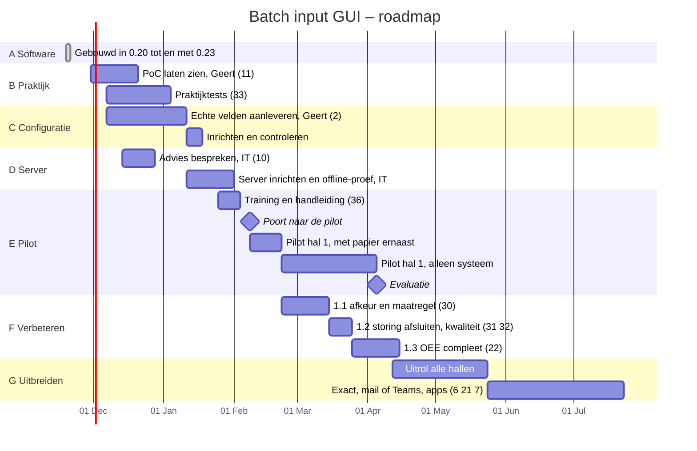

# Roadmap – wat moet er nog gebeuren, in welke volgorde en wanneer

> **Dit bestand (toekomst):** alles wat nog moet of kan gebeuren: functies, verbeteringen, praktijktests, acties van Geert en IT, en open besluiten, geordend in fasen met poorten en een globale planning. Het is de enige takenlijst.
> **Niet hier:** wat al gebouwd is → [`CHANGELOG.md`](CHANGELOG.md) (verleden); waarom iets zo is gekozen → [`DECISIONS.md`](DECISIONS.md) (verleden); de stand van nu en hoe het werkt → [`README.md`](README.md) (heden).

Bijgewerkt: 20 november 2026 · huidige versie 0.24.0

Elk punt heeft een vast nummer (#n). Is een punt gebouwd, dan verdwijnt het hier en staat het nummer in de changelog achter de versie. De data zijn een schatting, geen belofte. De software is zelden het knelpunt; de tijd zit in de punten waar Geert, IT of de fabriek aan zet zijn (gemarkeerd met *Geert* of *IT*). Schuift zo'n punt, dan schuift alles erna mee.

## In één oogopslag

## Fasen

### A. Pilotklaar maken (software) — gebouwd
Alle punten zijn gebouwd in 0.20.0 tot en met 0.23.0, sneller dan gepland (wat er per versie veranderde: changelog). In de software staat niets meer open vóór de pilot.

Daarna, uit de UI/UX-review van 20 november 2026 (D50), vóór de training (#36):
- #43 **Consistentie** (middel) — Eén oranje en één rood met één betekenis; kolomkoppen rechts boven getallen; één primaire knop per scherm; vaste woorden (D51); foutmelding direct onder het veld; rustigere lege stappen.
- #44 **Ongedaan maken en tabletmenu** (klein) — "Ongedaan maken" in de melding bij acties die je makkelijk terugdraait; inklapbaar menu in de portalen op een smal scherm.

**Poort A:** gehaald zodra Geert het laptoppakket van de nieuwste versie draait.

### B. Proof of concept en praktijk — december 2026
- #11 **Proof of concept laten zien** (klein, *Geert*) — Laptoppakket 0.23.0 draaien en laten zien; bevindingen worden nieuwe punten op deze roadmap.
- #33 **Praktijktests** (middel) — Nog nooit echt getest: handscanner, etiketprinter, tv als wandscherm, invoerscherm offline op een fabrieks-pc via https, tablet via het netwerk, twee pc's op dezelfde stap, nachtploeg rond de klokwissel. Op Windows nog niet: versies 0.8–0.23 op de laptop, Ctrl+C en venster sluiten, back-up terugzetten, serverpakket en draaiboek op een echte Windows Server. Per test vastleggen: wie, wanneer, uitkomst.

**Poort B:** elke praktijktest heeft een uitkomst; wat misging is opgelost of bewust geaccepteerd.

### C. Echte configuratie — december 2026 tot half januari 2027
- #2 **Echte velden per stap** (middel, *Geert*) — Per processtap de echte invoervelden aanleveren, het liefst in het sjabloon uit Beheer → Stappen en velden: veld, soort, eenheid, verplicht, tolerantie, grenzen, decimalen, op het certificaat. Ook de echte ploegtijden, oorzaken van stilstand, grondstoffen, producten, operators en pc's. Daarna samen inrichten via het sjabloon en controleren in een lege fabriek.

**Poort C:** alle 18 stappen ingericht en door een ploegleider op de laptop doorlopen met een proefbatch.

### D. Fabrieksserver — half december 2026 tot eind januari 2027
- #10 **Fabrieksserver installeren met IT** (middel, *Geert*, *IT*, D26) — Geert bespreekt het advies met IT en beantwoordt de vier vragen onder "Nog te besluiten" in het advies. IT richt de server in volgens `docs/SERVER.md`; eerste keer samen op een testmachine, met back-up, hersteltest en een pc die offline gaat.

**Poort D:** server draait met https, back-ups lopen, hersteltest geslaagd, de pc's in hal 1 bereiken hem.

### E. Pilot 1.0 — februari tot april 2027
- #36 **Training en handleiding** (klein) — Korte handleiding per rol (operator, ploegleider, Kwaliteit, planner, beheerder) en een trainingsmoment vóór de pilot, met de laptop of de server en fictieve data.
- #3 **Pilot met echte data** (groot) — Versie 1.0.0 in één hal: de eerste twee weken met de papieren registratie ernaast, dan alleen het systeem.

**Poort naar de pilot:** poorten A tot en met D gehaald, operators getraind, terugvalplan op papier afgesproken.

**Evaluatie na 8 weken:** zijn alle batches in het systeem terug te vinden, kloppen de cijfers met het papier, hoe vaak lag het systeem eruit, wat vinden operators en Kwaliteit ervan? Op basis daarvan: uitrollen, of eerst verbeteren.

### F. Verbeteren tijdens de pilot — februari tot april 2027
Wat Kwaliteit en Productie het meest helpt zodra er echte data is. De volgorde kan na de eerste pilotweken veranderen.
- #30 **Afkeur met omvang, herhaling en maatregel** (middel) — Bij afkeur de geschonden grens tonen, verdachte batches (zelfde grondstofpartij, dag of lot) en eerdere afwijkingen van hetzelfde veld. Daarna een eenvoudige maatregel: wat, wie, wanneer klaar, na 30 dagen controleren of het hielp.
- #31 **Notitie bij het einde van een storing** (klein) — Wat was het en wat is er gedaan.
- #32 **Kwaliteit "in één keer goed"** (klein) — Herbewerkingen tellen niet als goed; stilstand per oorzaak als paretodiagram, op minuten en op aantal.
- #22 **OEE compleet** (middel) — Normtijden per stap vastleggen, zodat ook de prestatie (snelheid) en de volledige OEE berekend kunnen worden.

### G. Uitbreiden na de pilot — vanaf april 2027
Uitrol naar alle hallen. Daarna, als het nodig blijkt:
- #6 **Koppeling met Exact** (groot) — Gegevens uitwisselen met Exact.
- #21 **Meldingen per mail of Teams** (klein) — Kan pas als de server bij een mailserver of Teams mag; nu bewust alleen in de schermen (D33).
- #7 **Installeerbare apps** (groot) — Invoerscherm en portalen als installeerbare applicaties op dezelfde server en API.
- #45 **Talenkeuze** (middel) — De schermen in meer talen, met een keuze per gebruiker of per pc. Vraagt dat alle schermteksten uit de code naar taalbestanden gaan; de woordenlijst van D51 is daarvoor de basis.
- #46 **Donkere modus** (klein) — Voor invoer en portalen, via de gedeelde tokens (#42). Bewust later (D50).
- #47 **Invoer via telefoon of tablet** (middel) — Portalen of schermen waarmee ook op een telefoon of tablet wordt ingevoerd. Dan gelden de richtlijnen voor smalle schermen en de safe-area (notch) wél (D50, afwijking E).

## Te besluiten (*Geert*)
Vóór of tijdens de pilot; de uitkomst wordt een punt in een fase of een besluit in `DECISIONS.md`.
- #8 **Analyses per operator** — Bijvoorbeeld afwijkingen per persoon. Bewust niet gebouwd (D12).
- #9 **Portalen voor andere afdelingen** — Welke afdelingen hebben nog een portaal nodig?
- #34 **Open vragen planning** — Moet de planner ook ploegen of pc's toewijzen? Mag een operator een lotvoorstel zelf aanpassen? Is "per stap per dag" zo bruikbaar?

## Hoe we deze roadmap bijhouden
- Nieuwe taken, adviezen, open vragen en praktijktests komen hier met het volgende vrije nummer (nu #48), in de fase waar ze horen.
- Is een punt gebouwd, dan haal je het hier weg en zet je het nummer in de changelog achter de versie.
- De tijdlijn en de fasen pas je aan als een fase klaar is, een poort niet gehaald wordt of de volgorde verandert.
- Rapporten op claude.ai zijn momentopnamen; wat eruit volgt komt hier als punt.
