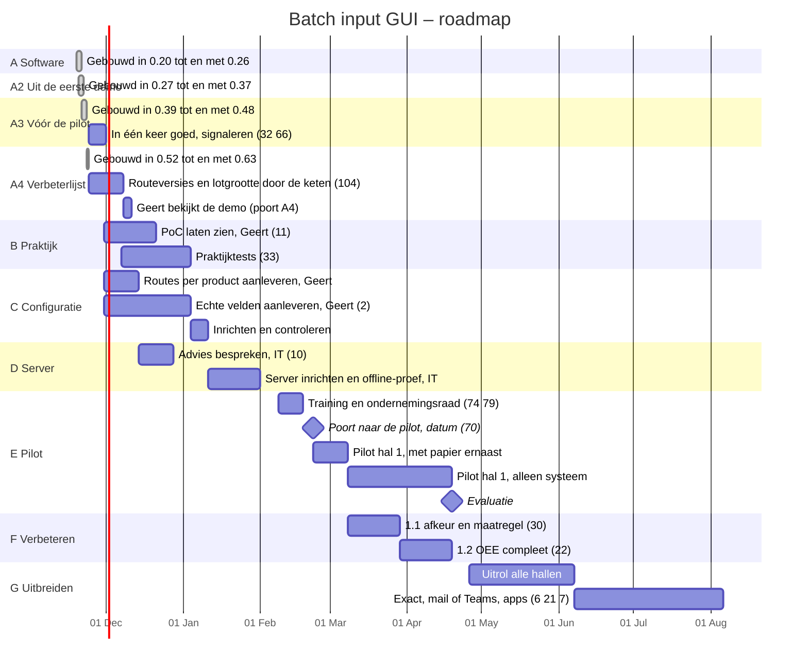

# Roadmap – wat moet er nog gebeuren, in welke volgorde en wanneer

> **Dit bestand (toekomst):** alles wat nog moet of kan gebeuren: functies, verbeteringen, praktijktests, acties van Geert en IT, en open besluiten, geordend in fasen met poorten en een globale planning. Het is de enige takenlijst.
> **Niet hier:** wat al gebouwd is → [`CHANGELOG.md`](CHANGELOG.md) (verleden); waarom iets zo is gekozen → [`DECISIONS.md`](DECISIONS.md) (verleden); de stand van nu en hoe het werkt → [`README.md`](README.md) (heden).

Bijgewerkt: 23 november 2026 · huidige versie 0.64.0

Elk punt heeft een vast nummer (#n). Is een punt gebouwd, dan verdwijnt het hier en staat het nummer in de changelog achter de versie. De data zijn een schatting, geen belofte. De software is zelden het knelpunt; de tijd zit in de punten waar Geert, IT of de fabriek aan zet zijn (gemarkeerd met *Geert* of *IT*). Schuift zo'n punt, dan schuift alles erna mee.

## In één oogopslag

## Fasen

### A. Pilotklaar maken (software) — gebouwd
Alle punten zijn gebouwd in 0.20.0 tot en met 0.23.0, sneller dan gepland (wat er per versie veranderde: changelog). In de software staat niets meer open vóór de pilot.

Daarna, uit de UI/UX-review van 20 november 2026 (D50): #41–#44 zijn gebouwd in 0.23.2 tot en met 0.25.0.

**Poort A:** gehaald zodra Geert het laptoppakket van de nieuwste versie draait.

### A2. Uit de eerste demo — gebouwd
Geerts lijst met 21 ideeën na het bekijken van de demo (20 november 2026). Eigen inlog en routes per product komen vóór de pilot (D53, D55); daardoor schuift de pilot naar schatting twee weken op (#70). Volgorde: eerst inlog en startpagina, dan producten, dan de kleine punten. Alles uit deze fase is gebouwd (0.27.0 tot en met 0.37.0, wat er per versie veranderde: changelog); de metingen van Kwaliteit (#64) kwamen er op Geerts keuze ook vóór de pilot bij (#71, D58). Over: #55 (later).

**Poort A2:** #49–#53 gebouwd (#49 en #50 in 0.27.0, #51 in 0.28.0, #52 in 0.29.0, #53 in 0.30.0) en door Geert in de demo bekeken; de routes per product staan erin (fictief).

### A3. Vóór de pilot (software) — november tot begin december 2026
Geerts keuze na de vraag "wat kan nog beter vóór de pilot" (21 november 2026): alles hieronder komt vóór de pilot. Volgorde: eerst wat in de eerste pilotweek al nodig is (#55 en #75 gebouwd in 0.39.0 en 0.40.0), dan het inrichten (#76, gebouwd in 0.41.0), dan wat helpt de pilot te beoordelen (#78 gebouwd in 0.42.0, #31 in 0.46.0, #77 in 0.47.0). Tussendoor kwamen een rondgang langs alle schermen op vormgeving (0.42.1) en alle schermen geschikt voor telefoon en tablet (#47, 0.43.0 tot en met 0.45.1), en na Geerts eigen rondgang in Planning de schermen Batches plannen en Stappen plannen (0.47.1, 0.47.2) en de capaciteit per product met afwijkende dagen (0.48.0, D69), duidelijker grenzen en tolerantie in de grafieken (0.48.1, D70), afmelden dat altijd op de startpagina landt (#82, 0.48.2), de capaciteit uit de route met "nog invullen" (#81, 0.49.0, D71), het wandscherm Kwaliteit (#83, 0.50.0, D72), en keuringsstappen met een specificatie per product (#80, 0.51.0, D73). Nog open:
- #32 **Kwaliteit "in één keer goed"** (klein) — Herbewerkingen tellen niet als goed; stilstand per oorzaak als paretodiagram, op minuten en op aantal.
- #66 **Procesbewaking: tijdig signaleren** (middel) — Een signaal van een regelkaart of een trend meteen als melding in de portalen en op het wandscherm, niet alleen achteraf in het scherm Regelkaarten. Drempels pas instellen met echte data (#2); vóór de pilot alleen de werking.

**Poort A3:** alle punten hierboven gebouwd en door Geert in de demo bekeken.

### A4. Verbeterlijst van 23 november — vóór de pilot
Geerts lijst met 23 punten na een eigen rondgang door de demo (23 november 2026), met de keuzes in D74. Twee punten waren al klaar: een lot bestaat al alleen uit batches van één product (D55), en de vraag over de doorlooptijden is beantwoord (#99). Gebouwd: #85 (twee keer ingevuld, 0.52.0, D75) #86 (ploegen A–E in twee divisies met rooster, 0.53.0, D76) #87 (Medewerkers met ploeg en account, 0.54.0, D77) #88 (startscherm voor Kwaliteit, 0.55.0, D78) #89 (trend bij alle producten, 0.56.0, D79) #90 (capaciteit in kilogram, 0.57.0, D80) en #91 (wandscherm passend en afmelden, 0.58.0, D81). Prioriteit 1 is daarmee klaar. Uit prioriteit 2 gebouwd: #48, #97, #98 en #99 (0.59.0) #93, #95 en #96 (0.60.0, D82), #94 (0.61.0, D83), #100 (0.62.0, D84) en #103 (0.63.0, D85). Prioriteit 2 is daarmee ook klaar. Het routeversie-databasefundament staat; de volledige aansluiting op productie en lotvorming blijft open als #104. Volgorde: eerst wat de juistheid van de gegevens raakt (prioriteit 1), dan het gebruiksgemak (prioriteit 2). Wat tijdens de pilot kan, staat in fase F.

**Nog open:**
- #104 **Routeversies en lotvorming door de hele keten** (groot) — Maak voor elk product een expliciete eigen route; geen automatische standaardroute. Leg batchrouteversie vast bij de eerste daadwerkelijke batchstap en lotrouteversie bij samenstellen. Een lot mag batches met verschillende batchrouteversies bevatten, maar blijft één product. Maak het aantal batches per lot instelbaar per product en leg norm, werkelijk aantal en eventuele afwijkingsreden vast. Laat planning, productiecontroles, werkvoorraad, analyses, lotpaspoort en certificaten de vastgelegde versies gebruiken. Reconstrueer bestaande historie alleen waar de configuratielog aantoonbaar volledig is; anders handmatig beoordelen. Rol dit gefaseerd uit met aandacht voor bestaande offline wachtrijen en oudere clients.

**Poort A4:** prioriteit 1 en 2 gebouwd en door Geert in de demo bekeken; #104 afgerond en de volledige routeketen gecontroleerd.

### B. Proof of concept en praktijk — december 2026
- #11 **Proof of concept laten zien** (klein, *Geert*) — Laptoppakket van de nieuwste versie draaien en laten zien; bevindingen worden nieuwe punten op deze roadmap.
- #33 **Praktijktests** (middel) — Nog nooit echt getest: handscanner, etiketprinter, tv als wandscherm, invoerscherm offline op een fabrieks-pc via https, tablet via het netwerk, twee pc's op dezelfde stap, nachtploeg rond de klokwissel. Op Windows nog niet: versies 0.8–0.23 op de laptop, Ctrl+C en venster sluiten, back-up terugzetten, serverpakket en draaiboek op een echte Windows Server. Hoe en wanneer goed: [`docs/PRAKTIJKTESTS.md`](docs/PRAKTIJKTESTS.md) (0.38.0). Per test vastleggen wie, wanneer en de uitkomst, in het invulblad dat daar genoemd staat.

**Poort B:** elke praktijktest heeft een uitkomst; wat misging is opgelost of bewust geaccepteerd.

### C. Echte configuratie — december 2026 tot half januari 2027
- #2 **Echte velden per stap** (middel, *Geert*) — De velden en grenzen kunnen nu per product (D55), ook via het sjabloon (blad "Grenzen per product"). Per processtap de echte invoervelden aanleveren, het liefst in het sjabloon uit Beheer → Stappen en velden: veld, soort, eenheid, verplicht, tolerantie, grenzen, decimalen, op het certificaat. Ook de echte ploegtijden, oorzaken van stilstand, grondstoffen, producten met hun route (welke stappen, in welke volgorde; D55), operators en pc's. Daarna samen inrichten via het sjabloon en controleren in een lege fabriek.

**Poort C:** alle 18 stappen ingericht en door een ploegleider op de laptop doorlopen met een proefbatch.

### D. Fabrieksserver — half december 2026 tot eind januari 2027
- #10 **Fabrieksserver installeren met IT** (middel, *Geert*, *IT*, D26) — Geert bespreekt het advies met IT en beantwoordt de vier vragen onder "Nog te besluiten" in het advies. IT richt de server in volgens `docs/SERVER.md`; eerste keer samen op een testmachine, met back-up, hersteltest en een pc die offline gaat.

**Poort D:** server draait met https, back-ups lopen, hersteltest geslaagd, de pc's in hal 1 bereiken hem.

### E. Pilot 1.0 — eind februari tot april 2027 (datum: #70)
- #74 **Training** (klein, *Geert*) — Een trainingsmoment per rol vóór de pilot, met de laptop of de server en fictieve data. De hulp per rol staat in de schermen en is als A4 af te drukken (0.38.0, #36, D59). Afspreken wat de ploeg doet als een pc bij het begin van een dienst offline is (praktijktest V3).
- #79 **Ondernemingsraad en privacy** (klein, *Geert*) — Het systeem legt per persoon vast wie wat invoert (nodig om terug te zoeken). Vóór de pilot met de ondernemingsraad bespreken wat er wordt vastgelegd, wie het mag zien en hoe lang het bewaard blijft; raakt ook #8 en #63 (D12).
- #3 **Pilot met echte data** (groot) — Versie 1.0.0 in één hal: de eerste twee weken met de papieren registratie ernaast, dan alleen het systeem.

**Poort naar de pilot:** poorten A tot en met D gehaald (ook A3), operators getraind, terugvalplan op papier afgesproken (met de lege formulieren uit 0.40.0), ondernemingsraad gehoord (#79).

**Evaluatie na 8 weken:** zijn alle batches in het systeem terug te vinden, kloppen de cijfers met het papier, hoe vaak lag het systeem eruit, wat vinden operators en Kwaliteit ervan? Op basis daarvan: uitrollen, of eerst verbeteren.

### F. Verbeteren tijdens de pilot — maart tot april 2027
Wat Kwaliteit en Productie het meest helpt zodra er echte data is. De volgorde kan na de eerste pilotweken veranderen.
- #30 **Afkeur met omvang, herhaling en maatregel** (middel) — Bij afkeur de geschonden grens tonen, verdachte batches (zelfde grondstofpartij, dag of lot) en eerdere afwijkingen van hetzelfde veld. Daarna een eenvoudige maatregel: wat, wie, wanneer klaar, na 30 dagen controleren of het hielp.
- #22 **OEE compleet** (middel) — Normtijden per stap vastleggen, zodat ook de prestatie (snelheid) en de volledige OEE berekend kunnen worden. De capaciteit in kg per uur (0.57.0, D80) is daarvoor de basis. De OEE komt in Productieanalyse, naast Stilstand en beschikbaarheid.
- #101 **Meetwaarde als gekleurde balk** (klein) — In Lotpaspoort en Afwijkingen de kolommen Gemeten en Grenzen als balk met de grenzen en tolerantie in kleur en een punt voor de gemeten waarde. Met echte data is beter te zien hoe die balk moet werken.
- #102 **Doorlooptijden in het lotpaspoort** (klein) — De doorlooptijden van het lot en zijn batches, vergeleken met de rest. Hoort eigenlijk niet bij Kwaliteit: past bij het productiedossier per lot (#69), dat het overzicht over alle afdelingen wordt.
- #92 **Wandscherm instellen in Beheer** (klein) — Per wandschermaccount in Beheer kiezen wat het toont (hal, stappen of Kwaliteit); de tv toont na het inloggen wat daar staat en hoeft er niemand meer heen (D74).
- #67 **Productieoptimalisatie** (middel) — Knelpunten, doorlooptijden en stilstand bestaan al, en capaciteit per stap en product (D55); erbij: hoe vol elke stap werkelijk was (benutting), en welke stap de doorstroom bepaalt.

### G. Uitbreiden na de pilot — vanaf eind april 2027
Uitrol naar alle hallen. Daarna, als het nodig blijkt:
- #6 **Koppeling met Exact** (groot) — Gegevens uitwisselen met Exact.
- #21 **Meldingen per mail of Teams** (klein) — Kan pas als de server bij een mailserver of Teams mag; nu bewust alleen in de schermen (D33).
- #7 **Installeerbare apps** (groot) — Invoerscherm en portalen als installeerbare applicaties op dezelfde server en API.
- #45 **Talenkeuze** (middel) — De schermen in meer talen, met een keuze per gebruiker of per pc. Vraagt dat alle schermteksten uit de code naar taalbestanden gaan; de woordenlijst van D51 is daarvoor de basis.
- #46 **Donkere modus** (klein) — Voor invoer en portalen, via de gedeelde tokens (#42). Bewust later (D50).
- #65 **Producteigenschap tegen procesparameter** (middel) — Verband zien tussen bijvoorbeeld een producteigenschap en de temperatuur in PS1 van dezelfde batch (spreidingsdiagram en correlatie). Vraagt #64.
- #68 **Kwaliteitsanalyse: verbanden** (groot) — Verbanden tussen grondstofpartijen, procesparameters, ploegen en afwijkingen. Per operator alleen na besluit #8 (D12).
- #84 **Specificatie per klant** (middel) — Naast de specificatie per product (#80, D73) een afwijkende specificatie voor een klant, en een lot toetsen aan de specificatie van de klant voor wie het is. Geert: later.
- #69 **Volledig digitaal productiedossier** (middel) — Lotpaspoort en certificaat bestaan al; erbij: één dossier per lot met alle metingen, grondstoffen, wie wat deed, stilstand, beoordelingen en herbewerkingen, om te bewaren of te versturen.

## Te besluiten (*Geert*)
Vóór of tijdens de pilot; de uitkomst wordt een punt in een fase of een besluit in `DECISIONS.md`.
- #8 **Analyses per operator** — Bijvoorbeeld afwijkingen per persoon. Bewust niet gebouwd (D12).
- #9 **Portalen voor andere afdelingen** — Welke afdelingen hebben nog een portaal nodig?
- #63 **Productiviteit per ploeg** — Punt 15 uit Geerts lijst. Per ploeg is minder gevoelig dan per persoon, maar bij kleine ploegen herken je toch personen; raakt D12 en mogelijk de ondernemingsraad. Wat telt als productiviteit: batches, stappen of uren per ploeg?
- #70 **Nieuwe pilotdatum** — Door #49–#53 vóór de pilot schuift de poort naar schatting van 8 naar 22 februari 2027; met de metingen van Kwaliteit (#64, D58) mogelijk iets later. Geert bevestigt de datum.
- #72 **Naam "Productieanalyse"** — Het portaal Productie heet nu Productieanalyse (D54). Geert bevestigt de naam of kiest een andere.
- #34 **Open vragen planning** — Moet de planner ook ploegen of pc's toewijzen? Mag een operator een lotvoorstel zelf aanpassen? Is "per stap per dag" zo bruikbaar?

## Hoe we deze roadmap bijhouden
- **Bij elke wijziging bijwerken**, in dezelfde commit als de wijziging zelf: elke nieuwe versie, en ook een wijziging zonder versie die de planning raakt.
  - Kopregel: datum en huidige versie.
  - Gebouwde punten hier weghalen; het nummer staat dan in de changelog achter de versie.
  - Inleiding van de fase: in welke versie wat gebouwd is, en wat nog open staat.
  - Tijdlijn: gebouwde punten naar de balk "Gebouwd in …" (`done`) van hun fase, open balken alleen met open nummers, data schuiven als de planning schuift.
  - Nieuwe taken, adviezen, open vragen en praktijktests met het volgende vrije nummer (nu #105), in de fase waar ze horen.
- `tests/test_roadmap.sh` controleert dit bij elke push op GitHub: de versie in de kopregel, geen gebouwd nummer meer als open punt of in een open balk, het volgende vrije nummer, en geen dubbele punt in een taaknaam van de tijdlijn.
- Rapporten op claude.ai zijn momentopnamen; wat eruit volgt komt hier als punt.
