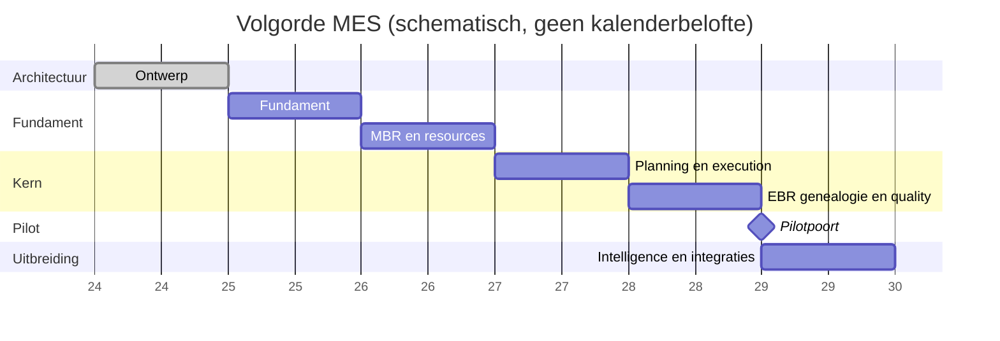

# Roadmap – MES

Enige centrale takenlijst; besluiten in DECISIONS.md, gerealiseerd in CHANGELOG.md, actuele werking in README.md. D89: 69 ontwerpbesluiten, nieuwe start vanaf main; PR #1 niet mergen.

Bijgewerkt: 24 november 2026 · huidige versie 0.62.1

## Afhankelijkheden (geen kalenderplanning)

De eerdere pilotdatum 22 februari 2027 is niet meer bindend. #70 blijft open. Fase 0: ontwerpbesluiten vastgelegd in D89 en docs/mes; acceptatie van documentatie nog vereist. Fasen 1–8 vormen de betrouwbare kern voor pilot 1.0.0. Minimale materiaalidentiteit, middelenvereisten en blokkades worden vóór afhankelijke functies ingevoerd; geen onbewezen productieomschakeling. Praktijkvoorbereiding parallel mogelijk. D99: de goedgekeurde legacy-review bepaalt de overgang per fase. Geen verdere investering in achterhaalde procesmodellen of uitgestelde uitbreidingen; alleen noodzakelijke beveiliging van tijdelijke interfaces.

## Fase 1 — Projectfundament en autorisaties

- #106 **Naam MES, terminologie, modulaire structuur** — Zie ontwerpdocumenten en acceptatiecriteria.
- #107 **Meerdere rollen, permissions, scope, scheiding beheer** — Zie ontwerpdocumenten en acceptatiecriteria; scheiding technische/security-grants (0051) geïmplementeerd, testbewijs en accountbeheer nog open; 0052 blokkeert oude roltoekenning, overgang naar persoonlijke MES-grants en UI nog open; 0053 beschermt identiteiten tegen gewone resets, gecontroleerd herstel nog open; 0054 begrenst bootstrap en schakelt oude noodsleutel uit; 0055 herstelprocedure eigenaar-only, sessie-intrekking 0056 geïmplementeerd, validatie en noodherstel nog open; 0057 diagnose en escalatieprotocol toegevoegd, uitzonderingsuitvoering nog te besluiten.
- #108 **Kritische rechten, herbevestiging, audittrail en kwalificaties** — Zie ontwerpdocumenten en acceptatiecriteria.
- #136 **PoC-omgeving vereenvoudigen** — D99: PGlite-browserdemo uit verplichte scope; inventariseer en faseer demo-specifieke afhankelijkheden, tests en workflows gecontroleerd uit. Windows-laptoppakket en PostgreSQL blijven verplichte PoC-/acceptatiebasis. Geen verdere demo-compatibiliteitsinvesteringen.

## Fase 2 — Master Data & Recipe Management

- #109 **Materiaaldefinities en MBR-identiteiten; meerdere recepten per product** — Zie ontwerpdocumenten en acceptatiecriteria.
- #110 **Onveranderlijke receptversies, procedurehiërarchie en afhankelijkheden** — Zie ontwerpdocumenten en acceptatiecriteria.
- #111 **Parameters, vijf voorwaarden, formule, schaalbaarheid, lotregels, instructies en specificaties** — Zie ontwerpdocumenten en acceptatiecriteria.
- #112 **MOC, vierogenprincipe, vergelijking, geldigheid en vrijgave** — Zie ontwerpdocumenten en acceptatiecriteria.
- #113 **Process Engineering-portaal, Excel en migratie naar concepten** — Zie ontwerpdocumenten en acceptatiecriteria.
- #103 **Routeversie-fundament** — Opnieuw implementeren binnen MBR; prototype PR #1 is niet gemerged.

## Fase 3 — Resource Management

- #114 **Enterprise/site/area/cell/unit, equipment classes en fysieke assets** — Zie ontwerpdocumenten en acceptatiecriteria.
- #115 **Geschiktheid, capaciteit, status, werkstations en stilstand** — Zie ontwerpdocumenten en acceptatiecriteria.
- #116 **Maintenance-portaal en middelenvereisten** — Zie ontwerpdocumenten en acceptatiecriteria. D99: storingsnotities herbeoordelen binnen de middelen- en stilstandscope.

## Fase 4 — Planning & Dispatching

- #117 **Productieorders, work schedules/requests, job orders** — Zie ontwerpdocumenten en acceptatiecriteria.
- #118 **Batch- en lotplanning, middelen en personeel, capaciteit** — Zie ontwerpdocumenten en acceptatiecriteria.
- #119 **Werkvrijgave, intrekking, job responses en orderhistorie** — Zie ontwerpdocumenten en acceptatiecriteria. D98: geen zelfstandige ongeplande batchcreatie door operators; ook spoedwerk vereist vrijgave.

## Fase 5 — Control Recipes & Production Execution

- #120 **Control Recipes, revisies, batchstart en geautoriseerde wijzigingen** — Zie ontwerpdocumenten en acceptatiecriteria. D98: systeem geeft batchidentiteit uit vanuit vrijgegeven werk; sluit legacy ongeplande creatieroute bij omschakeling.
- #121 **Procedure-uitvoering, instructies, kwalificaties, middelen en ISA-88-statussen** — Zie ontwerpdocumenten en acceptatiecriteria.
- #122 **Offline geldigheid, synchronisatie, conflicten en Production Execution-portaal** — Zie ontwerpdocumenten en acceptatiecriteria.
- #104 **Routeversies en lotvorming door de hele keten** — Expliciete productrecepten, Control Recipes, historische voorwaarden, gemengde receptversies van hetzelfde product tenzij expliciet incompatibel, offline overgang.
- #105 **Productafhankelijke lotgrootte** — Norm 1–50, werkelijk aantal en afwijkingsreden, eventuele goedkeuring; capaciteit, lotvoorstellen en uitvoering aansluiten. Prototype PR #1 is niet gemerged.

## Fase 6 — Electronic Batch Records

- #123 **Uitvoeringsidentiteit, EBR-standen, aanvullingen, export en Traceerbaarheid** — Zie ontwerpdocumenten en acceptatiecriteria.
- #69 **Volledig digitaal productiedossier** (middel) — Lotpaspoort en certificaat bestaan al; erbij: één dossier per lot met alle metingen, grondstoffen, wie wat deed, stilstand, beoordelingen en herbewerkingen, om te bewaren of te versturen.
- #102 **Doorlooptijden in het lotpaspoort** (klein) — De doorlooptijden van het lot en zijn batches, vergeleken met de rest. Hoort eigenlijk niet bij Kwaliteit: past bij het productiedossier per lot (#69), dat het overzicht over alle afdelingen wordt.
- #101 **Meetwaarde als gekleurde balk** (klein) — In Lotpaspoort en Afwijkingen de kolommen Gemeten en Grenzen als balk met de grenzen en tolerantie in kleur en een punt voor de gemeten waarde. Met echte data is beter te zien hoe die balk moet werken.

## Fase 7 — Quality Management

- #124 **Onafhankelijke productie- en kwaliteitsstatus, holds en afwijkingen** — Zie ontwerpdocumenten en acceptatiecriteria.
- #125 **Herbewerking als job order, Review by Exception, vrijgave en intrekking, CoA** — Zie ontwerpdocumenten en acceptatiecriteria.
- #30 **Afkeur met omvang, herhaling en maatregel** (middel) — Bij afkeur de geschonden grens tonen, verdachte batches (zelfde grondstofpartij, dag of lot) en eerdere afwijkingen van hetzelfde veld. Daarna een eenvoudige maatregel: wat, wie, wanneer klaar, na 30 dagen controleren of het hielp.

## Fase 8 — Material Tracking & Genealogy

- #126 **Materiaalpartijen, status, verbruik, transformaties en genealogie** — Zie ontwerpdocumenten en acceptatiecriteria.
- #127 **Impactanalyse, visualisatie en basis massabalans** — Zie ontwerpdocumenten en acceptatiecriteria.

## Fase 9 — Fabrieksimplementatie en pilot

- #92 **Wandscherm instellen in Beheer** (klein) — Per wandschermaccount in Beheer kiezen wat het toont (hal, stappen of Kwaliteit); de tv toont na het inloggen wat daar staat en hoeft er niemand meer heen (D74; uitgesteld volgens D99).
- #134 **Herinrichting rolhulp, pilotfeedback en pilotrapportage** — D99: actualiseren na stabiele kernschermen; uitgebreide wandschermen herbeoordelen op betrouwbare middelen- en statusgegevens.

- #128 **Echte MBR's, middelen, rollen, kwalificaties en organisatorische acceptatie** — Zie ontwerpdocumenten en acceptatiecriteria.
- #129 **Management-portaal basisrapportage; pilotpoort, schaduwpilot en terugvalprocedure** — Zie ontwerpdocumenten en acceptatiecriteria.
- #11 **Proof of concept laten zien** (klein, *Geert*) — Laptoppakket van de nieuwste versie draaien en laten zien; bevindingen worden nieuwe punten op deze roadmap.
- #2 **Echte velden per stap** (middel, *Geert*) — De velden en grenzen kunnen nu per product (D55), ook via het sjabloon (blad "Grenzen per product"). Per processtap de echte invoervelden aanleveren, het liefst in het sjabloon uit Beheer → Stappen en velden: veld, soort, eenheid, verplicht, tolerantie, grenzen, decimalen, op het certificaat. Ook de echte ploegtijden, oorzaken van stilstand, grondstoffen, producten met hun route (welke stappen, in welke volgorde; D55), operators en pc's. Daarna samen inrichten via het sjabloon en controleren in een lege fabriek.
- #10 **Fabrieksserver installeren met IT** (middel, *Geert*, *IT*, D26) — Geert bespreekt het advies met IT en beantwoordt de vier vragen onder "Nog te besluiten" in het advies. IT richt de server in volgens `docs/SERVER.md`; eerste keer samen op een testmachine, met back-up, hersteltest en een pc die offline gaat.
- #33 **Praktijktests** (middel) — Nog nooit echt getest: handscanner, etiketprinter, tv als wandscherm, invoerscherm offline op een fabrieks-pc via https, tablet via het netwerk, twee pc's op dezelfde stap, nachtploeg rond de klokwissel. Op Windows nog niet: versies 0.8–0.23 op de laptop, Ctrl+C en venster sluiten, back-up terugzetten, serverpakket en draaiboek op een echte Windows Server. Hoe en wanneer goed: [`docs/PRAKTIJKTESTS.md`](docs/PRAKTIJKTESTS.md) (0.38.0). Per test vastleggen wie, wanneer en de uitkomst, in het invulblad dat daar genoemd staat.
- #74 **Training** (klein, *Geert*) — Een trainingsmoment per rol vóór de pilot, met de laptop of de server en fictieve data. De hulp per rol staat in de schermen en is als A4 af te drukken (0.38.0, #36, D59). Afspreken wat de ploeg doet als een pc bij het begin van een dienst offline is (praktijktest V3).
- #79 **Ondernemingsraad en privacy** (klein, *Geert*) — Het systeem legt per persoon vast wie wat invoert (nodig om terug te zoeken). Vóór de pilot met de ondernemingsraad bespreken wat er wordt vastgelegd, wie het mag zien en hoe lang het bewaard blijft; raakt ook #8 en #63 (D12).
- #3 **Pilot met echte data** (groot) — Versie 1.0.0 in één hal: de eerste twee weken met de papieren registratie ernaast, dan alleen het systeem.

## Fase 10 — Manufacturing Intelligence

- #135 **Herbeoordeling geavanceerde SPC, Cpk en trends** — D99: pas na betrouwbare data, recept-/specificatieversies en KPI-definities; generieke grafiekcomponenten behouden.

- #88 **Voorspelling toekomstige keuringen** (nice-to-have, D96) — Opnieuw beoordelen na de basis-MES en pilot; alleen bij aantoonbare behoefte en betrouwbare planning/doorlooptijden, met scopecontrole. Actuele openstaande metingen, besluiten en beschikbare keuringsstappen blijven basisfunctionaliteit.

- #130 **KPI-definities, Management-portaal, MBR-vergelijking en massabalans** — Zie ontwerpdocumenten en acceptatiecriteria.
- #131 **RCA, CAPA, effectiviteitscontrole en aanvullende analyses** — Zie ontwerpdocumenten en acceptatiecriteria.
- #22 **OEE compleet** (middel) — Normtijden per stap vastleggen, zodat ook de prestatie (snelheid) en de volledige OEE berekend kunnen worden. De capaciteit in kg per uur (0.57.0, D80) is daarvoor de basis. De OEE komt in Productieanalyse, naast Stilstand en beschikbaarheid.
- #32 **Kwaliteit "in één keer goed"** (klein) — Herbewerkingen tellen niet als goed; stilstand per oorzaak als paretodiagram, op minuten en op aantal.
- #66 **Procesbewaking: tijdig signaleren** (middel) — Een signaal van een regelkaart of een trend meteen als melding in de portalen en op het wandscherm, niet alleen achteraf in het scherm Regelkaarten. Drempels pas instellen met echte data (#2); vóór de pilot alleen de werking.
- #67 **Productieoptimalisatie** (middel) — Knelpunten, doorlooptijden en stilstand bestaan al, en capaciteit per stap en product (D55); erbij: hoe vol elke stap werkelijk was (benutting), en welke stap de doorstroom bepaalt.
- #65 **Producteigenschap tegen procesparameter** (middel) — Verband zien tussen bijvoorbeeld een producteigenschap en de temperatuur in PS1 van dezelfde batch (spreidingsdiagram en correlatie). Vraagt #64.
- #68 **Kwaliteitsanalyse: verbanden** (groot) — Verbanden tussen grondstofpartijen, procesparameters, ploegen en afwijkingen. Per operator alleen na besluit #8 (D12).
- #84 **Specificatie per klant** (middel) — Naast de specificatie per product (#80, D73) een afwijkende specificatie voor een klant, en een lot toetsen aan de specificatie van de klant voor wie het is. Geert: later.

## Fase 11 — Integraties en uitrol

- #132 **ISA-95 interfaces, meetapparatuur, LIMS, DCS/SCADA en onderhoudssysteem** — Zie ontwerpdocumenten en acceptatiecriteria.
- #133 **Gefaseerde uitrol overige hallen** — Zie ontwerpdocumenten en acceptatiecriteria.
- #6 **Koppeling met Exact** (groot) — Gegevens uitwisselen met Exact.
- #21 **Meldingen per mail of Teams** (klein) — Kan pas als de server bij een mailserver of Teams mag; nu bewust alleen in de schermen (D33).
- #7 **Installeerbare apps** (groot) — Invoerscherm en portalen als installeerbare applicaties op dezelfde server en API.
- #45 **Talenkeuze** (middel) — De schermen in meer talen, met een keuze per gebruiker of per pc. Vraagt dat alle schermteksten uit de code naar taalbestanden gaan; de woordenlijst van D51 is daarvoor de basis.
- #46 **Donkere modus** (klein) — Voor invoer en portalen, via de gedeelde tokens (#42). Bewust later (D50).

## Te besluiten

- #8 **Analyses per operator** — Bijvoorbeeld afwijkingen per persoon. Bewust niet gebouwd (D12).
- #9 **Portalen voor andere afdelingen** — Welke afdelingen hebben nog een portaal nodig?
- #63 **Productiviteit per ploeg** — Punt 15 uit Geerts lijst. Per ploeg is minder gevoelig dan per persoon, maar bij kleine ploegen herken je toch personen; raakt D12 en mogelijk de ondernemingsraad. Wat telt als productiviteit: batches, stappen of uren per ploeg?
- #70 **Pilotdatum** — Opnieuw bepalen na inzicht in implementatievoortgang (G06).
- #72 **Naam Productieanalyse** — Besloten T10: Manufacturing Operations; implementatie bij #106.
- #34 **Open vragen planning** — Moet de planner ook ploegen of pc's toewijzen? Mag een operator een lotvoorstel zelf aanpassen? Is "per stap per dag" zo bruikbaar?

## Werkafspraken

- Volgende vrije nummer (nu #137) wordt toegekend aan nieuwe taken.
- Nieuwe taken met het volgende vrije nummer (nu #137); gebouwde nummers in CHANGELOG onder Unreleased, geen nieuwe versie zonder releaseverzoek.
- Faseacceptatie volgens docs/mes/ACCEPTANCE-CRITERIA.md en D88; eigenaar merget. Geen automatische release.

Fase 1 (0058): personeelsrechten en koppeling afgeschermd; gecontroleerde identiteitsoverdracht, kwalificaties, UI en testbewijs nog open.

Fase 1 (0059): beperkt securitykanaal gebouwd; persoonlijke loginbinding, leesinterface, bediening en acceptatie nog open.

Fase 1 (0060–0061): persoonlijke securitybinding, leesfuncties en eigenaar-only registratie/intrekking/vervanging gebouwd; IT-provisioning, restore, transport, bediening en acceptatie nog open.

Fase 1 (0062): bevestigde tijdelijke kwaliteitsbesluiten; dossierstand, overige statuswrites, UI en acceptatie nog open.

Fase 1 (0063): opdrachtloze herbewerking geweigerd; directe opdrachtwrites, statusovergangen en acceptatie nog open; definitieve Job Order fase 7.

Fase 1 (0064): opdrachtcreatie/intrekking via bevestigde databasefuncties; uitvoeringsscope, UI en acceptatie nog open.

Fase 1 (0065): controle uitvoeringsbevoegdheid bij opdrachtconsumptie gebouwd; betrouwbare aanroepersidentiteit, overige directe writes en acceptatie nog open.

Fase 1 (0066): databasefundament sessiebewijs gebouwd; API-integratie en afdwingen bij writes nog open.

Fase 1 (0067): API-authenticatie gebruikt sessiebewijs; transactiebinding en databasehandhaving volgen.

Fase 1 (0068): transactionele bewijscontrole en eerste stapregistratieguard; overige writes, definer-paden en acceptatie open.

Fase 1 (0069): meet- en grondstofguards, gewone correcties gebonden aan sessiebewijs; gecontroleerde conflict-/naleveringspaden en acceptatie open.

Fase 1 (0070): conflictinvoer en besluitpad afgeschermd; legacy checks, concurrentie, UI, leesrechten en acceptatie open.

Fase 1 (0071): tijdelijke papieren nalevering beschermd; legacy rolcheck, leesrechten, positieve regressies en acceptatie open.

Fase 1 (0072): eerste statusguards en gecontroleerde blokkade, planningannulering en lotsamenstelling; registratiebevoegdheden, batchcreatie en acceptatie open.

Fase 1 (0073): tijdelijke batchcreatie/planning beveiligd; processtart en afronding, overige planningswrites en acceptatie open.
