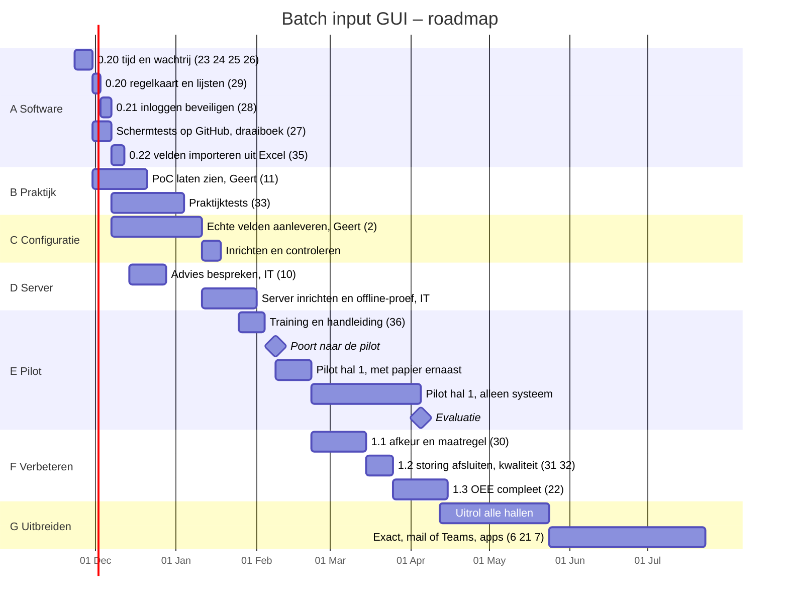

# Roadmap – in welke volgorde en wanneer

> **Dit bestand:** de volgorde van het werk, de fasen, de poorten die we per fase moeten halen, en een globale planning.
> **Niet hier:** wat een punt precies inhoudt → [`WISHLIST.md`](WISHLIST.md) (de nummers hieronder verwijzen daarheen); wat al gebouwd is → [`CHANGELOG.md`](CHANGELOG.md).

Bijgewerkt: 19 november 2026 · huidige versie 0.19.0

De data zijn een schatting, geen belofte. De software is zelden het knelpunt; de tijd zit in de punten waar Geert, IT of de fabriek aan zet zijn (gemarkeerd met *Geert* of *IT*). Schuift zo'n punt, dan schuift alles erna mee.

## In één oogopslag

## Fasen

### A. Pilotklaar maken (software) — eind november tot half december 2026
De fouten uit de doorlichting oplossen die ongemerkt verkeerde tijden of namen opleveren. Elk punt een eigen versie.

| Versie | Punten | Wat |
| --- | --- | --- |
| 0.20.0 | #23, #24 | Tijdstip en operator gaan mee met elke actie in de wachtrij |
| 0.20.1 | #25, #26 | Tijdzone vast, nachtploeg rond de klokwissel |
| 0.20.2 | #29 | Regelkaart "voorlopig" bij weinig metingen, afgekapte lijsten melden |
| 0.21.0 | #28 | Inloggen beveiligen |
| 0.21.1 | #27 | Schermtests op GitHub, draaiboek bijwerken, back-up vóór database-update |
| 0.22.0 | #35 | Velden per stap importeren uit een Excel-sjabloon (maakt #2 makkelijker) |

**Poort A:** alle punten gebouwd, alle tests groen op GitHub, nieuw laptoppakket bij Geert.

### B. Proof of concept en praktijk — december 2026
Geert laat het laptoppakket zien (#11) en we testen wat nog nooit echt is getest (#33): handscanner, etiketprinter, tv, een fabrieks-pc die offline gaat, twee pc's op dezelfde stap, Windows. Bevindingen worden nieuwe wishlistpunten.

**Poort B:** elke praktijktest heeft een uitkomst; wat misging is opgelost of bewust geaccepteerd.

### C. Echte configuratie — december 2026 tot half januari 2027
Geert levert per stap de echte velden aan, met eenheid, decimalen, setting, grenzen en "op het certificaat" (#2). Ook ploegtijden, oorzaken van stilstand, grondstoffen, producten, operators en pc's. Inrichten via het sjabloon (#35) en samen controleren in een lege fabriek.

**Poort C:** alle 18 stappen ingericht en door een ploegleider op de laptop doorlopen met een proefbatch.

### D. Fabrieksserver — half december 2026 tot eind januari 2027
Geert bespreekt het advies met IT en beantwoordt de open vragen (#10). IT richt de server in volgens `docs/SERVER.md`; samen een proef met back-up, hersteltest en een pc die offline gaat.

**Poort D:** server draait met https, back-ups lopen, hersteltest geslaagd, de pc's in hal 1 bereiken hem.

### E. Pilot 1.0 — februari tot april 2027
Training en een korte handleiding voor operators en ploegleiders (#36). Daarna versie 1.0.0 in één hal: de eerste twee weken met de papieren registratie ernaast, dan alleen het systeem (#3).

**Poort naar de pilot:** poorten A tot en met D gehaald, operators getraind, terugvalplan op papier afgesproken.

**Evaluatie na 8 weken:** zijn alle batches in het systeem terug te vinden, kloppen de cijfers met het papier, hoe vaak lag het systeem eruit, wat vinden operators en Kwaliteit ervan? Op basis daarvan: uitrollen, of eerst verbeteren.

### F. Verbeteren tijdens de pilot — februari tot april 2027
Wat Kwaliteit en Productie het meest helpt zodra er echte data is: afkeur met omvang, herhaling en maatregel (#30), notitie bij het einde van een storing (#31), kwaliteit "in één keer goed" (#32), en OEE compleet met normtijden (#22). De volgorde kan na de eerste pilotweken veranderen.

### G. Uitbreiden na de pilot — vanaf april 2027
Uitrol naar alle hallen. Daarna, als het nodig blijkt: koppeling met Exact (#6), meldingen per mail of Teams (#21), installeerbare apps (#7). Open besluiten (#8, #9, #34) neemt Geert vóór of tijdens de pilot; uitkomsten komen hier in de planning.

## Hoe we deze roadmap bijhouden
- Bijwerken als een fase klaar is, een poort niet gehaald wordt, of de volgorde verandert. Niet bij elke versie.
- Nieuwe punten komen eerst in de wishlist; hier alleen het nummer en de plek in de volgorde.
