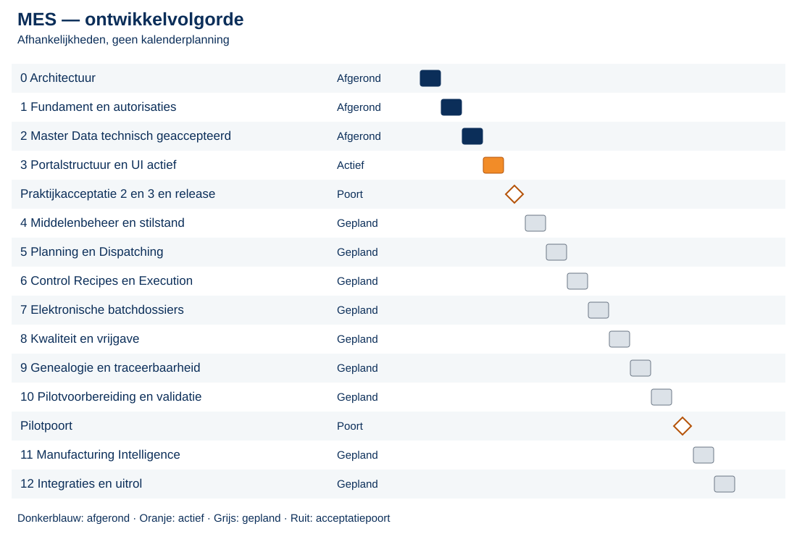

# Roadmap – MES

Enige centrale takenlijst; besluiten in DECISIONS.md, gerealiseerd in CHANGELOG.md, actuele werking in README.md. D89: 69 ontwerpbesluiten, nieuwe start vanaf main; PR #1 niet mergen.

Bijgewerkt: 27 november 2026 · huidige versie 0.64.0 (officieel uitgebracht)

D110: ISA-88/95 leidend voor alle nieuwe fasen; legacywensen zonder aangetoonde noodzaak of architectuurfit eerst naar het wishlist-/beoordelingsregister onderaan deze roadmap. Noodzakelijke fabrieks-, veiligheids-, kwaliteits-, wettelijke, integriteits- en migratievereisten blijven binnen passende scope. Geen automatische scope-uitbreiding.

## Afhankelijkheden (geen kalenderplanning)

[Diagram op volledige grootte](docs/diagrams/roadmap.svg) · [Bewerkbare Gantt-bron](docs/diagrams/roadmap.mmd)

Legenda B+: donkerblauw = technisch afgerond (fase 0 ontwerpbaseline; fase 1 functioneel geaccepteerd binnen PoC; fase 2 technisch geaccepteerd), oranje = in uitvoering, lichtgrijs = gepland. De gecombineerde praktijkacceptatie en release blijven expliciete poorten. De kunstmatige datums en gelijke balklengtes illustreren uitsluitend afhankelijkheden, niet duur of een kalenderbelofte.

De eerdere pilotdatum 22 februari 2027 is niet meer bindend. #70 blijft open. Fase 0: ontwerpbesluiten vastgelegd in D89 en docs/mes; acceptatie van documentatie nog vereist. Fasen 1–9 vormen de betrouwbare kern voor pilot 1.0.0. Minimale materiaalidentiteit, middelenvereisten en blokkades worden vóór afhankelijke functies ingevoerd; geen onbewezen productieomschakeling. Praktijkvoorbereiding parallel mogelijk. D99: de goedgekeurde legacy-review bepaalt de overgang per fase. Geen verdere investering in achterhaalde procesmodellen of uitgestelde uitbreidingen; alleen noodzakelijke beveiliging van tijdelijke interfaces.

## Fase 1 — Projectfundament en autorisaties (functioneel geaccepteerd)

Op 25 november 2026 is fase 1 functioneel geaccepteerd binnen de fictieve PoC-scope ([goedkeuring opdrachtgever](https://github.com/Gertjun/Manufacturing-Execution-System/pull/6#issuecomment-7171313853)). Geteste broncommit `582cf3c11308db77684d3062fed2fc1c2743bf80`, base `31c86973bf13848cba44fc38785084953fe65e39`, versie 0.62.1, schema 0095. [integrale CI 45645684067](https://github.com/Gertjun/Manufacturing-Execution-System/actions/runs/45645684067): Node 26 en Node 22 geslaagd; documentatiecontrole 45645661536 geslaagd. [Windows-build 45665375598](https://github.com/Gertjun/Manufacturing-Execution-System/actions/runs/45665375598): artifact MES-fase1-Windows-582cf3c, herkomst en SHA256 bevestigd. W1–W8: 107 controles, 106 rechtstreeks geslaagd en één als verwacht gedrag beoordeeld (werkplek blijft behouden). Zie [acceptatiebewijs PR #6](https://github.com/Gertjun/Manufacturing-Execution-System/pull/6#issuecomment-7171286531). Releasevoorbereiding 0.63.0 verandert de tree; nieuwe volledige CI vereist. Geen productieacceptatie of formele ISA-conformiteitsclaim.

Afgerond binnen fase-1-scope: #106 naam/terminologie/structuur; #107 rollen, permissions en functiescheiding; #108 kritische rechten, herbevestiging, audit en kwalificatiefundament; #136 Windows/PostgreSQL als PoC, browserdemo buiten verplichte scope. Definitieve domeinfuncties en betrouwbare area/equipment-context blijven in toegewezen fasen. Operationele security blijft vóór pilot vereist.

- #137 **Windows-bootstrap: onderbroken redeninvoer nader onderzoeken** — W7 geslaagd na hervatting met START.bat; exacte oorzaak niet gereproduceerd. Herstartinstructie en batchaankondiging gecorrigeerd in releasevoorbereiding. Bij herhaling terminalinvoer reproduceren; geen functionele blokker vastgesteld. 

Releasepoort: nieuwe volledige CI op actuele releasetree; opdrachtgever merget en autoriseert publicatie afzonderlijk. Geen formele ISA-conformiteit of fabrieksvrijgave.

### Historisch bewijs — tussentijdse audit (D100, eerdere tussenstanden)

Inhoudelijke audit afgesloten op basis van bestaande inventarisaties en baseline run 499; geen nieuwe concrete functionele blokker vastgesteld binnen beoordeelde scope. #106–#108/#136 functioneel gereed binnen deze bewijsgrens, niet geaccepteerd. Zie ACCEPTANCE-CRITERIA.md voor de formele afbakening. Databaseplaatje bijgewerkt en gericht gevalideerd; schermreview en gerichte schermvalidatie afgerond. Integrale testreview afgesloten; volledige acceptatie en Windows-praktijkvalidatie blijven verplicht.

Run [45616999067](https://github.com/Gertjun/Manufacturing-Execution-System/actions/runs/45616999067), job 139214856901, head 2e25ac588a081335ee16e75979e1212bb06a23df, base 31c86973bf13848cba44fc38785084953fe65e39: alle 16 verplichte Chrome/PostgreSQL-schermtestsuites geslaagd (768 getelde OK-controles, nul fouten), Node 26 API-typecheck, beide builds en offline-rechtenregressie geslaagd; documentatiecontrole 45616998994 groen. Uitsluitend fictieve gegevens; applicatie gebruikt beperkte mes_app-verbinding, eigenaar uitsluitend voor testvoorbereiding en DB-asserties. Geen volledige acceptatie of Windows-praktijkbewijs.

D84/schema 0094: [run 45577237440](https://github.com/Gertjun/Manufacturing-Execution-System/actions/runs/45577237440), job 139078079937, head 36ecbb9a04f1ae6d5f70dca5d7e04db6a7490455, base 31c86973bf13848cba44fc38785084953fe65e39: databaseplaatje gegenereerd in geïsoleerde PostgreSQL 18 en tests/test_schema_plaatje.sh geslaagd (62 tabellen, 132 verbanden). SHA-256 6f9e535cdf4e7cc82113181b0316d550b41c8c60ca663265bda3a512d7ea518c gecontroleerd bij opname in commit 65c73e04d072944178868c34d4e18ca91082f0f1; tijdelijke workflow verwijderd. Geen schemawijziging of integrale acceptatie.

D102/0094: goedgekeurde eenmalige initialisatie van bestaande persoonlijke identiteiten zonder MES-rechtenhistorie, via eigenaar en drie persoonlijke bevestigingen. Geen automatische legacy-grants; drie exact afgebakende grants, sessiegeneratie verhoogd, onveranderlijk bootstraprecord. Schone bootstrap blijft voorkeur voor fictieve pre-pilot. Gerichte DB- en toolregressies toegevoegd; uitvoeringsbewijs geslaagd in run run 499.

Run [45572488766](https://github.com/Gertjun/Manufacturing-Execution-System/actions/runs/45572488766), job 139062300483, head 6e332599aafc949b8cca94c401c4d0c21579d69c, base 31c86973bf13848cba44fc38785084953fe65e39: gehele gerichte PostgreSQL-baseline groen, inclusief startinventaris, mislukte herstelcontrole/cleanup, historische upgrade 0035–0093, 12/12 security, 10/10 autorisatie, 117/117 API en Linux-pakket; documentatie 45572480062 groen. Geen volledige acceptatie of Windows-bewijs.

Run [45575488676 (run 499)](https://github.com/Gertjun/Manufacturing-Execution-System/actions/runs/45575488676), job 139072267943, head de213112f706f7bbcbd07b4928c93e36e6d7ba02, base 31c86973bf13848cba44fc38785084953fe65e39: gerichte PostgreSQL-baseline geslaagd; schone installatie, schema-equivalentie 0001–0094, beperkte rechten, historische upgrade 0035–0094 met behoud van tien historische tabellen en zonder automatische legacy-grants, D102 eenmalige initialisatie, 14/14 security, 10/10 autorisatie, 117/117 API, back-up/herstel/rollback en Linux-laptoppakket. Documentatiecontrole 45575458558 geslaagd. Geen volledige Node 26-acceptatie of Windows-praktijkbewijs.

D100: serverstart toetst volledige migratie-inventaris; herstelcontrole sluit verbindingen en ruimt uitsluitend eigen uniek benoemde tijdelijke database op vóór exit, met foutmelding bij mislukte cleanup. Gerichte regressies voor onbekend schema, ontbrekende tussenmigratie, beschadigde dump, behoud historie en onderhoudslog toegevoegd. Uitvoeringsbewijs open; geen schemawijziging.

Run [45567796663](https://github.com/Gertjun/Manufacturing-Execution-System/actions/runs/45567796663), job 139046752938, head 8fd03f7c8c3ff3831b1e2d0a106189d05335d564, base 31c86973bf13848cba44fc38785084953fe65e39: gehele gerichte PostgreSQL-baseline groen, historische upgrade 0035–0093 inclusief tien tabellen, legacy-snapshot, nul automatische grants, ACL en pre-upgradeback-up bevestigd in log; 117/117 API, 12/12 security, 10/10 autorisatie, beheertools en Linux-pakket geslaagd. Geen Windows- of integrale acceptatie.

D100: [PostgreSQL-baseline 45566354900](https://github.com/Gertjun/Manufacturing-Execution-System/actions/runs/45566354900), job 139041993323, head e7813d396e03f3bc64fcd691ad159b416316f7d3, base 31c86973bf13848cba44fc38785084953fe65e39: alle stappen geslaagd, inclusief 117/117 API, schema-equivalentie 0001–0093, beheertools (onbekende schema’s, back-up/herstel, opzettelijke rollback) en Linux-pakket. Documentatiecontrole 45566342443 groen. Geen integrale acceptatie; historische schema-upgrade en Windows blijven open.
 
D100: weigering onbekende schemaversies vóór wijziging door een ouder migratiepakket geïmplementeerd; gerichte beheertoolregressie toegevoegd, testbewijs nog open.

0087/D101: verplichte laatste legacy-beheerder vervalt; historische identiteiten blijven behouden, fictieve fixtures worden gecontroleerd vervangen. Gebundelde DB/API-regressies en gerichte UI/offline-regressies geslaagd; integrale restinventarisatie van zelfstandige rolchecks, installatiegrenzen en schermacceptatie nog open.

D24-runtimecorrectie en gebundelde ACL-correcties gevalideerd in PostgreSQL-run 45556530186 (schema 0093), inclusief Linux-pakket. Windows, representatieve historische schema-upgrade, resterende installatiegrenzen en D101-restcontrole blijven open.
 
Werk in deze volgorde; dit is de afbakening van #106–#108 en #136, geen nieuwe zelfstandige takenlijst:

D101: alle legacy-rollen verliezen binnen fase 1 hun zelfstandige autorisatiewerking; behoud historische gegevens en noodzakelijke compatibiliteitsvelden. Controleer API, database, UI en regressies. Geen automatische grants, geen nieuwe domeinfunctionaliteit.
 
1. Gerichte baseline (concept-PR, label `database-baseline`, afzonderlijke PostgreSQL-job; laatste gerichte DB-baseline groen op de213112, zie ACCEPTANCE-CRITERIA.md voor exact bewijs; inhoudelijke auditreview afgesloten): schone installatie, migraties vanaf main, beperkte DB-rechten, autorisatie-unit-tests en relevante API-regressies. Eerst uitvoeringsbewijs en oorzaken van fouten vaststellen; geen nieuwe reeks speculative hardening-migraties.
2. Bundel alleen resterende blokkers: persoonlijk account-/sessiebeheer, rollen/permissions/scope/kwalificaties, onafhankelijke toekenning/intrekking, gecontroleerde personeelskoppeling, kritische herbevestiging en audit, effectieve DB-privileges en veilige tijdelijke interfaces. Zie acceptatiecriteria voor de bewijsgrens.
3. Rond #106–#108 en #136 functioneel af; geen uitbreiding van legacy procesmodellen. Indien tijdelijk pad niet veilig kan blijven: blokkeren en expliciet vastleggen, met beoordeling van gevolgen voor behouden kernfuncties.
4. Eindcontrole D99/ISA-mapping, databaseplaatje genereren en verifiëren, integrale testreview, volledige acceptatie op actuele head/base en beoordeling door Geert. Geen release of merge zonder toestemming.
 
## Fase 2 — Master Data & Recipe Management

Startbaseline: v0.63.0, main `ea3b78bc938647140b4e228e9382761504518906`, tree `344837981b9921dd0052ce2580a8c786a783f6e5`, schema 0095. PR #6 gemerged; [main-verificatie](https://github.com/Gertjun/Manufacturing-Execution-System/actions/runs/45680256072) en [releaseworkflow](https://github.com/Gertjun/Manufacturing-Execution-System/actions/runs/45680409404) geslaagd. Alle onderstaande punten blijven open. Eén concept-PR, geen versieverhoging tot releasevoorbereiding.

Uitvoeringsvolgorde: materiaalidentiteit (#109); MBR-identiteit en versiegrenzen (#109–110); procedurehiërarchie en routeafhankelijkheden (#103/110); receptinhoud (#111); MOC en vrijgave (#112); Process Engineering en gecontroleerde bronmigratie (#113); audit/testreview; integrale technische acceptatie en vastgelegde baseline (D111); gecombineerde Windows-praktijkacceptatie na fase 3. Per werkpakket eerst concrete cardinaliteiten, rechten, transacties en regressies toetsen aan D89/D99. Product/grondstof-ID's en historische feiten behouden; oude uitvoering blijft tijdelijk beschermd tot fase 5/6. Geen volledige resource- of executionfunctionaliteit vooruitbouwen. D105/D111: fase 2 behoudt de functionele scope inclusief Process Engineering-portaal; generieke portalharmonisatie pas fase 3. D111: fase 2 sluit technisch af na integrale regressies, audit, correcties en afzonderlijke technische acceptatie. De handmatige Windows-praktijkacceptatie van fase 2 wordt gecombineerd met die van fase 3 na UI-harmonisatie; geen uitstel van automatische functionele, beveiligings-, migratie- of pakketregressies. Fase 3 mag starten na expliciete technische acceptatie van de vastgelegde fase-2-baseline. Voorstel voor één officiële release na gecombineerde praktijkacceptatie; merge-/release-strategie en toestemming blijven bij opdrachtgever. Geen fase 4 vóór gecombineerde acceptatie en officiële release. Fase 1 en pilotpoort ongewijzigd. 113.7a–f technisch afgerond; zie definitief bewijs hieronder.

- #109 **Materiaaldefinities en MBR-identiteiten; meerdere recepten per product** — Migratie 0096: afgeschermd relationeel materiaalstamdatafundament; 0097 gecontroleerde materiaalfuncties toegevoegd; materiaal-API toegevoegd; gerichte DB/API-baseline geslaagd op a28cd0e (run 45682177664); gegenereerd diagram en OpenAPI opgenomen. 0098–0099 MBR-identiteiten, conceptversies, wijzigingsteller, audit en API gericht gevalideerd op d1815d3 (run 45684478100); portaal, bronmigratie en integrale acceptatie open.
- #110 **Onveranderlijke receptversies, procedurehiërarchie en afhankelijkheden** — 0100 relationele vierlaagse procedureboom en voorwaartse afhankelijkheden binnen één siblinggroep; versiegrenzen, volgorde en beperkte ACL afgedwongen. 0101 persoonlijke mutaties, gezamenlijke wijzigingsteller en audit toegevoegd; procedure-API en regressies toegevoegd; baseline 45687274731 op 593d495 volledig groen; 782 DB-regels en 121 API-tests. Vrijgavepoort volgt.
- #111 **Parameters, vijf voorwaarden, formule, schaalbaarheid, lotregels, instructies en specificaties** — 0102 relationele parameterdefinities en vijf afzonderlijke numerieke categorieën; 0103 referentieformule, materiaalversies, input/output en expliciet fixed/linear-schaalbeleid toegevoegd. Regressies nog niet uitgevoerd. 0106 relationeel fundament voor equipment- en personeelsvereisten, instructies en exacte specificatiegrenskoppelingen toegevoegd; nog niet getest. 0107 versiegebonden lotnorm (1–50), verplichte afwijkingsreden, goedkeuringsvereiste en expliciete incompatibiliteit tussen revisies van hetzelfde product toegevoegd; nog niet getest. 0108 persoonlijke parameter-/formulefuncties met gezamenlijke change_no en beperkte ACL toegevoegd; nog niet getest. 0109 persoonlijke middelen-/kwalificatie-/instructie-/specificatie-/lotregel-/compatibiliteitsfuncties toegevoegd, nog niet getest. Persoonlijk catalogus-/schaalregelbeheer en receptinhoud-/vereisten-API toegevoegd; schaalregel-API toegevoegd; resourcevalidatie en integrale acceptatie volgen. Lot-CR legt toegepaste norm expliciet vast bij gemengde normen; geen automatische keuze.
- #141 **Eenhedenmodel en versiegebonden schaalregels (D106)** — Binnen fase 2, vóór MOC/vrijgave: centraal model voor fysische grootheden/dimensies en eenheden, SI/ISO 80000 als aanvullend uitgangspunt; gecontroleerde, onveranderlijke conversiedefinities (factor/offset, onderscheid absolute waarde en verschil) en versiegebonden schaalregels. Uitbreidbaar naar niet-lineaire relaties, afhankelijkheid van andere formuleparameters en equipment; expliciete inputs, eenheden, toepassingsgebied, versie en validatie; geen automatische uitvoering of willekeurige code. Integreer met #109/#111/#112/#113, behoud de fixed/linear-basis. Ontbrekende of ongeldige regels mogen geen vrijgave of berekening mogelijk maken. Rekenfunctionaliteit volgt #142. 0104 relationeel catalogusfundament met zeven SI-dimensie-exponenten, aparte grootheidsemantiek, onveranderlijke eenheden/conversieversies en expliciete koppelingen aan materialen, parameters en formule toegevoegd; regressies nog niet uitgevoerd. 0105 relationele schaalregelgrafiek met getypeerde invoer, exacte conversieversies, uitvoerkoppelingen, versiegrenzen en cycluspreventie toegevoegd; nog niet getest. 0110 persoonlijk globaal catalogusbeheer met bestaande materiaalbeheerbevoegdheid, atomaire eerste conversieversie, onveranderlijke revisies en stale-controle toegevoegd; regressies nog niet uitgevoerd. 0111 persoonlijk productspecifiek schaalregelconceptbeheer met gedeelde wijzigingsteller, bestaande cyclus-/eenheidsvalidatie en audit toegevoegd; SQL-delimiters in ACL 0109/0110 gecorrigeerd; regressies nog niet uitgevoerd. 0112 begrensde getypeerde formulegrammatica v1 (postfix, vaste operatorcodes, invoer-ID's, geen evaluatie), persoonlijke conceptfuncties en bronbescherming toegevoegd; regressies nog niet uitgevoerd. 0113 statische dimensiecontrole en conservatieve semantiek toegevoegd; afgeleide eenhedenfactoren/grootheidsbetekenis nog niet bewezen, complexe regels blijven onder verplichte vrijgaveblokkade; regressies nog niet uitgevoerd. 0114 expliciete materiaaleenheidsselectie bij nieuwe identiteit/revisie, serverzijde symbool, bescherming tegen terugval naar tekst en productgebonden cataloguslezing toegevoegd; regressies nog niet uitgevoerd. Eenheden-API en expliciete materiaaleenheidsroutes toegevoegd, inclusief exacte decimale conversiefactoren als tekst op HTTP-grens; API-regressies nog niet uitgevoerd. Receptinhoud-API (parameters, vijf numerieke categorieën, referentieformule en materiaalvereisten) met exacte decimale tekst, gedeelde teller en persoonlijke transacties toegevoegd; regressies nog niet uitgevoerd. Receptvereisten-API (equipment, personeel, instructies, specificaties, lotnormen en incompatibiliteit) met gezamenlijke teller, exacte capaciteit en serverzijde afgeleide kwalificatieomschrijving/afwijkingsredenplicht toegevoegd; regressies nog niet uitgevoerd. Schaalregel-API (regels, invoer, uitvoerkoppelingen en volledige getypeerde formule per regel) met exacte constanten, persoonlijke transacties, gedeelde teller en bestaande fysische/structurele guards toegevoegd; regressies nog niet uitgevoerd. Bronmigratie, gegenereerde OpenAPI, technische validatie en vrijgavevalidatie volgen.
- #112 **MOC, vierogenprincipe, vergelijking, geldigheid en vrijgave** — 0115 lifecycle-statusfundament, bestaande versies uitsluitend concept, centrale conceptlock en databaseguards op alle huidige versiegebonden inhoud toegevoegd; geen statusovergangen geopend, regressies nog niet uitgevoerd. 0116 persoonlijk MOC-conceptdossier per revisie, expliciete eerdere referentierevisie, aanleiding, impactomschrijving en voorlopige impactlabels toegevoegd; regressies nog niet uitgevoerd. 0117 inhoudelijke versievergelijking over header en zestien inhoudstabellen met stabiele lokale codes, exacte externe referenties, voor/na en beide tellers toegevoegd; regressies nog niet uitgevoerd. D108 akkoord; 0118 matrix v1 met unie van opgegeven en afgeleide impact, afzonderlijke reviewpermissions en persoonlijke preview toegevoegd; regressies nog niet uitgevoerd. 0119 intern onveranderlijk ronde-/besluitmodel, exacte snapshots, persoonlijke bijdragers uit audit (inclusief verwijderingen), blokkade bij onbewezen herkomst, unieke beoordelaars en zelfgoedkeuringsguard toegevoegd; regressies nog niet uitgevoerd. Rondevoorbereiding intern, geen app-grants/statusovergang of besluitregistratie. 0120 persoonlijke indiening en beoordeling via bestaande begrensde wachtwoordcontrole, actuele productscope, exacte ronde, vierogen, afwijzing naar draft en automatische approved-status na alle domeinen toegevoegd; regressies nog niet uitgevoerd. 0121 conservatieve inhoudelijke vrijgavevalidatie met gestructureerde blokkades en interne assert onder receptlock toegevoegd; regressies nog niet uitgevoerd. Complexe schaalregels en onbewezen equipmentvereisten blijven geblokkeerd, geen fallback. 0122 intern onveranderlijk vrijgave-/intrekkingsbewijs en tijdsgebonden selectie met aparte besluit-/ingangsdatum en kennisgrens toegevoegd; geen app-grants, inserts of vrijgavestatus geopend. Regressies nog niet uitgevoerd. D109 akkoord; 0123 persoonlijke formele vrijgave en intrekking met afzonderlijke permissions, exacte goedgekeurde ronde, inhoudelijke assert, oplopende planning, laatste vrijgegeven baseline en onveranderlijk bewijs toegevoegd; regressies nog niet uitgevoerd. Effectieve vervanging afgeleid, geen timer. 0124 persoonlijke read-only beoordelingsinbox en exact historisch dossier met actuele productscope, pending domeinen, besluiten en release/intrekking toegevoegd; regressies nog niet uitgevoerd. MOC- en review-API toegevoegd (conceptdossier/impact, exacte vergelijking, matrixpreview, inbox, dossier, persoonlijke indiening/besluit); denied/locked na commit naar HTTP-fout, lifecycle zichtbaar, 55000 naar 409. API-regressies nog niet uitgevoerd. 0125 beperkte leestoegang tot vrijgavevalidatie voor bevoegde beoordelaars, geen toegang tot actuele draftinhoud; drie vrijgave-/intrekkings-API-routes toegevoegd, denied/locked na commit. API-regressies nog niet uitgevoerd. Positieve volledige vrijgavefixture, herstel-/planning-/concurrentieregressies, OpenAPI en integrale audit volgen. HTTP-transactie moet denied/locked committen voor behoud van inlogpogingen. Zie ontwerpdocumenten en acceptatiecriteria.
- #113 **Process Engineering-portaal en gecontroleerde bronmigratie (D110)** — Native MES-conceptbeheer volgens ISA-gebaseerd model, persoonlijke rechten en MOC/vrijgave; gecontroleerde broninventarisatie en mapping voorbereiden, expliciete eenheden, versiegrenzen en herkomst, ongeldige brongegevens rapporteren, behoud historische feiten en geen automatische vrijgave of verzonnen koppelingen. Zolang uitsluitend fictieve data en geen representatieve echte bronbestanden beschikbaar zijn: testfixtures en migratieplan, geen specifieke legacy-importinterface of daadwerkelijke productiedatamigratie verplicht voor fase 2. Werkelijke bronmigratie vóór relevante pilotinzet beoordelen/valideren. Structurele Excel-import/export geparkeerd (W01/W02); bestaande legacy-interfaces niet nu verwijderen. Zie ontwerpdocumenten en acceptatiecriteria. 113.1: Process Engineering-portaal met bestaande persoonlijke permissionprojectie, afzonderlijke globale materiaal-/eenhedentoegang, productspecifieke recept-/reviewtoegang, overzicht en expliciete tijdelijke placeholders toegevoegd. Geen generieke navigatieharmonisatie of nieuwe Excel-interface. UI-regressies nog niet uitgevoerd. Volgorde: 113.2 materiaal/eenheden, 113.3 MBR, 113.4 procedure/inhoud, 113.5 MOC/review/vrijgave, 113.6 bronvoorbereiding, 113.7 regressies. 113.2: native materiaal-/eenhedenschermen met persoonlijke API, materiaalklassen/identiteiten/revisies, expliciete catalogus-ID, zeven SI-exponenten, grootheden/eenheden, conversie en nieuwe conversierevisie; exacte decimale tekst, historische lijsten en versieconflicten via database. Product-/grondstofbronmapping volgt 113.6; geen Excel. Build en regressies nog niet uitgevoerd. 113.3: 0126 persoonlijke productselectie via servercapabilities, native MBR-identiteit/lege conceptrevisie/headerwijziging en historische revisielijst toegevoegd. Geen impliciete kopie of vrijgave. Build en regressies nog niet uitgevoerd. 113.4a: native versiegebonden ISA-88-procedureboom, aanmaak/wijziging/verwijdering en expliciete voorwaartse afhankelijkheden binnen siblinggroep; alleen conceptmutaties, persoonlijke API, gedeelde wijzigingsteller en vernieuwen gehele productlijst na mutatie. Build en schermtests nog niet uitgevoerd. Formule/parameters, vereisten/lotnorm en schaalregels volgen. 113.4b: native referentieformule en procesparametereditor, getypeerde invoer, expliciete eenheden, vijf onafhankelijke voorwaarden, vaste/lineaire schaling en exacte decimale tekst; uitsluitend conceptmutaties en gedeelde teller. Build en regressies nog niet uitgevoerd; overige receptvereisten volgen. 113.4c.1: 0127 beperkte gedeelde materiaalrevisie-/kwalificatiecatalogus voor persoonlijke productgebonden receptconceptbevoegdheid; geen bronrelaties, gebruikers, kwalificatietoekenningen of beheerrechten via deze interface. GET /recipes/references/:productId en negatieve API-regressies toegevoegd; SQL-delimiters ACL 0126 gecorrigeerd. Build en tests nog niet uitgevoerd. Materiaal-, equipment- en personeelseditors volgen. 113.4c.2: materiaalvereisteneditor gekoppeld aan exacte materiaalrevisie uit 0127 en referentieformule, optioneel procedure-element, input/output, exacte hoeveelheid, vaste/lineaire schaling. Eenheid afgeleid uit expliciet gekoppelde revisie en catalogus; geen impliciete conversie of vrije eenheidstekst. Historische ongekoppelde regels zichtbaar. Build en regressies nog niet uitgevoerd. 113.4c.3: native equipmentvereisteneditor met verplicht procedure-element, voorlopige equipmentklassecode, omschrijving, positief geheel aantal en optionele exacte positieve minimumcapaciteit met expliciete cataloguseenheid. Gedeelde wijzigingsteller met requirements-read; uitsluitend conceptmutaties via bestaande persoonlijke API. Geen fysieke toewijzing of definitieve equipmentcatalogus; fase 4. Build en regressies nog niet uitgevoerd. 113.4c.4: native personeelsvereisteneditor met verplicht procedure-element, expliciete kwalificatie uit beperkte referentiecatalogus 0127, positief geheel aantal en historische opgeslagen kwalificatieomschrijving. Geen dubbele kwalificatie-eis per element, uitsluitend conceptmutaties via bestaande persoonlijke API en gedeelde wijzigingsteller. Geen kwalificatietoekenning, gebruikersbeheer of personeelsplanning. Build en regressies nog niet uitgevoerd. 113.4d: native instructie- en specificatiekoppelingeditors; instructies per procedure-element met unieke positieve positie, tekst en bevestigingsplicht; exacte specificatiegrens binnen dezelfde revisie, uitsluitend categorie specification_limit en maximaal één koppeling per grens. Conceptmutaties via bestaande persoonlijke API en gedeelde teller; geen uitvoeringsbewijs, legacy-link of kwaliteitsvrijgave. Build en regressies nog niet uitgevoerd. 113.4e: native versiegebonden lotnorm 1–50 zonder standaardwaarde, afwijkingsreden verplicht en onafhankelijke goedkeuring optioneel; expliciete incompatibiliteit met andere revisies van hetzelfde product, reden verplicht, geen zelfverwijzing of dubbele regel. Alleen conceptmutaties via bestaande API en gedeelde teller. Geen lotvorming, automatische normkeuze of wijziging historische loten. Build en regressies nog niet uitgevoerd. 113.4f opgesplitst: identiteit (f.1), getypeerde invoer/conversiereferenties (f.2), gecontroleerde formule (f.3), uitvoerkoppelingen (f.4). 113.4f.1: native schaalregelidentiteit met drie regeltypen, expliciete uitvoereenheid, bronreferentie en toepassingsgebied; uitsluitend conceptmutaties via bestaande API en gedeelde teller. Geen evaluatie, vrijgave of impliciete terugval. Build en regressies nog niet uitgevoerd. 113.4f.2: native getypeerde schaalinvoer (batchhoeveelheid, numerieke parameter, voorlopige equipmenteigenschap, exacte constante), expliciete invoereenheid en brongebonden selectie van exacte conversierevisie bij verschillende eenheden; geen automatische conversiekeuze of evaluatie. Conceptmutaties via bestaande API en gedeelde teller. Build en regressies nog niet uitgevoerd. 113.4f.3: native gecontroleerde formule-editor met invoer-ID’s uit dezelfde regel, vijf vaste operatorcodes, postfix-grammatica v1 (1–128 tokens), symbolische weergave en structurele controle vóór PUT; server valideert structuur, dimensies en semantiek. Expliciet verwijderen via bestaande API, gedeelde teller; geen vrije code, evaluatie of vrijgave. Build en regressies nog niet uitgevoerd. 113.4f.4: native uitvoerkoppelingen naar exacte parametergrens of materiaalvereiste binnen dezelfde receptrevisie, uitsluitend dezelfde cataloguseenheid, één koppeling per doel, conceptmutaties via bestaande API en gedeelde teller. Geen impliciete conversie, evaluatie of vrijgave; server bewaakt scope, eenheid en cycli. Implementatie 113.4 compleet; build en regressies nog niet uitgevoerd. 113.5 opgesplitst: a MOC-dossier/impact, b vergelijking/matrixpreview, c indiening en onafhankelijke review, d vrijgave/intrekking en dossierhistorie. 113.5a: native MOC-dossier met expliciete onveranderlijke eerdere revisie van dezelfde receptidentiteit (initieel uitsluitend revisie 1), reden, algemene impact en unieke beschrijvende impactgebieden. Persoonlijke API, serverstatus en gezamenlijke teller; dossier niet verwijderbaar. Geen review- of vrijgaveactie. Build en regressies nog niet uitgevoerd. 113.5b: native revisievergelijking met serverindex van toegevoegd/verwijderd/gewijzigd per impactgebied en originele exacte voor-/na-JSON-tekst (geen numerieke herinterpretatie), matrixpreview met serververeiste domeinen en impactunie. Beide reads op identieke huidige/referentie-ID en tellers gecontroleerd; geen vastgezette ronde, indiening of vrijgave. Build en regressies nog niet uitgevoerd. 113.5c: persoonlijke wachtwoordbevestigde indiening na vergelijking/matrix met beide verwachte tellers; native beoordelingsinbox per bevoegde productscope, exacte vastgezette snapshot en besluiten, uitsluitend server-geprojecteerde persoonlijke open domeinen. Bevestigd approve/reject met reden, geen vrije actor, wachtwoord niet opgeslagen; server bewaakt bijdragers, unieke reviewer/domein, status en functiescheiding. Geen vrijgaveactie. Build en regressies nog niet uitgevoerd.
- #103 **Routeversie-fundament** — Opnieuw implementeren binnen MBR; prototype PR #1 is niet gemerged.

113.5d: persoonlijke formele vrijgave en intrekking via bestaande API, expliciete ingangsdatum, reden en herbevestiging; inhoudelijke blokkades en geregistreerd bewijs zichtbaar. 0128: alle beoordelingsrondes via bestaande productscope, alleen laatste actuele ronde met open persoonlijke domeinen; exacte historische snapshots en besluiten blijven behouden. API-regressie toegevoegd voor afwijzing, herindiening, historische leesrechten en geweigerde mutaties. Build, migratiegelijkheid en regressies nog niet uitgevoerd. Verdere visuele/UX-uitwerking inclusief datuminvoer en dossierpresentatie in fase 3; geen nieuwe bevoegdheden.

113.6: broninventarisatie op schema 0128, expliciete mapping-/validatieprocedure, stopcriteria en 16 fictieve beoordelingsfixtures vastgelegd in docs/mes/MIGRATION-STRATEGY.md. Geen importer, echte migratie of automatisch vrijgegeven recept. Uitvoering van fixture-/integrale validatie volgt 113.7; echte bronvalidatie vóór relevante pilot.

113.7b: functionele Chrome-regressie toegevoegd voor persoonlijke Engineering-toegang, conceptaanmaak/headerwijziging, bevroren revisie, historische rondes, onafhankelijke beoordeling en directe route na sessiewissel. Echte beperkte API en fictieve schone database; overige scenario's en integrale uitvoering nog open. Geen visuele harmonisatie.

113.7b vervolg: operatorredirect en precieze headerformulierselector gecorrigeerd; afzonderlijke productscope, geweigerde toegang tot globale materiaalcatalogus en inhoudelijk geblokkeerde vrijgave na drie onafhankelijke goedkeuringen toegevoegd. Uitvoering nog open.

113.7b: automatische bronmanifestregressie toegevoegd aan gerichte en integrale CI: 16 unieke fictieve gevallen, expliciete statussen en redenen, geen automatische vrijgave, behoud van NULL, exacte decimale tekst en historische correctiereferentie. Dit is manifestvalidatie, geen bewijs van uitgevoerde bronmigratie; DB/API-regressies toetsen afzonderlijk de operationele regels. Uitvoering nog open.

113.7a–d: inventarisatie en aanvullende regressies gerealiseerd; eerdere integrale CI groen. 113.7e: aanvullende positieve vrijgave/concurrencyregressie en correctie 0129 gevalideerd. Historische ontwikkelnotities hierboven beschrijven de stand op het moment van implementatie, niet de actuele teststatus.

Bewijs 26 november 2026: integrale CI [workflow 665](https://github.com/Gertjun/Manufacturing-Execution-System/actions/runs/45765379770), head `2ebc36e0e0316c3edb34535fbc9aefe97c5fc12d`, schema 0128, beide Node-suites en Chrome groen. Gerichte baseline [workflow 671](https://github.com/Gertjun/Manufacturing-Execution-System/actions/runs/45770644723), head `c7dce4f789acf84926a4f2e4a68f3bd669432fd9`, schema 0129, job 139742179386, base voor beide `ea3b78bc938647140b4e228e9382761504518906`: 1174/1174 DB, 16/16 security/beheertools inclusief bronmanifest, 10/10 autorisatiemodule, 129/129 API, schone installatie, migratiegelijkheid, historische upgrade 0035→0129 (tien historische tabellen, geen automatische grants), herstel en Linux-pakket groen. Geen integrale CI op 0129 of Windows-praktijkacceptatie geclaimd.

Auditcorrectie 0129: twee persoonlijke besluittransacties konden beide een gedeelde accountlock vasthouden en bij herbevestiging deadlocken (workflow 667). `execution_bind_transaction` neemt nu de exclusieve accountlock direct bij binding met dezelfde sessiebewijs- en accountvoorwaarden; `execution_session_actor` behoudt de gedeelde leeslock. Geen wijziging van bevoegdheden. workflow 671 bevestigt gelijktijdige identieke beoordelingen en releases (exact één 201, één 409), positieve vrijgave, toekomstige vervanging, intrekking vóór ingang, geen automatische terugval en historische kennisgrens. Zelfde-accounttransacties worden geserialiseerd; prestatie-impact en bredere concurrency bij pilot toetsen. Geen universele deadlockvrijheid geclaimd.

Technisch geaccepteerd op 26 november 2026: head `8987ea70e70aa079d77e71af2ef934bc3b9285d5`, base `ea3b78bc938647140b4e228e9382761504518906`, tree volgens audit `4fca93c0701d4f0cd50048368afeb419835686fc`, schema 0129. [Integrale workflow 675](https://github.com/Gertjun/Manufacturing-Execution-System/actions/runs/45772048106) en [documentatiecontrole 386](https://github.com/Gertjun/Manufacturing-Execution-System/actions/runs/45771796735) geslaagd. [Audit](https://github.com/Gertjun/Manufacturing-Execution-System/pull/7#issuecomment-7185305836) en [expliciete acceptatie](https://github.com/Gertjun/Manufacturing-Execution-System/pull/7#issuecomment-7185377148). 113.7a–f technisch afgerond; beperkingen uit audit blijven gelden. Oorspronkelijke strategie: fase-2-branch en PR 7 open laten, fase 3 vanaf exact deze head; vervangen door het onderstaande besluit tot merge zonder release. Gecombineerde Windows-praktijkacceptatie en afzonderlijke toestemming vóór publicatie en fase 4. Geen productie-/pilotacceptatie. Ontwikkelprocesverbetering: reproduceerbare generatie van schema.sql uit migraties afzonderlijk ontwerpen en valideren; bestaande installatieprocedure niet vervangen binnen deze correctie.

## Fase 3 — Portalstructuur, navigatie, UI-harmonisatie en visuele ontwerpstandaard

D105 zoals gewijzigd door D111: start uitsluitend na expliciete technische acceptatie van fase 2; handmatige Windows-praktijkacceptatie van beide fasen volgt na fase 3. D107 breidt de scope uit; de eerdere indicatie van één tot twee ontwikkelingsdagen vervalt. Nieuwe inschatting na inventarisatie; geen deadline. Aanleiding: praktijktest v0.63.0, portalenscherm toont juiste beschikbare portalen maar linkernavigatie niet altijd; `mes.quality` mist Production Execution naast Kwaliteit. Geen vastgestelde autorisatie-omzeiling; afzonderlijk melden en niet uitstellen als een daadwerkelijke kwetsbaarheid blijkt. Geen fase-3-implementatie binnen fase 2.

- #138 **Centrale portalregistratie en navigatie** — Eén uitbreidbare definitie van portalen, namen, iconen, routes, volgorde en vereiste bevoegdheden; dezelfde actuele autorisatielogica voor portalenscherm en linkerbalk, ook bij meerdere rollen en relevante combinaties/scopes. Alle bevoegde portalen op beide plaatsen, onbevoegde onzichtbaar én technisch ontoegankelijk bij directe URL. Onafhankelijke API/database-autorisatie blijft leidend; geen extra grants voor cosmetische consistentie.
- #139 **UI-harmonisatie en herbruikbare componenten** — Uniforme schermopbouw, hoofdbalk, linkernavigatie, namen, iconen, kleuren, typografie, tabellen, formulieren, knoppen, filters, status- en foutmeldingen, bevestigingsdialogen en lege toestanden. Herbruikbare componenten en ontwerpprincipes; praktisch bruikbaar in industriële productieomgeving. Geen nieuwe domeinfuncties vooruitbouwen.
- #140 **Portalregressies, audit en faseacceptatie** — Alle bestaande rollen en relevante bevoegdheidscombinaties; expliciet mes.quality met Kwaliteit en Production Execution, overeenstemming portalenscherm/linkerbalk, directe onbevoegde URL en onafhankelijke backendweigering; bestaande functionaliteit en beveiliging behouden. Tussentijdse audit, testreview, integrale CI, Windows-praktijktest en formele faseacceptatie, merge en release volgens D88/D90. Zie acceptatiecriteria.

- #145 **Baseline en inventarisatie fase 3** — Broncode-inventarisatie gestart: `portaal/src/basis.ts`, `main.ts`, `stijl.css`, `gedeeld/tokens.css`, `gedeeld/ui.ts`, `portaal/e2e/formaten.mjs`. Production Execution staat alleen in `tegelsVoor()` via `magInvoer()`, niet in `PORTALEN` voor `tekenMenu()`. Ook nalevering en display zijn aparte tegels. Geen runtimebewijs of autorisatielek vastgesteld. Architectuur-/bestandsinventarisatie afgerond; schermmetingen en visuele nulmeting volgen per werkpakket. Zie ACCEPTANCE-CRITERIA.md. Inventarisatie op architectuur-/bestandsniveau afgerond en documentatiecontrole workflow 390 groen inclusief roadmapstap. Schermmetingen blijven onderdeel van implementatie.

Op 26 november 2026 heeft de opdrachtgever de branchstrategie gewijzigd: technisch geaccepteerde fase 2 is via PR 7 gemerged naar main (`411a9d30aa09edb43121108b631bbe6f112ce5e9`), met exact dezelfde tree als 8987ea7 (`4fca93c0701d4f0cd50048368afeb419835686fc`). [Mergecontrole workflow 678](https://github.com/Gertjun/Manufacturing-Execution-System/actions/runs/45776097688) groen via hergebruik van eerder integraal testbewijs; [documentatiecontrole 388](https://github.com/Gertjun/Manufacturing-Execution-System/actions/runs/45776097577) groen. PR 8 vergelijkt voortaan met main; fase 3 blijft afzonderlijk technisch te accepteren. Technische acceptatie kan na expliciete toestemming tot merge leiden; praktijkacceptatie en afzonderlijke releasetoestemming blijven vereist voor publicatie. D111 en gecombineerde Windows-praktijkacceptatie blijven ongewijzigd; geen fase 4 vóór officiële publicatie. Officiële release blijft v0.63.0.

D107 — volgorde binnen fase 3 (geen extra fase):

| Werkpakket | Resultaat |
|---|---|
| 145.1 Inventarisatie | Alle bestaande portalen, UI, schema's, documenttypen en afwijkingen inventariseren; omvang en afhankelijkheden bepalen. |
| 139.1 Ontwerpstandaard | Ontwerpbaseline v1 CI workflow 391 groen inclusief roadmapcontrole. Opdrachtgever keurt zakelijke variant B+ goed (D114); VISUAL-STYLE.md v2 vastgelegd, CI voor v2 workflow 392 groen inclusief roadmapcontrole. |
| 139.2 UI-fundament | 139.2a: centrale B+ tokens, gedeelde knopvarianten, basisnavigatie, schermtitels en tabelbasis geïmplementeerd; gerichte regressies nog uit te voeren. 139.2b: gedeelde kaart-/status-/dialoogbasis en geïsoleerde Chrome-componentregressie voor beide builds (390/1280 px) toegevoegd; gerichte CI 687 en documentatiecontrole 395 op 9568654 groen. Schermspecifieke harmonisatie in 139.3. |
| 138.1 Portalharmonisatie | #138 en D113: 138.1a analyse; 138.1b/c één bestemmingsregister voor startpagina/menu, bestaande interne router en toegangsvoorwaarden behouden; expliciete werkstationoverdracht bij keuze. 138.1d: expliciete overstaproute, eenmalige tabgebonden keuze en sessie-/werkstationcontrole op antwoord; 138.1e: geïsoleerde browserregressies met fictieve projecties en bestaande backend-schermtest uitgebreid; 138.1f gerichte CI 693 en documentatiecontrole 399 op 8c12ab7 groen; P01–08, P10 centrale afmelding en 22 D101-controles geslaagd. Integrale backend-binding (mes.quality), afmelding vanuit invoer en Windows blijven acceptatiepunten. Technische frontendgrens voorlopig behouden wegens offline/wachtrij/werkstationbinding. |
| 139.3 UI-harmonisatie | 139.3a: gedeelde aanmeldkaart en portaltegels B+ geïmplementeerd; Chrome-regressie uitgebreid, CI volgt. 139.3b: gedeelde MES-identiteit, gebruikersnaam en versie in beide navigaties, mobiele werkstationcontext behouden; gerichte CI 696 en documentatiecontrole 401 op ab9deac groen voor a/b; 139.3c: Process Engineering kaart-, revisie-, formulier-, procedure- en MOC/vrijgavepresentatie B+ geïmplementeerd, CI volgt; 139.3d: operatorpresentatie B+, meetstatus, aanraakdoelen en wachtrijaccenten; gerichte CI 699 en documentatiecontrole 403 op 7643944 groen voor c/d; D114-aanvulling variant B: blauwe linkerrand 3 px voor open acties, centrale token en breedteregressie toegevoegd, CI volgt. 139.3e: Manufacturing Operations kaart-/staptegelaccenten, knelpuntsignalering en tabelinteractie B+ geïmplementeerd; gebundelde CI met variant B volgt. Gerichte CI 702 en documentatiecontrole 405 op baee95c groen voor 139.3e en eerdere variant B. Herziene D114: alle verticale linkeraccenten 6 px via één centrale token; bestaande CSS terugwerkend gemigreerd, gerichte CI 704 en documentatiecontrole 406 op d70f0b7 groen. 139.3f: kwaliteitskaarten, open meetacties, specificaties en regelkaartpresentatie B+; bestaande print en besluitlogica behouden, CI volgt. Documentatiecontrole 407 op 8a979b9 groen. 139.3g: Planning dagkaarten, lotvoorstellen, routedefinities, capaciteit en goedgekeurd centraal grafiekpalet C (D114); gebundelde CI met Kwaliteit volgt. Gerichte CI 707 en documentatiecontrole 408 op 9bb3fab groen voor f/g en grafiekpalet C. 139.3h: Beheer definitie-/gebeurteniskaarten, statusaccenten, lokale stapnavigatie en risicoknoppen B+; CI volgt. 139.3i-a: documentatiecontrole 409 op dc3a7c4 groen; CSS-componentmatrix uitgebreid naar alle zes D64-formaten, echte Engineering-routes toegevoegd aan bestaande formaatregressie, wachtwoordkeuze en mobiele versie geharmoniseerd, grafieklegenda gecorrigeerd; gebundelde CI met Beheer volgt. CI 710 op 8d86a7f: beide builds/contrast groen, Chrome faalt door specifiekere .tegel.nadruk die beheerbovenaccent overschrijft; documentatiecontrole 410 groen. 139.3i-b: CSS-correctie zonder testversoepeling; D64 uitgebreid naar acht gedeelde CSS-viewports inclusief Full HD en 4K; beperkte displaytest en D111 Windows-schaling uitgebreid; CI volgt. Gerichte CI 712 en documentatiecontrole 411 op b5e1084 groen (acht componentformaten). 139.3i-c: daadwerkelijke historische trendzones met fictieve API, ontbrekende/gemengde/strijdige grenzen, regelkaartgeometrie en Chromium-certificaat-PDF-regressie toegevoegd; gerichte CI volgt. Gerichte CI 714 en documentatiecontrole 412 op 5f3d812 groen; UI-implementatie gereed voor integrale acceptatie. Echte backendroutes, print/offline en volledige acht-formatentest blijven bij 140.1 vereist. |
| 139.4 Documentatieharmonisatie | 139.4a: fysieke ERD-generator en gegenereerde weergave met expliciete classificatie van 94 tabellen, conceptuele ERD en procesketen B+; SQL en relaties ongewijzigd; CI volgt. Documentatiecontrole 413 op 8668b63 groen inclusief PostgreSQL-hergeneratie. 139.4b: alle dertien fasen en gecombineerde acceptatiepoort in Gantt, architectuur/receptlevenscyclus/migratieproces B+; afzonderlijk naslagwerk blijft momentopname; broncontractcontrole toegevoegd; documentatiecontrole 414 groen. 139.4c: GitHub-dark-mode contrastprobleem in Gantt vastgesteld; reproduceerbare SVG met witte achtergrond en aparte labels, bron behouden; CI 415 faalde op verloren uitvoerpermissie van test_roadmap.sh; hersteld met mode 100755. Chrome-rendercontrole roadmap-SVG in beide kleurmodi toegevoegd; overige Mermaid-diagrammen en echte GitHub-weergave nog open. |
| 140.1 Integrale functionele regressies en borging | Offline-wachtrij gebruikt dezelfde beoordelingsvoorwaarde voor groep en presentatie. Positieve MBR-vrijgave en intrekking doorlopen het echte pad met een fictief recept, MOC, drie onafhankelijke domeinen en controle op exacte revisie en ronde, historisch bewijs en alleen-lezen gedrag. Beide gerichte browsercontroles lokaal geslaagd. Integrale run 730 op `ae0c6bf`: Node 22, acht schermformaten en positieve MBR-vrijgave groen. Node 26 faalde alleen in de wandschermtest: die verwachtte een leeg menu. De test controleert nu de exacte bestemming `#/wandscherm` en behoudt de controles op routeafscherming en API-rechten. Integrale run 45813077111 op 4cb17b9: wandscherm en overige schermtests groen, Beheer-timeout bij wissel naar beheerder1. D115 CI-optimalisatie op 538611f: gerichte Node 22-run 45816349524 groen (41 s). Beheer-test gebruikt nu expliciete afmelding, actuele MES-systeem/manager-identiteiten en HTTP-/identiteitscontrole; gerichte Chrome-verificatie volgt. Gerichte Chrome 45818078177 op d47159b groen (17 scripts, 406 s; cache hit), Beheer hersteld. D115 eerste optimalisatie geverifieerd; aanvullende individuele regressies en A/B/C-verdeling CI/Windows geïmplementeerd, runtimebewijs open. Run 45820963850: formaatregressie staande telefoon en mes.manager-matrix gefaald; correctie van schermwachting en bedoelde beperkte Kwaliteit-toegang geïmplementeerd; individuele verificatie vóór integrale hercontrole. D115: productie 45827603948 (146 s), basisformaten 45828121067 (171 s), meldingen 45829004253 (134 s), uitgebreide formaten 45829695975 (285 s) groen op 85f7ea3; 40% minder runnerduur voor basisformaten. Integrale run 45831543154 op 63708ad: Node22 en diagram groen, Node26 faalt op offline-status en logboek; gerichte timingcorrecties en beheerselectie geïmplementeerd, verificatie open. Integrale acceptatie en Windows-praktijk blijven open. |
| 140.2 Technische acceptatie | Geaccepteerd en gemerged via PR #8; zie bewijs hieronder. |
| 140.3 Windows-praktijkacceptatie | Windows-praktijktest W01–W12 uitgevoerd; 11 blokken geslaagd binnen hun uitgevoerde scope, W10 met fysieke 4K-beperking. Functioneel geaccepteerd op 27 november 2026 op bron 33b7a91, inclusief beperkingen en 14 verbeterpunten ([functionele acceptatie PR #9](https://github.com/Gertjun/Manufacturing-Execution-System/pull/9#issuecomment-7217036681)); officieel gepubliceerd op 27 november 2026 ([release v0.64.0](https://github.com/Gertjun/Manufacturing-Execution-System/releases/tag/v0.64.0)). |
| 140.4 Officiële publicatie | Afgerond: v0.64.0 op 00b356b, releaseworkflow 45993256405 groen; mergecontrole 45993172307 hergebruikte integraal bewijs. |

Afhankelijkheden: expliciete technische acceptatie van fase 2 vóór start fase 3 (D111); merge en publicatie uitsluitend na afzonderlijk besluit opdrachtgever; gecombineerde Windows-praktijkacceptatie en officiële release vóór fase 4; latere portalen en documentatie volgen de standaard bij ontwikkeling. Geen nieuwe domeinfunctionaliteit, geen SQL- of autorisatiewijziging vanwege vormgeving. Bestaand PDF-naslagwerk is een momentopname en wordt afzonderlijk geharmoniseerd/geactualiseerd na vaststelling van de standaard. Geen nieuwe pilotdatum.

### #146 CI-optimalisatieronde vóór fase 4 (D115, technisch afgerond)

Opdrachtgever akkoord 27 november 2026: eerst CI-optimalisatie, daarna fase 4. Basis v0.64.0 / 00b356b; geen functionele wijziging, geen nieuwe release. Nulmeting: run 45991082965 Node22 43 s, Node26 678 s; diagram 34 s; documentatie 7 s; dubbele ready_for_review Node22 50 s (45992904866); mergebewijs 15 s (45993172307), beide zware jobs overgeslagen.

| Werkpakket | Scope | Status |
|---|---|---|
| CI-A | Exact PR-head/base/testbewijs bij ready_for_review en reopened; ontbrekend/ongeldig bewijs verplicht opnieuw testen. | Praktisch bewezen bij ready_for_review (run 781); reopened niet apart getest |
| CI-B | Exact modusgebonden hergebruik gerichte tests; bewuste herhaling via ci-force-herhaling; acceptatie en reviewshots niet overslaan. | Praktisch bewezen (run 773, run 777); 14 beleidstestgroepen groen |
| CI-C | Schema- en documentatiecontrole ontdubbelen met aantoonbaar bewijs; behoud contextcontrole. | Documentatiebewijs na merge bewezen (run 452); schema ongewijzigd, negatieve scenario’s op beleidsniveau |
| CI-D | Eén runner en één build voor formaten (basis), productie en meldingen via scherm-bundel-test; afzonderlijke verse fixtures en rustcontrole per script; geen fixturecache. | Praktisch bewezen (run 771, run 776); 27,1–36,6% minder runnerduur |
| CI-E | Bestaande Windows-releasepakketten overslaan, ook expliciete selectie; hercontrole vóór build, geen clobber, gedeelde releaseconcurrency. | Code en beleidstests groen; bestaande pakketten niet gewijzigd |
| CI-F | Labelconcurrency isoleren; snelle controles behouden; nieuwste schemabewijs over workflows vergelijken; irrelevante labels starten geen runner. | Audit, beleidstests en integrale acceptatie groen; gelijktijdige dubbele aanvragen niet apart getest |

Technisch geaccepteerd door opdrachtgever op 27 november 2026 op `c43c34e`, inclusief testbeperkingen; PR #11 gemerged naar main `a03d72d`. Identieke git-tree `acd290ce608dd380597a6ff5aac0b9d4a9af4bb7`. Geen functionele wijziging of nieuwe release.

| Verificatie | Bewijs | Status |
|---|---|---|
| V01 Documentatie | run 449, run 450, run 451 | Geslaagd |
| V02 CI-beleid | run 769, run 775, run 779 (14/14 op eindcommit) | Geslaagd |
| V03 Schermbundel | run 771, run 776 (formaten, productie, meldingen) | Geslaagd |
| V04 Compatibiliteit | run 772 | Geslaagd |
| V05 Hergebruik | run 773, run 777, run 781 | Geslaagd |
| V06 Workflowaudit | correcties 721b863 en c43c34e; run 779 | Afgerond binnen scope |
| V07 Integrale acceptatie | Tests run 780 (Node22/26), diagramrun 29 | Geslaagd |
| V08 Acceptatie/merge | akkoord opdrachtgever, PR #11, run 781 | Afgerond |
| V09 Na merge | Tests run 782 en documentatie run 452, identieke tree, release v0.64.0 ongewijzigd | Technisch geslaagd |

Meetresultaten: schermbundel 451 s afzonderlijk versus 329 s (run 771) en 286 s (run 776), 27,1–36,6% minder runnerduur (bewijsjob vooraf niet inbegrepen); hergebruik compatibiliteitsbewijs circa 89%; schermbundelbewijs 4,9 s versus 286 s (circa 98,3%). Integrale workflow run 780 8m34s versus run 782 18s na merge (96,5% kortere workflowduur, geen runner- of facturatieclaim). Documentatie run 452 12 s. Geen cumulatieve besparingsclaim.

Beperkingen: gelijktijdige dubbele aanvragen en reopened niet afzonderlijk praktisch getest; Windows-releasepakketbescherming op beleidsniveau, zonder bestaande pakketten te wijzigen; technische diagrammen automatisch gecontroleerd, niet apart visueel beoordeeld; schemabewijshergebruik bij gewijzigde schema's niet afzonderlijk live bewezen. Alle verplichte acceptatietests behouden. Fase 4 mag na administratieve afronding starten; nog niet gestart.

## Fase 4 — Middelenbeheer en stilstand (Resource Management)

- #114 **Enterprise/site/area/cell/unit, equipment classes en fysieke assets** — 114.1 ontwerpcontract gecommit in 46119a2, documentatiecontrole run 456 groen; 114.2 intern hiërarchiefundament 0130 geverifieerd via run 787 op 147b9db. 114.3 equipmentcatalogus 0131 geverifieerd via run 789 op aac6447; 114.4 fysieke assets en historie 0132 baseline run 791 op 893fcb2 groen; concurrentieregressie toegevoegd. 114.5a persoonlijk klassebeheer 0133 en 114.4 concurrentieregressie geverifieerd via run 795 op ee7cc9a; 114.5b persoonlijke objectmutaties 0134 en 114.5c persoonlijke koppelingen 0135 toegevoegd; run 797 op 5b078c8 groen (1364/1364); 114.5d expliciete scopemapping 0136 toegevoegd, persoonlijk mappingbeheer 0137 toegevoegd; rolregisterbroncontrole en extra SQL/TypeScript-regressies toegevoegd; 114.5 technisch afgerond via run 803 op e818619 (1388/1388); 114.6a beperkte persoonlijke leesprojecties 0138 toegevoegd; 114.6b /resources API-routes toegevoegd, 114.6c afzonderlijke rechtenprojectie en native Maintenance-portaal toegevoegd (8edfd66, 1a6cd6c); 114.6d security-scopemapping in Beheer toegevoegd (4f5378c); 114.6e API- en browserregressies toegevoegd (0d9ff3a, b19e34e); 114.6 technisch geverifieerd op 7cf15a1: baseline 812 (1396/1396 SQL, 131/131 API), compatibiliteit 813 (builds en Chrome F4-114 groen); 6/7 #114, 6/20 fase 4. 114.7 technisch afgerond op a121290 via baseline 816 (1396/1396 SQL, 131/131 API, expliciete upgrade 0129 → 0138 A11 groen); A01–A11 afgedekt, browserbewijs 813 op ongewijzigde applicatiebron. #114 7/7 technisch afgerond, fase 4 7/20; #115.1 volgt. Windows-praktijk en integrale faseacceptatie blijven open. Zie [RESOURCE-MANAGEMENT.md](docs/mes/RESOURCE-MANAGEMENT.md). D115-aanvulling: afgeleide technische documentatie mag tijdens conceptontwikkeling achterlopen; SQL-integriteitscontroles blijven verplicht; volledige hergeneratie en verificatie bij faseacceptatie/release. Beleid geïmplementeerd, verificatie volgt.
- #115 **Geschiktheid, capaciteit, status, werkstations en stilstand** — Zie ontwerpdocumenten en acceptatiecriteria. 115.1 ontwerpcontract numerieke, versiegebonden capabilities met bestaande grootheden/eenheden vastgelegd; 115.1 technisch afgerond op b259a7d: baseline 823 (1442/1442 SQL, 131/131 API, 966 beheertoolwaarden), F4-115-A01–A05 en commit/rollback-races groen. #115 1/7, fase 4 8/20. Leesprojectie en UI volgen binnen #115; 115.2 ontwerpcontract capaciteit als expliciete capability-aanwijzing en conservatieve technische vergelijking vastgelegd; intern fundament 0141 en persoonlijke capaciteitsaanwijzing 0142 en interne technische vergelijking 0143 toegevoegd; 115.2–115.6 geïmplementeerd (0141–0153), inclusief capaciteit, status, werkstationkoppeling, online middelstilstand en gescheiden portaalprojecties; 0154 replay-hardening. 115.7 gerichte runtimeverificatie afgerond; #115 7/7, fase 4 14/20 (70%). Gerichte verificatie #115: baseline [878](https://github.com/Gertjun/Manufacturing-Execution-System/actions/runs/46075597785) op `9f5604f` (1740/1740 SQL, 133/133 API, 1012 beheertoolwaarden, upgrade 0129→0154, beide legacy-racevolgordes en offlineheaders/minutenoverlap); compatibiliteit [874](https://github.com/Gertjun/Manufacturing-Execution-System/actions/runs/46074532971) op `68749ea` (37 D101-controles, Chrome-portalen); volledige operatorflow [883](https://github.com/Gertjun/Manufacturing-Execution-System/actions/runs/46077666629) op `ae1be4c`. Vergelijking bevestigt uitsluitend testbestanden gewijzigd tussen deze heads; geen nieuw runtimebewijs op één gezamenlijke head. Windows-praktijk, integrale faseacceptatie en afzonderlijke merge/release blijven open. Specifieke intrekking tijdens wachten op replay-lock niet afzonderlijk aangetoond; meenemen in integrale beveiligingsverificatie.
- #116 **Maintenance-portaal en middelenvereisten** — Zie ontwerpdocumenten en acceptatiecriteria. 116.1 technisch afgerond: afzonderlijke `resource_status_reader`-rol (0155), geen automatische grants, globale en begrensde inzage, per middel mutatiesignaal en onafhankelijke servercontrole. Baseline [895](https://github.com/Gertjun/Manufacturing-Execution-System/actions/runs/46121447232) op `9cb34a3`: 1774/1774 SQL, 133/133 API, security 16/16, autorisatie 11/11, beheertools en Linux-upgrade groen; compatibiliteit [893](https://github.com/Gertjun/Manufacturing-Execution-System/actions/runs/46118038745) op `b6e8aa3` groen. Alleen migratiepad gewijzigd tussen beide heads, zonder inhoudswijziging. Integrale faseacceptatie en Windows-praktijk blijven open. 116.2: onafhankelijke technische status en operationele stilstand in Maintenance-portaal, ontbrekend leesrecht, geweigerde leesaanvraag en herstel afgedekt door Chrome-regressies. [Node22-compatibiliteit](https://github.com/Gertjun/Manufacturing-Execution-System/actions/runs/46125334492) op `8171489` groen, inclusief portalnavigatie en B+; volledige Node26, PostgreSQL-baseline en diagramcontrole niet opnieuw uitgevoerd. #116 2/6 gericht technisch geverifieerd, fase 4 16/20 (80%); 116.3 volgt. Integrale acceptatie blijft open. D99: storingsnotities herbeoordelen binnen de middelen- en stilstandscope.

## Fase 5 — Productieplanning en werkvrijgave (Planning & Dispatching)

- #117 **Productieorders, work schedules/requests, job orders** — Zie ontwerpdocumenten en acceptatiecriteria.
- #118 **Batch- en lotplanning, middelen en personeel, capaciteit** — Zie ontwerpdocumenten en acceptatiecriteria.
- #119 **Werkvrijgave, intrekking, job responses en orderhistorie** — Zie ontwerpdocumenten en acceptatiecriteria. D98: geen zelfstandige ongeplande batchcreatie door operators; ook spoedwerk vereist vrijgave.

## Fase 6 — Control Recipes en productie-uitvoering

- **DOC6 — Gebruikershandleidingen en documentatiepoort (D116, gepland)** — Na functionele stabilisatie en praktische validatie van fase 6: Process Engineer, Engineering Approver, Maintenance Technician en Production Planner. Volledig engineer-stappenplan van nieuw product tot vrijgegeven MBR: receptstructuur, productiestappen, parameters/grenzen, schaalregels, eenheidsconversies, middelenvereisten, lotvorming, MOC en revisiebeheer. Wacht op gevalideerde middelen- en uitvoeringsfuncties uit fasen 4 en 6. Praktijkvalidatie per rol. Zie D116 en acceptatiecriteria; onderdeel van faseafronding, geen wijziging ontwikkelvolgorde.

- #120 **Control Recipes, revisies, batchstart en geautoriseerde wijzigingen** — Zie ontwerpdocumenten en acceptatiecriteria. D98: systeem geeft batchidentiteit uit vanuit vrijgegeven werk; sluit legacy ongeplande creatieroute bij omschakeling.
- #142 **Gecontroleerde receptberekeningen en eenheidsconversie (D106)** — Afhankelijk van #141 en fase 4 voor equipmentcontext. Bij afleiding/revisie van Control Recipe: dimensioneel geldige conversies, vaste/lineaire en goedgekeurde niet-lineaire schaalrelaties, afhankelijke parameters en beschikbare equipmentgegevens. Contextafhankelijke omzetting (massa/volume, hoeveelheid stof) alleen met toepasselijke, versiegebonden eigenschappen en condities. Detecteer cycli, ontbrekende gegevens, buitenbereik, ongeldige dimensies, ongedefinieerde uitkomsten en afrondingsconflicten; geen impliciete fallback. Leg originele waarden, regels/versies, inputs, eenheden, factoren/offset, afronding, equipmentcontext en resultaten reproduceerbaar vast; gecontroleerde wijzigingen, geen retroactieve herberekening. Geen generieke scriptuitvoering of procesbesturing.
- #121 **Procedure-uitvoering, instructies, kwalificaties, middelen en ISA-88-statussen** — Zie ontwerpdocumenten en acceptatiecriteria.
- #122 **Offline geldigheid, synchronisatie, conflicten en Production Execution-portaal** — Zie ontwerpdocumenten en acceptatiecriteria.
- #104 **Routeversies en lotvorming door de hele keten** — Expliciete productrecepten, Control Recipes, historische voorwaarden, gemengde receptversies van hetzelfde product tenzij expliciet incompatibel, offline overgang.
- #105 **Productafhankelijke lotgrootte** — Norm 1–50, werkelijk aantal en afwijkingsreden, eventuele goedkeuring; capaciteit, lotvoorstellen en uitvoering aansluiten. Prototype PR #1 is niet gemerged.

## Fase 7 — Elektronische batchdossiers (EBR)

- #123 **Uitvoeringsidentiteit, EBR-standen, aanvullingen, export en Traceerbaarheid** — Zie ontwerpdocumenten en acceptatiecriteria.
- #69 **Volledig digitaal productiedossier** (middel) — Lotpaspoort en certificaat bestaan al; erbij: één dossier per lot met alle metingen, grondstoffen, wie wat deed, stilstand, beoordelingen en herbewerkingen, om te bewaren of te versturen.
- #102 **Doorlooptijden in het lotpaspoort** (klein) — De doorlooptijden van het lot en zijn batches, vergeleken met de rest. Hoort eigenlijk niet bij Kwaliteit: past bij het productiedossier per lot (#69), dat het overzicht over alle afdelingen wordt.
- #101 **Meetwaarde als gekleurde balk** (klein) — In Lotpaspoort en Afwijkingen de kolommen Gemeten en Grenzen als balk met de grenzen en tolerantie in kleur en een punt voor de gemeten waarde. Met echte data is beter te zien hoe die balk moet werken.

## Fase 8 — Kwaliteit, vrijgave en herbewerking

- #124 **Onafhankelijke productie- en kwaliteitsstatus, holds en afwijkingen** — Zie ontwerpdocumenten en acceptatiecriteria.
- #125 **Herbewerking als job order, Review by Exception, vrijgave en intrekking, CoA** — Zie ontwerpdocumenten en acceptatiecriteria.
- #30 **Afkeur met omvang, herhaling en maatregel** (middel) — Bij afkeur de geschonden grens tonen, verdachte batches (zelfde grondstofpartij, dag of lot) en eerdere afwijkingen van hetzelfde veld. Daarna een eenvoudige maatregel: wat, wie, wanneer klaar, na 30 dagen controleren of het hielp.

## Fase 9 — Materiaalgenealogie en traceerbaarheid

- **DOC9 — Gebruikershandleidingen en documentatiepoort (D116, gepland)** — Na functionele stabilisatie en praktische validatie van fase 9: Operator, Shift Supervisor, Quality Technician en Quality Approver; elektronische batchdossiers, materiaalgenealogie en traceerbaarheid. Eerdere handleidingen uitsluitend functioneel noodzakelijke aanvullingen. Praktijkvalidatie per rol. Zie D116 en acceptatiecriteria; onderdeel van faseafronding, geen wijziging ontwikkelvolgorde.

- #126 **Materiaalpartijen, status, verbruik, transformaties en genealogie** — Zie ontwerpdocumenten en acceptatiecriteria.
- #127 **Impactanalyse, visualisatie en basis massabalans** — Zie ontwerpdocumenten en acceptatiecriteria.
- #143 **Automatische operationele massabalans en rendement (D106)** — Bouw voort op #126/#127, #142 en de feitelijke uitvoeringsrecords. Per batch, lot en processtap/transformatie: theoretische versus werkelijke input/output en verbruik, voorraadverandering/hold-up, afval, bijproducten, bekende verliezen, onverklaard verschil en rendement. Expliciete systeemgrens, tijdsperiode, grondslag, eenheden, volledigheid en toleranties; geen dubbel tellen van interne transfers of gemengde batches. Onbekend/niet gemeten blijft onbekend; afwijkingen zichtbaar en door bevoegden beoordeeld. Geen nieuwe dubbele bron van feitelijk verbruik.

## Fase 10 — Pilotvoorbereiding en integrale validatie

- **DOC10 — Gebruikershandleidingen en documentatiepoort (D116, gepland)** — Na functionele stabilisatie en praktische validatie van fase 10: Integrale validatie bestaande handleidingen; basishandleiding Manufacturing Manager, System Administrator, Security Administrator, Display Account; IT-installatie, onderhoud, back-up en herstel; training per rol, snelstartkaarten, pilotdraaiboek inclusief terugvalprocedure, definitieve publicatie van pilotgevalideerde documentatie. Verplicht vóór daadwerkelijke pilot; koppeling #134/#128/#74/#129/#10. Zie D116 en acceptatiecriteria; onderdeel van faseafronding, geen wijziging ontwikkelvolgorde.

- #92 **Wandscherm instellen in Beheer** (klein) — Per wandschermaccount in Beheer kiezen wat het toont (hal, stappen of Kwaliteit); de tv toont na het inloggen wat daar staat en hoeft er niemand meer heen (D74; uitgesteld volgens D99).
- #134 **Herinrichting rolhulp, pilotfeedback en pilotrapportage** — D99/D116: actualiseren via DOC6/DOC9/DOC10/DOC12; DOC10 integreert rolhulp en pilotdocumentatie, geen dubbel werkpakket. Uitgebreide wandschermen herbeoordelen op betrouwbare middelen- en statusgegevens.

- #128 **Echte MBR's, middelen, rollen, kwalificaties en organisatorische acceptatie** — Zie ontwerpdocumenten en acceptatiecriteria.
- #129 **Management-portaal basisrapportage; pilotpoort, schaduwpilot en terugvalprocedure** — Zie ontwerpdocumenten en acceptatiecriteria.
- #11 **Proof of concept laten zien** (klein, *Geert*) — Laptoppakket van de nieuwste versie draaien en laten zien; bevindingen worden nieuwe punten op deze roadmap.
- #2 **Echte velden per stap** (middel, *Geert*) — De velden en grenzen kunnen nu per product (D55), ook via het sjabloon (blad "Grenzen per product"). Per processtap de echte invoervelden aanleveren, het liefst in het sjabloon uit Beheer → Stappen en velden: veld, soort, eenheid, verplicht, tolerantie, grenzen, decimalen, op het certificaat. Ook de echte ploegtijden, oorzaken van stilstand, grondstoffen, producten met hun route (welke stappen, in welke volgorde; D55), operators en pc's. Daarna samen inrichten via het sjabloon en controleren in een lege fabriek.
- #10 **Fabrieksserver installeren met IT** (middel, *Geert*, *IT*, D26) — Geert bespreekt het advies met IT en beantwoordt de vier vragen onder "Nog te besluiten" in het advies. IT richt de server in volgens `docs/SERVER.md`; eerste keer samen op een testmachine, met back-up, hersteltest en een pc die offline gaat.
- #33 **Praktijktests** (middel) — Nog nooit echt getest: handscanner, etiketprinter, tv als wandscherm, invoerscherm offline op een fabrieks-pc via https, tablet via het netwerk, twee pc's op dezelfde stap, nachtploeg rond de klokwissel. Op Windows nog niet: versies 0.8–0.23 op de laptop, Ctrl+C en venster sluiten, back-up terugzetten, serverpakket en draaiboek op een echte Windows Server. Hoe en wanneer goed: [`docs/PRAKTIJKTESTS.md`](docs/PRAKTIJKTESTS.md) (0.38.0). Per test vastleggen wie, wanneer en de uitkomst, in het invulblad dat daar genoemd staat.
- #74 **Training** (klein, *Geert*) — D116/DOC10: training en gevalideerde rolhandleidingen verplicht vóór de pilot. Een trainingsmoment per rol vóór de pilot, met de laptop of de server en fictieve data. De hulp per rol staat in de schermen en is als A4 af te drukken (0.38.0, #36, D59). Afspreken wat de ploeg doet als een pc bij het begin van een dienst offline is (praktijktest V3).
- #79 **Ondernemingsraad en privacy** (klein, *Geert*) — Het systeem legt per persoon vast wie wat invoert (nodig om terug te zoeken). Vóór de pilot met de ondernemingsraad bespreken wat er wordt vastgelegd, wie het mag zien en hoe lang het bewaard blijft; raakt ook #8 en #63 (D12).
- #3 **Pilot met echte data** (groot) — Versie 1.0.0 in één hal: de eerste twee weken met de papieren registratie ernaast, dan alleen het systeem.

## Fase 11 — Manufacturing Intelligence

- #135 **Herbeoordeling geavanceerde SPC, Cpk en trends** — D99: pas na betrouwbare data, recept-/specificatieversies en KPI-definities; generieke grafiekcomponenten behouden.

- #88 **Voorspelling toekomstige keuringen** (nice-to-have, D96) — Opnieuw beoordelen na de basis-MES en pilot; alleen bij aantoonbare behoefte en betrouwbare planning/doorlooptijden, met scopecontrole. Actuele openstaande metingen, besluiten en beschikbare keuringsstappen blijven basisfunctionaliteit.

- #130 **KPI-definities, Management-portaal, MBR-vergelijking en massabalans** — Zie ontwerpdocumenten en acceptatiecriteria.
- #144 **Historische massabalans-, rendements- en verliesanalyse (D106)** — Op basis van #143 en reproduceerbare EBR/CR-standen: vergelijk batches, producten, loten en MBR-revisies, trends in rendement en materiaalverbruik, structurele verliezen en verbeterpotentieel. Expliciete KPI-definities, vergelijkbare grondslagen, datakwaliteit en traceerbare bron; ISO 22400 waar toepasselijk als aanvullend referentiekader, geen automatische wijziging van vrijgegeven recepten.
- #131 **RCA, CAPA, effectiviteitscontrole en aanvullende analyses** — Zie ontwerpdocumenten en acceptatiecriteria.
- #22 **OEE compleet** (middel) — Normtijden per stap vastleggen, zodat ook de prestatie (snelheid) en de volledige OEE berekend kunnen worden. De capaciteit in kg per uur (0.57.0, D80) is daarvoor de basis. De OEE komt in Productieanalyse, naast Stilstand en beschikbaarheid.
- #32 **Kwaliteit "in één keer goed"** (klein) — Herbewerkingen tellen niet als goed; stilstand per oorzaak als paretodiagram, op minuten en op aantal.
- #66 **Procesbewaking: tijdig signaleren** (middel) — Een signaal van een regelkaart of een trend meteen als melding in de portalen en op het wandscherm, niet alleen achteraf in het scherm Regelkaarten. Drempels pas instellen met echte data (#2); vóór de pilot alleen de werking.
- #67 **Productieoptimalisatie** (middel) — Knelpunten, doorlooptijden en stilstand bestaan al, en capaciteit per stap en product (D55); erbij: hoe vol elke stap werkelijk was (benutting), en welke stap de doorstroom bepaalt.
- #65 **Producteigenschap tegen procesparameter** (middel) — Verband zien tussen bijvoorbeeld een producteigenschap en de temperatuur in PS1 van dezelfde batch (spreidingsdiagram en correlatie). Vraagt #64.
- #68 **Kwaliteitsanalyse: verbanden** (groot) — Verbanden tussen grondstofpartijen, procesparameters, ploegen en afwijkingen. Per operator alleen na besluit #8 (D12).
- #84 **Specificatie per klant** (middel) — Naast de specificatie per product (#80, D73) een afwijkende specificatie voor een klant, en een lot toetsen aan de specificatie van de klant voor wie het is. Geert: later.

## Fase 12 — Integraties en uitrol

- **DOC12 — Gebruikershandleidingen en documentatiepoort (D116, gepland)** — Na functionele stabilisatie en praktische validatie van fase 12: Uitbreiding Manufacturing Manager en Process Engineer (analyse), handleiding Analyst, IT-integraties en Integration Account, uitroldraaiboek overige hallen, gerichte actualisatie bestaande handleidingen. Fase 11: OEE, SPC, Cpk, massabalansen, rendementsanalyse, RCA en CAPA; noodzakelijke instructies vóór eventuele eerdere ingebruikname. Zie D116 en acceptatiecriteria; onderdeel van faseafronding, geen wijziging ontwikkelvolgorde.

- #132 **ISA-95 interfaces, meetapparatuur, LIMS, DCS/SCADA en onderhoudssysteem** — Zie ontwerpdocumenten en acceptatiecriteria.
- #133 **Gefaseerde uitrol overige hallen** — Zie ontwerpdocumenten en acceptatiecriteria.
- #6 **Koppeling met Exact** (groot) — Gegevens uitwisselen met Exact.
- #21 **Meldingen per mail of Teams** (klein) — Kan pas als de server bij een mailserver of Teams mag; nu bewust alleen in de schermen (D33).
- #7 **Installeerbare apps** (groot) — Invoerscherm en portalen als installeerbare applicaties op dezelfde server en API.
- #45 **Talenkeuze** (middel) — De schermen in meer talen, met een keuze per gebruiker of per pc. Vraagt dat alle schermteksten uit de code naar taalbestanden gaan; de woordenlijst van D51 is daarvoor de basis.
- #46 **Donkere modus** (klein) — Voor invoer en portalen, via de gedeelde tokens (#42). Bewust later (D50).

## Te besluiten

- #8 **Analyses per operator** — Bijvoorbeeld afwijkingen per persoon. Bewust niet gebouwd (D12).
- #9 **Portalen voor andere afdelingen** — Welke afdelingen hebben nog een portaal nodig?
- #63 **Productiviteit per ploeg** — Punt 15 uit Geerts lijst. Per ploeg is minder gevoelig dan per persoon, maar bij kleine ploegen herken je toch personen; raakt D12 en mogelijk de ondernemingsraad. Wat telt als productiviteit: batches, stappen of uren per ploeg?
- #70 **Pilotdatum** — Opnieuw bepalen na inzicht in implementatievoortgang (G06).
- #72 **Naam Productieanalyse** — Besloten T10: Manufacturing Operations; implementatie bij #106.
- #34 **Open vragen planning** — Moet de planner ook ploegen of pc's toewijzen? Mag een operator een lotvoorstel zelf aanpassen? Is "per stap per dag" zo bruikbaar?

## Werkafspraken

- Nieuwe taken met het volgende vrije nummer (nu #147); gebouwde nummers in CHANGELOG onder Unreleased, geen nieuwe versie zonder releaseverzoek.
- Faseacceptatie volgens docs/mes/ACCEPTANCE-CRITERIA.md en D88; eigenaar merget. Geen automatische release.

Fase 1 (0058): personeelsrechten en koppeling afgeschermd; gecontroleerde identiteitsoverdracht, kwalificaties, UI en testbewijs nog open.

Fase 1 (0059): beperkt securitykanaal gebouwd; persoonlijke loginbinding, leesinterface, bediening en acceptatie nog open.

Fase 1 (0060–0061): persoonlijke securitybinding, leesfuncties en eigenaar-only registratie/intrekking/vervanging gebouwd; IT-provisioning, restore, transport, bediening en acceptatie nog open.

Fase 1 (0062): bevestigde tijdelijke kwaliteitsbesluiten; dossierstand, overige statuswrites, UI en acceptatie nog open.

Fase 1 (0063): opdrachtloze herbewerking geweigerd; directe opdrachtwrites, statusovergangen en acceptatie nog open; definitieve Job Order fase 8.

Fase 1 (0064): opdrachtcreatie/intrekking via bevestigde databasefuncties; uitvoeringsscope, UI en acceptatie nog open.

Fase 1 (0065): controle uitvoeringsbevoegdheid bij opdrachtconsumptie gebouwd; betrouwbare aanroepersidentiteit, overige directe writes en acceptatie nog open.

Fase 1 (0066): databasefundament sessiebewijs gebouwd; API-integratie en afdwingen bij writes nog open.

Fase 1 (0067): API-authenticatie gebruikt sessiebewijs; transactiebinding en databasehandhaving volgen.

Fase 1 (0068): transactionele bewijscontrole en eerste stapregistratieguard; overige writes, definer-paden en acceptatie open.

Fase 1 (0069): meet- en grondstofguards, gewone correcties gebonden aan sessiebewijs; gecontroleerde conflict-/naleveringspaden en acceptatie open.

Fase 1 (0070): conflictinvoer en besluitpad afgeschermd; legacy checks, concurrentie, UI, leesrechten en acceptatie open.

Fase 1 (0071): tijdelijke papieren nalevering beschermd; legacy rolcheck, leesrechten, positieve regressies en acceptatie open.

Fase 1 (0072): eerste statusguards en gecontroleerde blokkade, planningannulering en lotsamenstelling; registratiebevoegdheden, batchcreatie en acceptatie open.

Fase 1 (0073): tijdelijke batchcreatie/planning beveiligd; processtart en afronding, overige planningswrites en acceptatie open.

Fase 1 (0074): directe stapregistratie-writes ingetrokken; gecontroleerde start/afronding/rework, interne paden en acceptatie nog te toetsen.

Fase 1 (0075): functiezoekpaden en oude authenticatie-ingangen aangescherpt; volledige rechtenaudit en acceptatie open.

Fase 1 (0076): expliciete functieallowlist; transitieve runtimevalidatie, tabelrechten en overige legacy-writes open.

Fase 1 (0077): tabelschrijfallowlist; audit-/melding-insert, kolomgrants, leesrechten en resterende legacy-autorisatie nog afschermen.

Fase 1 (0088–0089): keuringsstart en oorspronkelijke kwaliteitsmeting op MES-permissions; fictieve meetidentiteit aangepast. Correcties en conflictbesluiten op MES-permissions; papieren nalevering, overige legacy-besluiten, fixtures en bewijs nog open.

Fase 1 (0090): papieren nalevering onafhankelijk van oude rollen; regressies voorbereid. Overige kwaliteitsbesluiten, effectieve rechten, UI en fixtures open.

D101 (0091): onderliggende batch- en keuringsbesluiten en herbewerkingsopdrachten omgezet naar MES-permissions; bevestigde wrappers blijven leidend. Uitgestelde specificatie- en certificaatwrites blijven afgeschermd. Gebundelde validatie en overige rechtenaudit open.

D100/D101 (0092): run 45509817373 op b017950: schone installatie, 12 securitytests, 10 autorisatietests, 116 API-tests en Linux-laptoppakket geslaagd; schema-equivalentie faalde door search_path maak_herbewerking, databaseregels door drie resterende positieve/procesregressies met oude kwaliteitsidentiteit. Begrensde search_path hersteld via 0092, fixtures omgezet naar expliciet bevoegde MES-identiteit. Negatieve legacy-regressies behouden; hertest open.

D100/D101: run 45510366427 op 0c1a15f bevestigt schema-equivalentie 0001–0092, security 12/12, autorisatie 10/10, API 116/116 en Linux-laptoppakket. Databaseregressie stopt bij papieren nalevering: eerdere fictieve test_training is verplicht voor execution.record; supervisor heeft die niet. Negatieve kwalificatietest bij nalevering toegevoegd, daarna uitsluitend fictieve supervisor voorzien van kwalificatie en alle vereiste permissions gecontroleerd. Geen productiewijziging; hertest open.

D24/D100/D101: run 45510881306, job 138857977598, head f8054187f592cb0eee63453e39629820e15adc60, base 31c86973bf13848cba44fc38785084953fe65e39: PostgreSQL 18 schoon, schema-equivalentie 0001–0092, databaseregels 610/610, security 12/12, autorisatie 10/10, API 116/116, Linux-laptoppakket en documentatie geslaagd. Totaal 748 getelde controles. Effectieve rechtenaudit: runtime-start weigert voortaan ook CREATE op database; regressie toegevoegd, nog niet uitgevoerd. Sequence-ACL, historische grant-opties, definer-paden, UI/offline en finale acceptatie open.

D24/D100: vanaf schema 0092 geen directe sequence-ACL voor runtime, legacy-login, securitykanaal of PUBLIC; identity-inserts en eigenaartrigger blijven leidend. Oude sequence-grants inclusief delegatie worden ingetrokken; tests simuleren historische grants, herhaalde rechteninstallatie en geweigerde nextval/setval/SELECT. Validatie open; overige ACL en definer-audit volgen.

D100: rechteninstallatie vanaf 0092 trekt vooraf alle tabel- en afzonderlijke kolom-ACLs voor PUBLIC, mes_app, batchgui_app en mes_security_channel in (CASCADE), waarna bestaande expliciete lees-/schrijfinterface opnieuw wordt opgebouwd. Regressies simuleren oude UPDATE/REFERENCES, TRIGGER, sessiehash- en wachtwoordhashleestoegang en grant-opties; normale beperkte toegang blijft getest. Geen gegevenswijziging. Directe functie-/schema-/database-ACLs en afwijkende roltoekenningen blijven aparte auditpunten; validatie open.

D100: vanaf 0092 ook schema- en routine-ACL reset met CASCADE voor PUBLIC en drie betrokken rollen; bestaande applicatie-allowlist en exact vijf persoonlijk gebonden securitykanaalfuncties hersteld zonder delegatie. Regressies simuleren historische PUBLIC-uitvoering, CREATE, grant-opties en kruisrechten tussen runtime/security. Buiten fabriek, persoonlijke directe grants, rolstructuur en SECURITY DEFINER-eigenaars/paden afzonderlijk beoordelen. Validatie open.

D100: rechteninstallatie valideert alle geïnstalleerde SECURITY DEFINER-functies op schema-eigenaarschap, expliciet vertrouwd zoekpad met pg_temp laatst en geen PUBLIC EXECUTE. Afwijkingen worden geweigerd, niet automatisch van eigenaar veranderd. Regressies voor catalogus en opzettelijk onveilig zoekpad toegevoegd. Vertrouwen in public-schema/extension-eigenaren, directe persoonlijke grants en afwijkende installatie-ACLs buiten fabriek blijven afzonderlijke aandachtspunten. Gebundelde validatie open.

D100: run 45512256648 op ab91c41: schema-equivalentie, schone installatie, security 12/12, autorisatie 10/10, API 117/117 en Linux-laptoppakket geslaagd. Databasetest stopt bij sequence-catalogusquery: PostgreSQL kan WHERE-predicaten herordenen en has_sequence_privilege op niet-sequence pg_statistic evalueren. CASE begrenst de functieaanroep tot relkind S, zonder wijziging van de getoetste rechten of productiecode. Hertest open.

D100: rechteninstallatie vanaf 0092 weigert technische rollen met beheerattributen, ongewenste transitieve lidmaatschappen of delegatie; securitykanaal moet NOLOGIN zijn. Historische batchgui_app → mes_app blijft toegestaan. Regressies simuleren extra lidmaatschap en LOGIN; geen automatische verwijdering van afwijkende rechten. Nieuwe validatie open.

D100/0093: persoonlijke securityrollen worden bij binding, iedere securityhandeling en rechteninstallatie getoetst op effectieve tabel-/kolom-/sequence-rechten, extra functierechten of delegatie, eigendom in fabriek en CREATE op database/fabriek/public. Regressies simuleren directe kolom-, functie- en public-CREATE-grants na binding. Afwijkingen worden geweigerd, niet automatisch ingetrokken; directe SQL-toegang bij afwijkende grants vereist IT-herstel. Andere schema's/databases en vertrouwen in public/extension-eigenaars blijven open. Validatie open.

D100: SQL-delimiters 0093 vóór CI hersteld; persoonlijke leden via expliciete recursieve rolrelaties bepaald (geen impliciete superuserlidmaatschappen). Rechteninstallatie weigert onvertrouwd public-eigendom, CREATE-grants buiten installatie-eigenaren, afwijkend pgcrypto-eigendom/schema en onvertrouwde routine-eigenaren in public. Regressie voor PUBLIC CREATE toegevoegd. Geen automatische intrekking of eigendomsoverdracht. Validatie open; andere schema's/databases en reeds gecompromitteerde vertrouwde eigenaren vallen buiten deze controle.

D100: run 45555577075 op dd9ede8: schoon schema en migratie-equivalentie 0001–0093, security en autorisatiemodule geslaagd; databaseregels, API en Linux-pakket geblokkeerd door enkelvoudige SQL-dollardelimiters in technische rolcontrole in rechten.sql. Delimiters hersteld; schema, migratie 0093 en rechtenbestand statisch gecontroleerd op dit patroon. Geen wijziging van beveiligingslogica of testverwachtingen. Hertest open.

D100: run 45556043173 op 5c2f957: schema-equivalentie, security, autorisatie, API en Linux-pakket geslaagd; databaseregels stoppen bij intrekking doordat de nieuwe ACL-testlus de bestaande variabelen grant (UUID) en revoke (query) overschrijft. Lusvariabelen hernoemd naar acl_grant_sql en acl_revoke_sql, zonder wijziging van scenario's, verwachtingen of productiecode. Hertest open.

D100: gerichte PostgreSQL-baseline [45556530186](https://github.com/Gertjun/Manufacturing-Execution-System/actions/runs/45556530186), job 139009809147, head 82598c571650a30d4989bdccd4d82d1bb95b76fa, base 31c86973bf13848cba44fc38785084953fe65e39: 666/666 databaseregels, 12/12 security, 10/10 autorisatie, 117/117 API (805 getelde controles), schone installatie, schema-equivalentie 0001–0093 en Linux-laptoppakket geslaagd. Technische/persoonlijke rechten en public-regressies aantoonbaar geslaagd. Geen integrale faseacceptatie; D101 UI/offline, overige installatiegrenzen, Windows, representatieve upgrade en Node 26 blijven open.

D101: nieuwe offline acties vereisen de persoonlijke permissionprojectie van hetzelfde token, per handeling en waar nodig product en meetveld. Lokale registratie en wachtrij worden atomair in IndexedDB opgeslagen, inclusief batch aanmaken plus starten; bij weigering geen lokale wijziging. Oude wachtrijacties blijven behouden; servercontrole bij synchronisatie blijft leidend. UI-context is geen serverbewijs. Gerichte regressies en schermvalidatie nog open.

D101: zelfstandige Chrome-regressie offline-rechten.mjs gebruikt echte IndexedDB en productiemodules via Vite, fictieve sessies en gemodelleerde serverweigering; controleert ontbrekende projectie, productscope, veldrechten, geheimen, sessiewisseling, gezamenlijke opslag, rollback en behoud bij weigering. Opgenomen in Node 22 en volledige acceptatie. Nog niet uitgevoerd.

D101: [Node 22-compatibiliteitsrun 45558147763](https://github.com/Gertjun/Manufacturing-Execution-System/actions/runs/45558147763), job 139015099770, head 6aaa391c1afa9e516d8d512573249feedb1a6d60, base 31c86973bf13848cba44fc38785084953fe65e39: 22/22 gerichte Chrome/IndexedDB-controles geslaagd, API-typecheck en beide applicatiebuilds groen; documentatiecontrole eveneens groen. Fictieve sessies en gesimuleerde serverweigering; geen integrale scherm-/netwerkacceptatie. Volledige Node 26-suite overgeslagen.

### Praktijkbevindingen fase 2 + 3 (140.3, 27 november 2026)

Zie [Windows-praktijkbewijs](docs/mes/ACCEPTANCE-CRITERIA.md#windows-praktijkbewijs-1403--27-november-2026). Hieronder één centraal register; prioriteiten en faseplaatsing door opdrachtgever goedgekeurd op 27 november 2026 (PR #9); geen automatische scope-uitbreiding (D110). Geen formele ISA-conformiteitsclaim: aansluiting op ISA-88 recept-/proceduremodellen en ISA-95 materiaal-, planning- en operationsinformatie is een ontwerpbeoordeling, geen normcertificering. Geen van deze punten is op basis van de gerapporteerde test een releaseblokker zonder afzonderlijk opdrachtgeversbesluit.

| ID | Bevinding / voorgesteld acceptatiecriterium | Prioriteit | Voorstel plaatsing |
|---|---|---|---|
| W07-UX01 | SI-dimensie herkenbare naam/optionele toelichting en afgeleide SI-notatie; standaarddimensies; voorkom dubbele exponentvector; behoud aparte grootheidsemantiek. | Middel | #141, fase-2-nazorg |
| W07-UX02 | Conversies in consistente lijst/toevoegen/details/revisie-blokstructuur. | Laag | #141, fase-2-nazorg |
| W07-UX03 | Gecontroleerde cataloguslevenscyclus: afhankelijkheden zichtbaar; ongebruikte correctie/verwijdering uitsluitend na servercontrole; gebruikte technische identiteit onveranderlijk, deactivering/audit; conversieversies behouden. Ontwerp eerst toetsen aan D106. | Middel | #141, fase-2-nazorg |
| W07-UX04 | Gedeelde materiaalidentiteit, compacte lijst, filters/product/klasse/status, zoekfunctie, where-used uit receptreferenties inclusief revisie/status, serverpaginering en duplicaatsignalering. | Hoog | #109/#113, fase-2-nazorg vóór pilot |
| W07-UX05 | Bevestigde UX-fout: na toevoegen procedure/UP/operation/phase sluit recept. Behoud uitklapstatus, scroll/focus bij herladen, zonder stale wijzigingsteller. Generiek waar toepasselijk. | Hoog | #113, fase-2/3-nazorg |
| W07-UX06 | Leesbare preflight-validatie concept vóór MOC; voorstel verplichte pre-submitcontrole afzonderlijk beoordelen; definitieve servervrijgavepoort behouden. | Hoog | #112/#113, fase-2-nazorg |
| W07-UX07 | Gecontroleerd kopiëren naar nieuwe conceptrevisie, nieuwe identiteit/teller, brontraceerbaarheid, geen wijziging vrijgegeven historie of automatische overname goedkeuring. | Hoog | #110–113, fase-2-nazorg |
| W07-UX08 | Correctie aanvragen vanuit ingediend/goedgekeurd MOC vóór vrijgave, verplichte reden, engineertaak, behoud eerdere snapshot/besluiten, nieuwe onafhankelijke ronde, persoonlijke audit; vrijgegeven inhoud uitsluitend via nieuwe conceptrevisie. | Hoog | #112/#113, fase-2-nazorg vóór pilot |
| W07-UX09 | Persoonsnaam/account in plaats van UUID; historische identiteit en technische audit-ID behouden, ook bij naamswijziging/deactivering; generieke toepassing. | Middel | #139 / MOC, fase-3-nazorg |
| W07-UX10 | Leesbaar uitklapbaar dossier uit exact vastgezette snapshot, niet actuele stamgegevens; ruwe JSON beschikbaar maar standaard ingeklapt. | Hoog | #112/#139, fase-2/3-nazorg |
| W07-UX11 | Prominente actuele status, beoordelingsmatrix en besluitenhistorie met actor, tijd, onderbouwing en correctieaanvragen; actuele status onderscheiden van geschiedenis. | Hoog | #112/#139, fase-2/3-nazorg |
| W09-UX01 | Alle producten: gestapelde kolommen in relevante productievolumegrafieken, stabiele productkleuren, aantal/aandeel/totaal, dag/week/maand, uitsplitsing tabel, enkel product blijft enkelvoudig. | Middel | Fase 5/6 planning/uitvoering en toekomstige analyse; eerst passende modelbron beoordelen |
| W09-UX02 | Openstaande staptoewijzingen per dag/stap, filter en doorklik naar batches; route, voorgangers, capaciteit en werkelijke dagbehoefte onderscheiden; nog niet gereed versus planbaar, geen impliciete zelfde-dagverplichting. | Hoog | Fase 5 Planning & Dispatching |
| W12-UX01 | Tijdelijke meldingen beter leesbaar; centraal gedrag, handmatig sluiten en hoverpauze. Voorgestelde duur bevestiging 5 s, info 10 s, waarschuwing 15 s, kritiek tot sluiten; ontwerp nog niet vastgesteld. | Middel | Fase-3-nazorg gedeelde UI |

Totaal 14: 8 hoog, 5 middel, 1 laag. Bundel catalogus/materialen (UX01–04), recept/MOC-correctie (UX05–08), dossierpresentatie (UX09–11), productieplanning/-analyse (W09) en gedeelde meldingen (W12). Uitvoeringsontwerp en impact op bestaande fasegrenzen per bundel beoordelen; per bundel gerichte regressies volgens D115. Geen uitvoering gestart. W09-OBS01 en W12-001 verklaard; W04-001 verwacht gedrag; W01-OBS01/W04-OBS02 en W10/W11 bewijsnuances in acceptatiebewijs.

## Wishlist en beoordelingschecklist — buiten verplichte fases (D110)

Dit register is onderdeel van ROADMAP (D48: één takenlijst). Geen ingeplande fase, geen acceptatievoorwaarde en geen implementatietoestemming. IDs W01 e.v. zijn wishlist-identiteiten, geen nieuwe roadmappuntnummers. Beoordeel per fase bij scope-inventarisatie, bij concrete nieuwe fabrieksbehoefte of wanneer de pilot aanleiding geeft; geen automatische promotie.

| ID | Wens / herkomst | Status | Te onderzoeken |
|---|---|---|---|
| W01 | Structurele Excel-import voor MBR-receptbeheer (#113; D46/D82) | Geparkeerd | Aantoonbare efficiëntiewinst tegenover native MES-invoer, verliesvrije mapping, audit en conceptworkflow |
| W02 | Structurele Excel-export van MBR-recepten (#113) | Geparkeerd | Concrete informatiebehoefte, gecontroleerd leesformaat, risico op parallel receptbeheer |
| W03 | Generieke Excel-export van iedere tabel (D39; door D99 al niet verplicht) | Herbeoordelen | Per use-case noodzakelijke export, geen generieke verplichting; bestaand gedrag niet nu verwijderen |
| W04 | Legacy Excel-veld-/grenssjablonen (D46/D82) | Herbeoordelen bij uitfasering | Noodzakelijke overgang, echte brongegevens en gecontroleerde mapping; geen tweede receptinterface vooruitbouwen |

Checklist voor iedere kandidaat:
- [ ] Herkomst, concrete gebruikerstaak en operationele noodzaak vastgesteld.
- [ ] Relatie met ISA-88/95 en goedgekeurde MES-architectuur vastgesteld; ISA is geen uitputtende functionaliteitslijst.
- [ ] Veiligheid, wetgeving, kwaliteit, data-integriteit en noodzakelijke productie/migratie onderscheiden van voorkeuren.
- [ ] MES-native alternatief, toegevoegde waarde, risico's, beheerlast, afhankelijkheden en testlast beoordeeld.
- [ ] Besluit opdrachtgever vastgelegd: afwijzen, parkeren, herontwerpen of inplannen; bij inplannen fase, acceptatiecriteria en besluit-ID vastleggen.

Nieuwe legacywensen zonder aangetoonde noodzaak en architectuurfit komen eerst hier. Strijdige implementatievormen niet overnemen. Onveilige of architectuurstrijdige bestaande interfaces volgens D99 beoordelen en beveiligen/uitfaseren; geen automatische verwijdering van werkende functionaliteit of data. Noodzakelijke beveiligingscorrecties niet parkeren. Eerdere geaccepteerde fasen en historisch bewijs blijven ongewijzigd.

139.4c vervolg: documentatiecontrole 416 op 4993bba groen inclusief Chrome-roadmap in beide thema's en SQL-hergeneratie. Gedeelde Graphviz-renderer voor zes bestaande Mermaid-bronnen toegevoegd; strikte parser, behoud van alle getekende relaties/cardinaliteiten en witte achtergrond, herhaalbaarheidscontrole in CI. SVG-publicatie en browsercontrole van zes diagrammen volgen na groene rendercontrole; geen nieuwe MES-runtimeafhankelijkheid.

139.4c vervolg: documentatiecontrole 417 op 427a1e8 groen; fysieke ERD 94 nodes/132 getekende edges (203 FK in schema, bestaande actorfilter), conceptueel 20/17, architectuur 8/7, receptlevenscyclus 11/11, migratie 7/7, procesketen 10/9. Chrome-tekstcontrole in beide thema's en reviewartifact met zes SVG's toegevoegd; publicatie in Markdown en beoordeling van relatielabels/layout nog open.

139.4c vervolg: documentatieworkflow 418 op 7d2c2b9 faalde bij YAML-validatie vóór uitvoering; bestaande versienummercontrole stond onbedoeld onder artifact-inputs. Shellcommando's teruggezet in de roadmap-teststap, geen test verwijderd. Nieuwe CI volgt.

139.4c vervolg: CI 419 op 62022ae groen; reviewartifact 15105383022 visueel beoordeeld. Automatische Graphviz-layout oogt onrustig; vier procesdiagrammen krijgen expliciete posities, gelijke blokafmetingen en rijafstand, hoofdassen en zijtakken. Browserregressie borgt geometrie. Conceptuele ERD en fysieke domeinopdeling nog open; SVG-insluiting volgt na visuele acceptatie.

139.4c vervolg: CI 420 op 91605cc faalde bij neato -n2 op architectuur; stderr niet zichtbaar. Dezelfde architectuur-DOT werkt lokaal met Graphviz 2.42.4, precieze runneroorzaak onbewezen. Vier flowcharts nu deterministisch direct SVG uit dezelfde Mermaid-nodes/edges, vaste geometrie en expliciete teruglussen; ERD behoudt dot met stderr-logging. Lokale Chromium-proef met bestaande labels/relaties in beide modi groen; CI op volledige repository volgt. Geen nieuwe runtimeafhankelijkheid.

139.4c vervolg: documentatiecontrole [421](https://github.com/Gertjun/Manufacturing-Execution-System/actions/runs/45800935144) op `41de46c` groen. Vier procesdiagrammen visueel beoordeeld. Documentatiecontrole [422](https://github.com/Gertjun/Manufacturing-Execution-System/actions/runs/45805045413) op `8563a16` groen met twaalf SVG’s. Conceptuele ERD gegroepeerd, zes fysieke domeinweergaven dekken alle 203 FK’s. De beoordeelde SVG’s zijn opgenomen in de technische Markdown en hergeneratie wordt in CI vergeleken. Publicatiecontrole 423 bevestigde reproductie en Chrome-weergave, maar de schematest telde de nieuwe domeinkop als tabel. Kopniveau gecorrigeerd in `5112cfa`; [documentatiecontrole 424](https://github.com/Gertjun/Manufacturing-Execution-System/actions/runs/45806249451) volledig groen. Werkpakket 139.4 technisch afgerond. Directe visuele controle in de GitHub-browser bleef beperkt door ontbrekende toegang.

140.2 vervolg: gezamenlijke schermrun 45836383841 op 7e62716 (277 s) stopte na Sjabloon vóór Engineering. PostgreSQL-log: DROP SCHEMA botste met execution_session_change_password, deadlock, exit 1. Individuele flow 45834850677 (92 s) en beheer 45835486061 (137 s) groen. Alle 17 verplichte schermscripts gebruikten een detached npm/tsx-procesgroep met niet-afgewachte stop. Centrale testhelper start nu rechtstreeks Node met tsx-import en wacht op API-exit; timeout is een expliciete fout, geen stille retry. Harness vereist exclusieve fictieve database en wacht begrensd op afwezigheid van andere client-backends vóór reset en na elk script; beëindigt geen DB-clients, toont veilige sessiediagnostiek bij timeout. Scherm-overgang-test: Sjabloon → reset → Engineering; daarna gezamenlijke schermsuite, pas daarna integrale acceptatie beoordelen. Geen applicatiecode gewijzigd of assertions verwijderd. Runtimebewijs open.

### Actuele status 140.2 en 140.3

Technische acceptatie fase 3 op 26 november 2026: [opdrachtgever PR #8](https://github.com/Gertjun/Manufacturing-Execution-System/pull/8#issuecomment-7195834987), head `c91791eefbccd9cefca161fc8a270903fe845f0e`, base `411a9d30aa09edb43121108b631bbe6f112ce5e9`, main na merge `33b7a91fd6dcfd323148bd1505fb34c7bdc11f37`, identieke tree `911b9ceb52659b84d6b805ee18b842b5ec8db740`, schema 0129. [Integrale tests 45842215303](https://github.com/Gertjun/Manufacturing-Execution-System/actions/runs/45842215303), diagramcontrole 45842215320, documentatiecontrole 45838559603 en compatibiliteit 45846031472 groen; mergecontroles 45846545270 en 45846545348 groen. Alle eerder vastgelegde beperkingen blijven gelden. Geen Windows-, pilot- of productieacceptatie.

Windows-kandidaat: [build 45847472975](https://github.com/Gertjun/Manufacturing-Execution-System/actions/runs/45847472975) groen, buildcommit `ce71ca6534160798c9cb1948d08db097ccf80fdf`; bron exact `33b7a91fd6dcfd323148bd1505fb34c7bdc11f37` met bovenstaande tree. Artifact [MES-fase2-3-Windows-33b7a91](https://github.com/Gertjun/Manufacturing-Execution-System/actions/runs/45847472975/artifacts/15130988657), ID 15130988657, vervalt 10 december 2026. ZIP-test, verplichte bestanden, SHA256-bestand en herkomstbestand geslaagd in build; fysieke uitvoering en lokale checksumcontrole nog open. Interne versie 0.63.0, schema 0129, uitsluitend fictief, geen release.

Windows-praktijktest W01–W12 uitgevoerd; 11 blokken geslaagd binnen hun uitgevoerde scope, W10 met fysieke 4K-beperking. Functioneel geaccepteerd op 27 november 2026 op bron 33b7a91, inclusief beperkingen en 14 verbeterpunten ([functionele acceptatie PR #9](https://github.com/Gertjun/Manufacturing-Execution-System/pull/9#issuecomment-7217036681)); officieel gepubliceerd op 27 november 2026 ([release v0.64.0](https://github.com/Gertjun/Manufacturing-Execution-System/releases/tag/v0.64.0)). Zie [praktijkbewijs](docs/mes/ACCEPTANCE-CRITERIA.md) en het praktijkbevindingenregister hierboven. Geen fase 4 vóór expliciet akkoord en officiële release.
