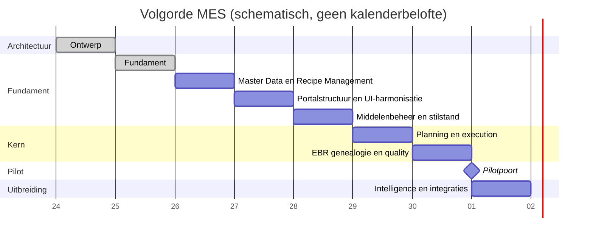

# Roadmap – MES

Enige centrale takenlijst; besluiten in DECISIONS.md, gerealiseerd in CHANGELOG.md, actuele werking in README.md. D89: 69 ontwerpbesluiten, nieuwe start vanaf main; PR #1 niet mergen.

Bijgewerkt: 25 november 2026 · huidige versie 0.63.0

## Afhankelijkheden (geen kalenderplanning)

De eerdere pilotdatum 22 februari 2027 is niet meer bindend. #70 blijft open. Fase 0: ontwerpbesluiten vastgelegd in D89 en docs/mes; acceptatie van documentatie nog vereist. Fasen 1–9 vormen de betrouwbare kern voor pilot 1.0.0. Minimale materiaalidentiteit, middelenvereisten en blokkades worden vóór afhankelijke functies ingevoerd; geen onbewezen productieomschakeling. Praktijkvoorbereiding parallel mogelijk. D99: de goedgekeurde legacy-review bepaalt de overgang per fase. Geen verdere investering in achterhaalde procesmodellen of uitgestelde uitbreidingen; alleen noodzakelijke beveiliging van tijdelijke interfaces.

## Fase 1 — Projectfundament en autorisaties (functioneel geaccepteerd)

Op 25 november 2026 is fase 1 functioneel geaccepteerd binnen de fictieve PoC-scope ([goedkeuring opdrachtgever](https://github.com/Gertjun/Manufacturing-Execution-System/pull/6#issuecomment-7171313853)). Geteste broncommit `582cf3c11308db77684d3062fed2fc1c2743bf80`, base `31c86973bf13848cba44fc38785084953fe65e39`, versie 0.62.1, schema 0095. [integrale CI 45645684067](https://github.com/Gertjun/Manufacturing-Execution-System/actions/runs/45645684067): Node 26 en Node 22 geslaagd; documentatiecontrole 45645661536 geslaagd. [Windows-build 45665375598](https://github.com/Gertjun/Manufacturing-Execution-System/actions/runs/45665375598): artifact MES-fase1-Windows-582cf3c, herkomst en SHA256 bevestigd. W1–W8: 107 controles, 106 rechtstreeks geslaagd en één als verwacht gedrag beoordeeld (werkplek blijft behouden). Zie [acceptatiebewijs PR #6](https://github.com/Gertjun/Manufacturing-Execution-System/pull/6#issuecomment-7171286531). Releasevoorbereiding 0.63.0 verandert de tree; nieuwe volledige CI vereist. Geen productieacceptatie of formele ISA-conformiteitsclaim.

Afgerond binnen fase-1-scope: #106 naam/terminologie/structuur; #107 rollen, permissions en functiescheiding; #108 kritische rechten, herbevestiging, audit en kwalificatiefundament; #136 Windows/PostgreSQL als PoC, browserdemo buiten verplichte scope. Definitieve domeinfuncties en betrouwbare area/equipment-context blijven in toegewezen fasen. Operationele security blijft vóór pilot vereist.

- #137 **Windows-bootstrap: onderbroken redeninvoer nader onderzoeken** — W7 geslaagd na hervatting met START.bat; exacte oorzaak niet gereproduceerd. Herstartinstructie en batchaankondiging gecorrigeerd in releasevoorbereiding. Bij herhaling terminalinvoer reproduceren; geen functionele blokker vastgesteld. 

Releasepoort: nieuwe volledige CI op actuele releasetree; opdrachtgever merget en autoriseert publicatie afzonderlijk. Geen formele ISA-conformiteit of fabrieksvrijgave.

### Historisch bewijs — tussentijdse audit (D100, eerdere tussenstanden)

Inhoudelijke audit afgesloten op basis van bestaande inventarisaties en baseline run 499; geen nieuwe concrete functionele blokker vastgesteld binnen beoordeelde scope. #106–#108/#136 functioneel gereed binnen deze bewijsgrens, niet geaccepteerd. Zie ACCEPTANCE-CRITERIA.md voor de formele afbakening. Databaseplaatje bijgewerkt en gericht gevalideerd; schermreview en gerichte schermvalidatie afgerond. Integrale testreview afgesloten; volledige acceptatie en Windows-praktijkvalidatie blijven verplicht.

Run [45616999067](https://github.com/Gertjun/Manufacturing-Execution-System/actions/runs/45616999067), job 139214856901, head 2e25ac588a081335ee16e75979e1212bb06a23df, base 31c86973bf13848cba44fc38785084953fe65e39: alle 16 verplichte Chrome/PostgreSQL-schermtestsuites geslaagd (768 getelde OK-controles, nul fouten), Node 26 API-typecheck, beide builds en offline-rechtenregressie geslaagd; documentatiecontrole 45616998994 groen. Uitsluitend fictieve gegevens; applicatie gebruikt beperkte mes_app-verbinding, eigenaar uitsluitend voor testvoorbereiding en DB-asserties. Geen volledige acceptatie of Windows-praktijkbewijs.

D84/schema 0094: [run 45577237440](https://github.com/Gertjun/Manufacturing-Execution-System/actions/runs/45577237440), job 139078079937, head 36ecbb9a04f1ae6d5f70dca5d7e04db6a7490455, base 31c86973bf13848cba44fc38785084953fe65e39: databaseplaatje gegenereerd in geïsoleerde PostgreSQL 18 en tests/test_schema_plaatje.sh geslaagd (62 tabellen, 132 verbanden). SHA-256 6f9e535cdf4e7cc82113181b0316d550b41c8c60ca663265bda3a512d7ea518c gecontroleerd bij opname in commit 65c73e04d072944178868c34d4e18ca91082f0f1; tijdelijke workflow verwijderd. Geen schemawijziging of integrale acceptatie.

D102/0094: goedgekeurde eenmalige initialisatie van bestaande persoonlijke identiteiten zonder MES-rechtenhistorie, via eigenaar en drie persoonlijke bevestigingen. Geen automatische legacy-grants; drie exact afgebakende grants, sessiegeneratie verhoogd, onveranderlijk bootstraprecord. Schone bootstrap blijft voorkeur voor fictieve pre-pilot. Gerichte DB- en toolregressies toegevoegd; uitvoeringsbewijs geslaagd in run run 499.

Run [45572488766](https://github.com/Gertjun/Manufacturing-Execution-System/actions/runs/45572488766), job 139062300483, head 6e332599aafc949b8cca94c401c4d0c21579d69c, base 31c86973bf13848cba44fc38785084953fe65e39: gehele gerichte PostgreSQL-baseline groen, inclusief startinventaris, mislukte herstelcontrole/cleanup, historische upgrade 0035–0093, 12/12 security, 10/10 autorisatie, 117/117 API en Linux-pakket; documentatie 45572480062 groen. Geen volledige acceptatie of Windows-bewijs.

Run [45575488676 (run 499)](https://github.com/Gertjun/Manufacturing-Execution-System/actions/runs/45575488676), job 139072267943, head de213112f706f7bbcbd07b4928c93e36e6d7ba02, base 31c86973bf13848cba44fc38785084953fe65e39: gerichte PostgreSQL-baseline geslaagd; schone installatie, schema-equivalentie 0001–0094, beperkte rechten, historische upgrade 0035–0094 met behoud van tien historische tabellen en zonder automatische legacy-grants, D102 eenmalige initialisatie, 14/14 security, 10/10 autorisatie, 117/117 API, back-up/herstel/rollback en Linux-laptoppakket. Documentatiecontrole 45575458558 geslaagd. Geen volledige Node 26-acceptatie of Windows-praktijkbewijs.

D100: serverstart toetst volledige migratie-inventaris; herstelcontrole sluit verbindingen en ruimt uitsluitend eigen uniek benoemde tijdelijke database op vóór exit, met foutmelding bij mislukte cleanup. Gerichte regressies voor onbekend schema, ontbrekende tussenmigratie, beschadigde dump, behoud historie en onderhoudslog toegevoegd. Uitvoeringsbewijs open; geen schemawijziging.

Run [45567796663](https://github.com/Gertjun/Manufacturing-Execution-System/actions/runs/45567796663), job 139046752938, head 8fd03f7c8c3ff3831b1e2d0a106189d05335d564, base 31c86973bf13848cba44fc38785084953fe65e39: gehele gerichte PostgreSQL-baseline groen, historische upgrade 0035–0093 inclusief tien tabellen, legacy-snapshot, nul automatische grants, ACL en pre-upgradeback-up bevestigd in log; 117/117 API, 12/12 security, 10/10 autorisatie, beheertools en Linux-pakket geslaagd. Geen Windows- of integrale acceptatie.

D100: [PostgreSQL-baseline 45566354900](https://github.com/Gertjun/Manufacturing-Execution-System/actions/runs/45566354900), job 139041993323, head e7813d396e03f3bc64fcd691ad159b416316f7d3, base 31c86973bf13848cba44fc38785084953fe65e39: alle stappen geslaagd, inclusief 117/117 API, schema-equivalentie 0001–0093, beheertools (onbekende schema’s, back-up/herstel, opzettelijke rollback) en Linux-pakket. Documentatiecontrole 45566342443 groen. Geen integrale acceptatie; historische schema-upgrade en Windows blijven open.
 
D100: weigering onbekende schemaversies vóór wijziging door een ouder migratiepakket geïmplementeerd; gerichte beheertoolregressie toegevoegd, testbewijs nog open.

0087/D101: verplichte laatste legacy-beheerder vervalt; historische identiteiten blijven behouden, fictieve fixtures worden gecontroleerd vervangen. Gebundelde DB/API-regressies en gerichte UI/offline-regressies geslaagd; integrale restinventarisatie van zelfstandige rolchecks, installatiegrenzen en schermacceptatie nog open.

D24-runtimecorrectie en gebundelde ACL-correcties gevalideerd in PostgreSQL-run 45556530186 (schema 0093), inclusief Linux-pakket. Windows, representatieve historische schema-upgrade, resterende installatiegrenzen en D101-restcontrole blijven open.
 
Werk in deze volgorde; dit is de afbakening van #106–#108 en #136, geen nieuwe zelfstandige takenlijst:

D101: alle legacy-rollen verliezen binnen fase 1 hun zelfstandige autorisatiewerking; behoud historische gegevens en noodzakelijke compatibiliteitsvelden. Controleer API, database, UI en regressies. Geen automatische grants, geen nieuwe domeinfunctionaliteit.
 
1. Gerichte baseline (concept-PR, label `database-baseline`, afzonderlijke PostgreSQL-job; laatste gerichte DB-baseline groen op de213112, zie ACCEPTANCE-CRITERIA.md voor exact bewijs; inhoudelijke auditreview afgesloten): schone installatie, migraties vanaf main, beperkte DB-rechten, autorisatie-unit-tests en relevante API-regressies. Eerst uitvoeringsbewijs en oorzaken van fouten vaststellen; geen nieuwe reeks speculative hardening-migraties.
2. Bundel alleen resterende blokkers: persoonlijk account-/sessiebeheer, rollen/permissions/scope/kwalificaties, onafhankelijke toekenning/intrekking, gecontroleerde personeelskoppeling, kritische herbevestiging en audit, effectieve DB-privileges en veilige tijdelijke interfaces. Zie acceptatiecriteria voor de bewijsgrens.
3. Rond #106–#108 en #136 functioneel af; geen uitbreiding van legacy procesmodellen. Indien tijdelijk pad niet veilig kan blijven: blokkeren en expliciet vastleggen, met beoordeling van gevolgen voor behouden kernfuncties.
4. Eindcontrole D99/ISA-mapping, databaseplaatje genereren en verifiëren, integrale testreview, volledige acceptatie op actuele head/base en beoordeling door Geert. Geen release of merge zonder toestemming.
 
## Fase 2 — Master Data & Recipe Management

Startbaseline: v0.63.0, main `ea3b78bc938647140b4e228e9382761504518906`, tree `344837981b9921dd0052ce2580a8c786a783f6e5`, schema 0095. PR #6 gemerged; [main-verificatie](https://github.com/Gertjun/Manufacturing-Execution-System/actions/runs/45680256072) en [releaseworkflow](https://github.com/Gertjun/Manufacturing-Execution-System/actions/runs/45680409404) geslaagd. Alle onderstaande punten blijven open. Eén concept-PR, geen versieverhoging tot releasevoorbereiding.

Uitvoeringsvolgorde: materiaalidentiteit (#109); MBR-identiteit en versiegrenzen (#109–110); procedurehiërarchie en routeafhankelijkheden (#103/110); receptinhoud (#111); MOC en vrijgave (#112); Process Engineering, Excel en migratie (#113); audit/testreview; integrale acceptatie; Windows-praktijkacceptatie en afzonderlijke toestemming voor merge/release. Per werkpakket eerst concrete cardinaliteiten, rechten, transacties en regressies toetsen aan D89/D99. Product/grondstof-ID's en historische feiten behouden; oude uitvoering blijft tijdelijk beschermd tot fase 5/6. Geen volledige resource- of executionfunctionaliteit vooruitbouwen. D105: fase 2 behoudt alle scope inclusief Process Engineering-portaal en eigen volledige acceptatie/merge/release; generieke portalharmonisatie pas fase 3. Volgende werkpakket: receptinhoud en parameters.

- #109 **Materiaaldefinities en MBR-identiteiten; meerdere recepten per product** — Migratie 0096: afgeschermd relationeel materiaalstamdatafundament; 0097 gecontroleerde materiaalfuncties toegevoegd; materiaal-API toegevoegd; gerichte DB/API-baseline geslaagd op a28cd0e (run 45682177664); gegenereerd diagram en OpenAPI opgenomen. 0098–0099 MBR-identiteiten, conceptversies, wijzigingsteller, audit en API gericht gevalideerd op d1815d3 (run 45684478100); portaal, bronmigratie en integrale acceptatie open.
- #110 **Onveranderlijke receptversies, procedurehiërarchie en afhankelijkheden** — 0100 relationele vierlaagse procedureboom en voorwaartse afhankelijkheden binnen één siblinggroep; versiegrenzen, volgorde en beperkte ACL afgedwongen. 0101 persoonlijke mutaties, gezamenlijke wijzigingsteller en audit toegevoegd; procedure-API en regressies toegevoegd; baseline 45687274731 op 593d495 volledig groen; 782 DB-regels en 121 API-tests. Vrijgavepoort volgt.
- #111 **Parameters, vijf voorwaarden, formule, schaalbaarheid, lotregels, instructies en specificaties** — 0102 relationele parameterdefinities en vijf afzonderlijke numerieke categorieën; 0103 referentieformule, materiaalversies, input/output en expliciet fixed/linear-schaalbeleid toegevoegd. Regressies nog niet uitgevoerd. 0106 relationeel fundament voor equipment- en personeelsvereisten, instructies en exacte specificatiegrenskoppelingen toegevoegd; nog niet getest. 0107 versiegebonden lotnorm (1–50), verplichte afwijkingsreden, goedkeuringsvereiste en expliciete incompatibiliteit tussen revisies van hetzelfde product toegevoegd; nog niet getest. Resourcevalidatie, persoonlijke functies en API volgen. Lot-CR legt toegepaste norm expliciet vast bij gemengde normen; geen automatische keuze.
- #141 **Eenhedenmodel en versiegebonden schaalregels (D106)** — Binnen fase 2, vóór MOC/vrijgave: centraal model voor fysische grootheden/dimensies en eenheden, SI/ISO 80000 als aanvullend uitgangspunt; gecontroleerde, onveranderlijke conversiedefinities (factor/offset, onderscheid absolute waarde en verschil) en versiegebonden schaalregels. Uitbreidbaar naar niet-lineaire relaties, afhankelijkheid van andere formuleparameters en equipment; expliciete inputs, eenheden, toepassingsgebied, versie en validatie; geen automatische uitvoering of willekeurige code. Integreer met #109/#111/#112/#113, behoud de fixed/linear-basis. Ontbrekende of ongeldige regels mogen geen vrijgave of berekening mogelijk maken. Rekenfunctionaliteit volgt #142. 0104 relationeel catalogusfundament met zeven SI-dimensie-exponenten, aparte grootheidsemantiek, onveranderlijke eenheden/conversieversies en expliciete koppelingen aan materialen, parameters en formule toegevoegd; regressies nog niet uitgevoerd. 0105 relationele schaalregelgrafiek met getypeerde invoer, exacte conversieversies, uitvoerkoppelingen, versiegrenzen en cycluspreventie toegevoegd; nog niet getest. Getypeerde formuledefinitie, persoonlijke catalogus-/conceptfuncties, gecontroleerde mapping en vrijgavevalidatie volgen.
- #112 **MOC, vierogenprincipe, vergelijking, geldigheid en vrijgave** — Zie ontwerpdocumenten en acceptatiecriteria.
- #113 **Process Engineering-portaal, Excel en migratie naar concepten** — Zie ontwerpdocumenten en acceptatiecriteria.
- #103 **Routeversie-fundament** — Opnieuw implementeren binnen MBR; prototype PR #1 is niet gemerged.

## Fase 3 — Portalstructuur, navigatie en UI-harmonisatie

D105: start uitsluitend na volledige acceptatie, merge en officiële release van fase 2. Indicatief één tot twee ontwikkelingsdagen, geen deadline. Aanleiding: praktijktest v0.63.0, portalenscherm toont juiste beschikbare portalen maar linkernavigatie niet altijd; `mes.quality` mist Production Execution naast Kwaliteit. Geen vastgestelde autorisatie-omzeiling; afzonderlijk melden en niet uitstellen als een daadwerkelijke kwetsbaarheid blijkt. Geen fase-3-implementatie binnen fase 2.

- #138 **Centrale portalregistratie en navigatie** — Eén uitbreidbare definitie van portalen, namen, iconen, routes, volgorde en vereiste bevoegdheden; dezelfde actuele autorisatielogica voor portalenscherm en linkerbalk, ook bij meerdere rollen en relevante combinaties/scopes. Alle bevoegde portalen op beide plaatsen, onbevoegde onzichtbaar én technisch ontoegankelijk bij directe URL. Onafhankelijke API/database-autorisatie blijft leidend; geen extra grants voor cosmetische consistentie.
- #139 **UI-harmonisatie en herbruikbare componenten** — Uniforme schermopbouw, hoofdbalk, linkernavigatie, namen, iconen, kleuren, typografie, tabellen, formulieren, knoppen, filters, status- en foutmeldingen, bevestigingsdialogen en lege toestanden. Herbruikbare componenten en ontwerpprincipes; praktisch bruikbaar in industriële productieomgeving. Geen nieuwe domeinfuncties vooruitbouwen.
- #140 **Portalregressies, audit en faseacceptatie** — Alle bestaande rollen en relevante bevoegdheidscombinaties; expliciet mes.quality met Kwaliteit en Production Execution, overeenstemming portalenscherm/linkerbalk, directe onbevoegde URL en onafhankelijke backendweigering; bestaande functionaliteit en beveiliging behouden. Tussentijdse audit, testreview, integrale CI, Windows-praktijktest en formele faseacceptatie, merge en release volgens D88/D90. Zie acceptatiecriteria.

## Fase 4 — Middelenbeheer en stilstand (Resource Management)

- #114 **Enterprise/site/area/cell/unit, equipment classes en fysieke assets** — Zie ontwerpdocumenten en acceptatiecriteria.
- #115 **Geschiktheid, capaciteit, status, werkstations en stilstand** — Zie ontwerpdocumenten en acceptatiecriteria.
- #116 **Maintenance-portaal en middelenvereisten** — Zie ontwerpdocumenten en acceptatiecriteria. D99: storingsnotities herbeoordelen binnen de middelen- en stilstandscope.

## Fase 5 — Productieplanning en werkvrijgave (Planning & Dispatching)

- #117 **Productieorders, work schedules/requests, job orders** — Zie ontwerpdocumenten en acceptatiecriteria.
- #118 **Batch- en lotplanning, middelen en personeel, capaciteit** — Zie ontwerpdocumenten en acceptatiecriteria.
- #119 **Werkvrijgave, intrekking, job responses en orderhistorie** — Zie ontwerpdocumenten en acceptatiecriteria. D98: geen zelfstandige ongeplande batchcreatie door operators; ook spoedwerk vereist vrijgave.

## Fase 6 — Control Recipes en productie-uitvoering

- #120 **Control Recipes, revisies, batchstart en geautoriseerde wijzigingen** — Zie ontwerpdocumenten en acceptatiecriteria. D98: systeem geeft batchidentiteit uit vanuit vrijgegeven werk; sluit legacy ongeplande creatieroute bij omschakeling.
- #142 **Gecontroleerde receptberekeningen en eenheidsconversie (D106)** — Afhankelijk van #141 en fase 4 voor equipmentcontext. Bij afleiding/revisie van Control Recipe: dimensioneel geldige conversies, vaste/lineaire en goedgekeurde niet-lineaire schaalrelaties, afhankelijke parameters en beschikbare equipmentgegevens. Contextafhankelijke omzetting (massa/volume, hoeveelheid stof) alleen met toepasselijke, versiegebonden eigenschappen en condities. Detecteer cycli, ontbrekende gegevens, buitenbereik, ongeldige dimensies, ongedefinieerde uitkomsten en afrondingsconflicten; geen impliciete fallback. Leg originele waarden, regels/versies, inputs, eenheden, factoren/offset, afronding, equipmentcontext en resultaten reproduceerbaar vast; gecontroleerde wijzigingen, geen retroactieve herberekening. Geen generieke scriptuitvoering of procesbesturing.
- #121 **Procedure-uitvoering, instructies, kwalificaties, middelen en ISA-88-statussen** — Zie ontwerpdocumenten en acceptatiecriteria.
- #122 **Offline geldigheid, synchronisatie, conflicten en Production Execution-portaal** — Zie ontwerpdocumenten en acceptatiecriteria.
- #104 **Routeversies en lotvorming door de hele keten** — Expliciete productrecepten, Control Recipes, historische voorwaarden, gemengde receptversies van hetzelfde product tenzij expliciet incompatibel, offline overgang.
- #105 **Productafhankelijke lotgrootte** — Norm 1–50, werkelijk aantal en afwijkingsreden, eventuele goedkeuring; capaciteit, lotvoorstellen en uitvoering aansluiten. Prototype PR #1 is niet gemerged.

## Fase 7 — Elektronische batchdossiers (EBR)

- #123 **Uitvoeringsidentiteit, EBR-standen, aanvullingen, export en Traceerbaarheid** — Zie ontwerpdocumenten en acceptatiecriteria.
- #69 **Volledig digitaal productiedossier** (middel) — Lotpaspoort en certificaat bestaan al; erbij: één dossier per lot met alle metingen, grondstoffen, wie wat deed, stilstand, beoordelingen en herbewerkingen, om te bewaren of te versturen.
- #102 **Doorlooptijden in het lotpaspoort** (klein) — De doorlooptijden van het lot en zijn batches, vergeleken met de rest. Hoort eigenlijk niet bij Kwaliteit: past bij het productiedossier per lot (#69), dat het overzicht over alle afdelingen wordt.
- #101 **Meetwaarde als gekleurde balk** (klein) — In Lotpaspoort en Afwijkingen de kolommen Gemeten en Grenzen als balk met de grenzen en tolerantie in kleur en een punt voor de gemeten waarde. Met echte data is beter te zien hoe die balk moet werken.

## Fase 8 — Kwaliteit, vrijgave en herbewerking

- #124 **Onafhankelijke productie- en kwaliteitsstatus, holds en afwijkingen** — Zie ontwerpdocumenten en acceptatiecriteria.
- #125 **Herbewerking als job order, Review by Exception, vrijgave en intrekking, CoA** — Zie ontwerpdocumenten en acceptatiecriteria.
- #30 **Afkeur met omvang, herhaling en maatregel** (middel) — Bij afkeur de geschonden grens tonen, verdachte batches (zelfde grondstofpartij, dag of lot) en eerdere afwijkingen van hetzelfde veld. Daarna een eenvoudige maatregel: wat, wie, wanneer klaar, na 30 dagen controleren of het hielp.

## Fase 9 — Materiaalgenealogie en traceerbaarheid

- #126 **Materiaalpartijen, status, verbruik, transformaties en genealogie** — Zie ontwerpdocumenten en acceptatiecriteria.
- #127 **Impactanalyse, visualisatie en basis massabalans** — Zie ontwerpdocumenten en acceptatiecriteria.
- #143 **Automatische operationele massabalans en rendement (D106)** — Bouw voort op #126/#127, #142 en de feitelijke uitvoeringsrecords. Per batch, lot en processtap/transformatie: theoretische versus werkelijke input/output en verbruik, voorraadverandering/hold-up, afval, bijproducten, bekende verliezen, onverklaard verschil en rendement. Expliciete systeemgrens, tijdsperiode, grondslag, eenheden, volledigheid en toleranties; geen dubbel tellen van interne transfers of gemengde batches. Onbekend/niet gemeten blijft onbekend; afwijkingen zichtbaar en door bevoegden beoordeeld. Geen nieuwe dubbele bron van feitelijk verbruik.

## Fase 10 — Pilotvoorbereiding en integrale validatie

- #92 **Wandscherm instellen in Beheer** (klein) — Per wandschermaccount in Beheer kiezen wat het toont (hal, stappen of Kwaliteit); de tv toont na het inloggen wat daar staat en hoeft er niemand meer heen (D74; uitgesteld volgens D99).
- #134 **Herinrichting rolhulp, pilotfeedback en pilotrapportage** — D99: actualiseren na stabiele kernschermen; uitgebreide wandschermen herbeoordelen op betrouwbare middelen- en statusgegevens.

- #128 **Echte MBR's, middelen, rollen, kwalificaties en organisatorische acceptatie** — Zie ontwerpdocumenten en acceptatiecriteria.
- #129 **Management-portaal basisrapportage; pilotpoort, schaduwpilot en terugvalprocedure** — Zie ontwerpdocumenten en acceptatiecriteria.
- #11 **Proof of concept laten zien** (klein, *Geert*) — Laptoppakket van de nieuwste versie draaien en laten zien; bevindingen worden nieuwe punten op deze roadmap.
- #2 **Echte velden per stap** (middel, *Geert*) — De velden en grenzen kunnen nu per product (D55), ook via het sjabloon (blad "Grenzen per product"). Per processtap de echte invoervelden aanleveren, het liefst in het sjabloon uit Beheer → Stappen en velden: veld, soort, eenheid, verplicht, tolerantie, grenzen, decimalen, op het certificaat. Ook de echte ploegtijden, oorzaken van stilstand, grondstoffen, producten met hun route (welke stappen, in welke volgorde; D55), operators en pc's. Daarna samen inrichten via het sjabloon en controleren in een lege fabriek.
- #10 **Fabrieksserver installeren met IT** (middel, *Geert*, *IT*, D26) — Geert bespreekt het advies met IT en beantwoordt de vier vragen onder "Nog te besluiten" in het advies. IT richt de server in volgens `docs/SERVER.md`; eerste keer samen op een testmachine, met back-up, hersteltest en een pc die offline gaat.
- #33 **Praktijktests** (middel) — Nog nooit echt getest: handscanner, etiketprinter, tv als wandscherm, invoerscherm offline op een fabrieks-pc via https, tablet via het netwerk, twee pc's op dezelfde stap, nachtploeg rond de klokwissel. Op Windows nog niet: versies 0.8–0.23 op de laptop, Ctrl+C en venster sluiten, back-up terugzetten, serverpakket en draaiboek op een echte Windows Server. Hoe en wanneer goed: [`docs/PRAKTIJKTESTS.md`](docs/PRAKTIJKTESTS.md) (0.38.0). Per test vastleggen wie, wanneer en de uitkomst, in het invulblad dat daar genoemd staat.
- #74 **Training** (klein, *Geert*) — Een trainingsmoment per rol vóór de pilot, met de laptop of de server en fictieve data. De hulp per rol staat in de schermen en is als A4 af te drukken (0.38.0, #36, D59). Afspreken wat de ploeg doet als een pc bij het begin van een dienst offline is (praktijktest V3).
- #79 **Ondernemingsraad en privacy** (klein, *Geert*) — Het systeem legt per persoon vast wie wat invoert (nodig om terug te zoeken). Vóór de pilot met de ondernemingsraad bespreken wat er wordt vastgelegd, wie het mag zien en hoe lang het bewaard blijft; raakt ook #8 en #63 (D12).
- #3 **Pilot met echte data** (groot) — Versie 1.0.0 in één hal: de eerste twee weken met de papieren registratie ernaast, dan alleen het systeem.

## Fase 11 — Manufacturing Intelligence

- #135 **Herbeoordeling geavanceerde SPC, Cpk en trends** — D99: pas na betrouwbare data, recept-/specificatieversies en KPI-definities; generieke grafiekcomponenten behouden.

- #88 **Voorspelling toekomstige keuringen** (nice-to-have, D96) — Opnieuw beoordelen na de basis-MES en pilot; alleen bij aantoonbare behoefte en betrouwbare planning/doorlooptijden, met scopecontrole. Actuele openstaande metingen, besluiten en beschikbare keuringsstappen blijven basisfunctionaliteit.

- #130 **KPI-definities, Management-portaal, MBR-vergelijking en massabalans** — Zie ontwerpdocumenten en acceptatiecriteria.
- #144 **Historische massabalans-, rendements- en verliesanalyse (D106)** — Op basis van #143 en reproduceerbare EBR/CR-standen: vergelijk batches, producten, loten en MBR-revisies, trends in rendement en materiaalverbruik, structurele verliezen en verbeterpotentieel. Expliciete KPI-definities, vergelijkbare grondslagen, datakwaliteit en traceerbare bron; ISO 22400 waar toepasselijk als aanvullend referentiekader, geen automatische wijziging van vrijgegeven recepten.
- #131 **RCA, CAPA, effectiviteitscontrole en aanvullende analyses** — Zie ontwerpdocumenten en acceptatiecriteria.
- #22 **OEE compleet** (middel) — Normtijden per stap vastleggen, zodat ook de prestatie (snelheid) en de volledige OEE berekend kunnen worden. De capaciteit in kg per uur (0.57.0, D80) is daarvoor de basis. De OEE komt in Productieanalyse, naast Stilstand en beschikbaarheid.
- #32 **Kwaliteit "in één keer goed"** (klein) — Herbewerkingen tellen niet als goed; stilstand per oorzaak als paretodiagram, op minuten en op aantal.
- #66 **Procesbewaking: tijdig signaleren** (middel) — Een signaal van een regelkaart of een trend meteen als melding in de portalen en op het wandscherm, niet alleen achteraf in het scherm Regelkaarten. Drempels pas instellen met echte data (#2); vóór de pilot alleen de werking.
- #67 **Productieoptimalisatie** (middel) — Knelpunten, doorlooptijden en stilstand bestaan al, en capaciteit per stap en product (D55); erbij: hoe vol elke stap werkelijk was (benutting), en welke stap de doorstroom bepaalt.
- #65 **Producteigenschap tegen procesparameter** (middel) — Verband zien tussen bijvoorbeeld een producteigenschap en de temperatuur in PS1 van dezelfde batch (spreidingsdiagram en correlatie). Vraagt #64.
- #68 **Kwaliteitsanalyse: verbanden** (groot) — Verbanden tussen grondstofpartijen, procesparameters, ploegen en afwijkingen. Per operator alleen na besluit #8 (D12).
- #84 **Specificatie per klant** (middel) — Naast de specificatie per product (#80, D73) een afwijkende specificatie voor een klant, en een lot toetsen aan de specificatie van de klant voor wie het is. Geert: later.

## Fase 12 — Integraties en uitrol

- #132 **ISA-95 interfaces, meetapparatuur, LIMS, DCS/SCADA en onderhoudssysteem** — Zie ontwerpdocumenten en acceptatiecriteria.
- #133 **Gefaseerde uitrol overige hallen** — Zie ontwerpdocumenten en acceptatiecriteria.
- #6 **Koppeling met Exact** (groot) — Gegevens uitwisselen met Exact.
- #21 **Meldingen per mail of Teams** (klein) — Kan pas als de server bij een mailserver of Teams mag; nu bewust alleen in de schermen (D33).
- #7 **Installeerbare apps** (groot) — Invoerscherm en portalen als installeerbare applicaties op dezelfde server en API.
- #45 **Talenkeuze** (middel) — De schermen in meer talen, met een keuze per gebruiker of per pc. Vraagt dat alle schermteksten uit de code naar taalbestanden gaan; de woordenlijst van D51 is daarvoor de basis.
- #46 **Donkere modus** (klein) — Voor invoer en portalen, via de gedeelde tokens (#42). Bewust later (D50).

## Te besluiten

- #8 **Analyses per operator** — Bijvoorbeeld afwijkingen per persoon. Bewust niet gebouwd (D12).
- #9 **Portalen voor andere afdelingen** — Welke afdelingen hebben nog een portaal nodig?
- #63 **Productiviteit per ploeg** — Punt 15 uit Geerts lijst. Per ploeg is minder gevoelig dan per persoon, maar bij kleine ploegen herken je toch personen; raakt D12 en mogelijk de ondernemingsraad. Wat telt als productiviteit: batches, stappen of uren per ploeg?
- #70 **Pilotdatum** — Opnieuw bepalen na inzicht in implementatievoortgang (G06).
- #72 **Naam Productieanalyse** — Besloten T10: Manufacturing Operations; implementatie bij #106.
- #34 **Open vragen planning** — Moet de planner ook ploegen of pc's toewijzen? Mag een operator een lotvoorstel zelf aanpassen? Is "per stap per dag" zo bruikbaar?

## Werkafspraken

- Nieuwe taken met het volgende vrije nummer (nu #145); gebouwde nummers in CHANGELOG onder Unreleased, geen nieuwe versie zonder releaseverzoek.
- Faseacceptatie volgens docs/mes/ACCEPTANCE-CRITERIA.md en D88; eigenaar merget. Geen automatische release.

Fase 1 (0058): personeelsrechten en koppeling afgeschermd; gecontroleerde identiteitsoverdracht, kwalificaties, UI en testbewijs nog open.

Fase 1 (0059): beperkt securitykanaal gebouwd; persoonlijke loginbinding, leesinterface, bediening en acceptatie nog open.

Fase 1 (0060–0061): persoonlijke securitybinding, leesfuncties en eigenaar-only registratie/intrekking/vervanging gebouwd; IT-provisioning, restore, transport, bediening en acceptatie nog open.

Fase 1 (0062): bevestigde tijdelijke kwaliteitsbesluiten; dossierstand, overige statuswrites, UI en acceptatie nog open.

Fase 1 (0063): opdrachtloze herbewerking geweigerd; directe opdrachtwrites, statusovergangen en acceptatie nog open; definitieve Job Order fase 8.

Fase 1 (0064): opdrachtcreatie/intrekking via bevestigde databasefuncties; uitvoeringsscope, UI en acceptatie nog open.

Fase 1 (0065): controle uitvoeringsbevoegdheid bij opdrachtconsumptie gebouwd; betrouwbare aanroepersidentiteit, overige directe writes en acceptatie nog open.

Fase 1 (0066): databasefundament sessiebewijs gebouwd; API-integratie en afdwingen bij writes nog open.

Fase 1 (0067): API-authenticatie gebruikt sessiebewijs; transactiebinding en databasehandhaving volgen.

Fase 1 (0068): transactionele bewijscontrole en eerste stapregistratieguard; overige writes, definer-paden en acceptatie open.

Fase 1 (0069): meet- en grondstofguards, gewone correcties gebonden aan sessiebewijs; gecontroleerde conflict-/naleveringspaden en acceptatie open.

Fase 1 (0070): conflictinvoer en besluitpad afgeschermd; legacy checks, concurrentie, UI, leesrechten en acceptatie open.

Fase 1 (0071): tijdelijke papieren nalevering beschermd; legacy rolcheck, leesrechten, positieve regressies en acceptatie open.

Fase 1 (0072): eerste statusguards en gecontroleerde blokkade, planningannulering en lotsamenstelling; registratiebevoegdheden, batchcreatie en acceptatie open.

Fase 1 (0073): tijdelijke batchcreatie/planning beveiligd; processtart en afronding, overige planningswrites en acceptatie open.

Fase 1 (0074): directe stapregistratie-writes ingetrokken; gecontroleerde start/afronding/rework, interne paden en acceptatie nog te toetsen.

Fase 1 (0075): functiezoekpaden en oude authenticatie-ingangen aangescherpt; volledige rechtenaudit en acceptatie open.

Fase 1 (0076): expliciete functieallowlist; transitieve runtimevalidatie, tabelrechten en overige legacy-writes open.

Fase 1 (0077): tabelschrijfallowlist; audit-/melding-insert, kolomgrants, leesrechten en resterende legacy-autorisatie nog afschermen.

Fase 1 (0088–0089): keuringsstart en oorspronkelijke kwaliteitsmeting op MES-permissions; fictieve meetidentiteit aangepast. Correcties en conflictbesluiten op MES-permissions; papieren nalevering, overige legacy-besluiten, fixtures en bewijs nog open.

Fase 1 (0090): papieren nalevering onafhankelijk van oude rollen; regressies voorbereid. Overige kwaliteitsbesluiten, effectieve rechten, UI en fixtures open.

D101 (0091): onderliggende batch- en keuringsbesluiten en herbewerkingsopdrachten omgezet naar MES-permissions; bevestigde wrappers blijven leidend. Uitgestelde specificatie- en certificaatwrites blijven afgeschermd. Gebundelde validatie en overige rechtenaudit open.

D100/D101 (0092): run 45509817373 op b017950: schone installatie, 12 securitytests, 10 autorisatietests, 116 API-tests en Linux-laptoppakket geslaagd; schema-equivalentie faalde door search_path maak_herbewerking, databaseregels door drie resterende positieve/procesregressies met oude kwaliteitsidentiteit. Begrensde search_path hersteld via 0092, fixtures omgezet naar expliciet bevoegde MES-identiteit. Negatieve legacy-regressies behouden; hertest open.

D100/D101: run 45510366427 op 0c1a15f bevestigt schema-equivalentie 0001–0092, security 12/12, autorisatie 10/10, API 116/116 en Linux-laptoppakket. Databaseregressie stopt bij papieren nalevering: eerdere fictieve test_training is verplicht voor execution.record; supervisor heeft die niet. Negatieve kwalificatietest bij nalevering toegevoegd, daarna uitsluitend fictieve supervisor voorzien van kwalificatie en alle vereiste permissions gecontroleerd. Geen productiewijziging; hertest open.

D24/D100/D101: run 45510881306, job 138857977598, head f8054187f592cb0eee63453e39629820e15adc60, base 31c86973bf13848cba44fc38785084953fe65e39: PostgreSQL 18 schoon, schema-equivalentie 0001–0092, databaseregels 610/610, security 12/12, autorisatie 10/10, API 116/116, Linux-laptoppakket en documentatie geslaagd. Totaal 748 getelde controles. Effectieve rechtenaudit: runtime-start weigert voortaan ook CREATE op database; regressie toegevoegd, nog niet uitgevoerd. Sequence-ACL, historische grant-opties, definer-paden, UI/offline en finale acceptatie open.

D24/D100: vanaf schema 0092 geen directe sequence-ACL voor runtime, legacy-login, securitykanaal of PUBLIC; identity-inserts en eigenaartrigger blijven leidend. Oude sequence-grants inclusief delegatie worden ingetrokken; tests simuleren historische grants, herhaalde rechteninstallatie en geweigerde nextval/setval/SELECT. Validatie open; overige ACL en definer-audit volgen.

D100: rechteninstallatie vanaf 0092 trekt vooraf alle tabel- en afzonderlijke kolom-ACLs voor PUBLIC, mes_app, batchgui_app en mes_security_channel in (CASCADE), waarna bestaande expliciete lees-/schrijfinterface opnieuw wordt opgebouwd. Regressies simuleren oude UPDATE/REFERENCES, TRIGGER, sessiehash- en wachtwoordhashleestoegang en grant-opties; normale beperkte toegang blijft getest. Geen gegevenswijziging. Directe functie-/schema-/database-ACLs en afwijkende roltoekenningen blijven aparte auditpunten; validatie open.

D100: vanaf 0092 ook schema- en routine-ACL reset met CASCADE voor PUBLIC en drie betrokken rollen; bestaande applicatie-allowlist en exact vijf persoonlijk gebonden securitykanaalfuncties hersteld zonder delegatie. Regressies simuleren historische PUBLIC-uitvoering, CREATE, grant-opties en kruisrechten tussen runtime/security. Buiten fabriek, persoonlijke directe grants, rolstructuur en SECURITY DEFINER-eigenaars/paden afzonderlijk beoordelen. Validatie open.

D100: rechteninstallatie valideert alle geïnstalleerde SECURITY DEFINER-functies op schema-eigenaarschap, expliciet vertrouwd zoekpad met pg_temp laatst en geen PUBLIC EXECUTE. Afwijkingen worden geweigerd, niet automatisch van eigenaar veranderd. Regressies voor catalogus en opzettelijk onveilig zoekpad toegevoegd. Vertrouwen in public-schema/extension-eigenaren, directe persoonlijke grants en afwijkende installatie-ACLs buiten fabriek blijven afzonderlijke aandachtspunten. Gebundelde validatie open.

D100: run 45512256648 op ab91c41: schema-equivalentie, schone installatie, security 12/12, autorisatie 10/10, API 117/117 en Linux-laptoppakket geslaagd. Databasetest stopt bij sequence-catalogusquery: PostgreSQL kan WHERE-predicaten herordenen en has_sequence_privilege op niet-sequence pg_statistic evalueren. CASE begrenst de functieaanroep tot relkind S, zonder wijziging van de getoetste rechten of productiecode. Hertest open.

D100: rechteninstallatie vanaf 0092 weigert technische rollen met beheerattributen, ongewenste transitieve lidmaatschappen of delegatie; securitykanaal moet NOLOGIN zijn. Historische batchgui_app → mes_app blijft toegestaan. Regressies simuleren extra lidmaatschap en LOGIN; geen automatische verwijdering van afwijkende rechten. Nieuwe validatie open.

D100/0093: persoonlijke securityrollen worden bij binding, iedere securityhandeling en rechteninstallatie getoetst op effectieve tabel-/kolom-/sequence-rechten, extra functierechten of delegatie, eigendom in fabriek en CREATE op database/fabriek/public. Regressies simuleren directe kolom-, functie- en public-CREATE-grants na binding. Afwijkingen worden geweigerd, niet automatisch ingetrokken; directe SQL-toegang bij afwijkende grants vereist IT-herstel. Andere schema's/databases en vertrouwen in public/extension-eigenaars blijven open. Validatie open.

D100: SQL-delimiters 0093 vóór CI hersteld; persoonlijke leden via expliciete recursieve rolrelaties bepaald (geen impliciete superuserlidmaatschappen). Rechteninstallatie weigert onvertrouwd public-eigendom, CREATE-grants buiten installatie-eigenaren, afwijkend pgcrypto-eigendom/schema en onvertrouwde routine-eigenaren in public. Regressie voor PUBLIC CREATE toegevoegd. Geen automatische intrekking of eigendomsoverdracht. Validatie open; andere schema's/databases en reeds gecompromitteerde vertrouwde eigenaren vallen buiten deze controle.

D100: run 45555577075 op dd9ede8: schoon schema en migratie-equivalentie 0001–0093, security en autorisatiemodule geslaagd; databaseregels, API en Linux-pakket geblokkeerd door enkelvoudige SQL-dollardelimiters in technische rolcontrole in rechten.sql. Delimiters hersteld; schema, migratie 0093 en rechtenbestand statisch gecontroleerd op dit patroon. Geen wijziging van beveiligingslogica of testverwachtingen. Hertest open.

D100: run 45556043173 op 5c2f957: schema-equivalentie, security, autorisatie, API en Linux-pakket geslaagd; databaseregels stoppen bij intrekking doordat de nieuwe ACL-testlus de bestaande variabelen grant (UUID) en revoke (query) overschrijft. Lusvariabelen hernoemd naar acl_grant_sql en acl_revoke_sql, zonder wijziging van scenario's, verwachtingen of productiecode. Hertest open.

D100: gerichte PostgreSQL-baseline [45556530186](https://github.com/Gertjun/Manufacturing-Execution-System/actions/runs/45556530186), job 139009809147, head 82598c571650a30d4989bdccd4d82d1bb95b76fa, base 31c86973bf13848cba44fc38785084953fe65e39: 666/666 databaseregels, 12/12 security, 10/10 autorisatie, 117/117 API (805 getelde controles), schone installatie, schema-equivalentie 0001–0093 en Linux-laptoppakket geslaagd. Technische/persoonlijke rechten en public-regressies aantoonbaar geslaagd. Geen integrale faseacceptatie; D101 UI/offline, overige installatiegrenzen, Windows, representatieve upgrade en Node 26 blijven open.

D101: nieuwe offline acties vereisen de persoonlijke permissionprojectie van hetzelfde token, per handeling en waar nodig product en meetveld. Lokale registratie en wachtrij worden atomair in IndexedDB opgeslagen, inclusief batch aanmaken plus starten; bij weigering geen lokale wijziging. Oude wachtrijacties blijven behouden; servercontrole bij synchronisatie blijft leidend. UI-context is geen serverbewijs. Gerichte regressies en schermvalidatie nog open.

D101: zelfstandige Chrome-regressie offline-rechten.mjs gebruikt echte IndexedDB en productiemodules via Vite, fictieve sessies en gemodelleerde serverweigering; controleert ontbrekende projectie, productscope, veldrechten, geheimen, sessiewisseling, gezamenlijke opslag, rollback en behoud bij weigering. Opgenomen in Node 22 en volledige acceptatie. Nog niet uitgevoerd.

D101: [Node 22-compatibiliteitsrun 45558147763](https://github.com/Gertjun/Manufacturing-Execution-System/actions/runs/45558147763), job 139015099770, head 6aaa391c1afa9e516d8d512573249feedb1a6d60, base 31c86973bf13848cba44fc38785084953fe65e39: 22/22 gerichte Chrome/IndexedDB-controles geslaagd, API-typecheck en beide applicatiebuilds groen; documentatiecontrole eveneens groen. Fictieve sessies en gesimuleerde serverweigering; geen integrale scherm-/netwerkacceptatie. Volledige Node 26-suite overgeslagen.
