# Database – tabellen en verbanden

> **Dit bestand:** een plaatje van de database, **automatisch gemaakt** uit `db/schema.sql` met
> `tools/schema_plaatje.py` (#100, D84). Niet met de hand wijzigen: `tests/test_schema_plaatje.sh` faalt als het niet bij is.
> Opnieuw maken: `python3 tools/schema_plaatje.py "host=localhost user=postgres"`.
> **Niet hier:** de regels in de database en waarom → `db/schema.sql` en [`DECISIONS.md`](../DECISIONS.md).

Schema `fabriek`: 51 tabellen en 104 verbanden.

## Overzicht

Een lijn loopt van de tabel waarnaar verwezen wordt naar de tabel met de verwijzing, met de kolom erbij. `||` = altijd ingevuld, `|o` = mag leeg zijn, `o{` = nul of meer, `o|` = hoogstens één. Niet getekend, wel in de lijst hieronder: verwijzingen naar `gebruiker`, `operator` en `pc` (wie iets deed of waar).

```mermaid
erDiagram
    activity_qualification
    authorization_grant
    authorization_legacy_snapshot
    authorization_permission
    authorization_role
    authorization_role_permission
    batch
    batch_besluit
    capaciteit_afwijking
    capaciteit_stap
    certificaat
    config_log
    gebruiker
    geweigerde_invoer
    grondstof
    grondstof_gebruik
    herbewerking
    inlogpoging
    instelling
    invoerconflict
    keuring
    lot
    lot_voorstel
    lot_voorstel_batch
    melding
    melding_gelezen
    onderhoud_log
    operator
    overdracht
    pc
    pc_stap
    personnel_qualification
    ploeg
    processtap
    product
    product_stap
    qualification
    rooster
    rooster_ploeg
    schema_versie
    specificatie
    specificatie_regel
    stap_grondstof
    stapplanning
    stapregistratie
    stilstand
    stilstand_oorzaak
    terugmelding
    veld
    veld_product
    waarde
    authorization_permission ||--o{ activity_qualification : "permission_code"
    authorization_permission ||--o{ authorization_role_permission : "permission_code"
    authorization_role ||--o{ authorization_grant : "role_code"
    authorization_role ||--o{ authorization_role_permission : "role_code"
    batch ||--o{ batch_besluit : "batch_id"
    batch |o--o{ herbewerking : "batch_id"
    batch ||--o{ lot_voorstel_batch : "batch_id"
    batch |o--o{ stapplanning : "batch_id"
    batch |o--o{ stapregistratie : "batch_id"
    gebruiker |o--o| operator : "gebruiker_id"
    grondstof ||--o{ grondstof_gebruik : "grondstof_id"
    grondstof |o--o{ invoerconflict : "grondstof_id"
    grondstof ||--o{ stap_grondstof : "grondstof_id"
    grondstof_gebruik |o--o| grondstof_gebruik : "vervangt_id"
    grondstof_gebruik |o--o{ invoerconflict : "bestaand_gebruik_id"
    herbewerking |o--o{ keuring : "herbewerking_id"
    lot |o--o{ batch : "lot_id"
    lot ||--o{ certificaat : "lot_id"
    lot |o--o{ herbewerking : "lot_id"
    lot |o--o{ lot_voorstel : "lot_id"
    lot |o--o{ stapplanning : "lot_id"
    lot |o--o{ stapregistratie : "lot_id"
    lot_voorstel ||--o{ lot_voorstel_batch : "voorstel_id"
    lot_voorstel |o--o{ stapplanning : "voorstel_id"
    melding ||--o{ melding_gelezen : "melding_id"
    ploeg ||--o{ overdracht : "ploeg_id"
    processtap |o--o{ capaciteit_afwijking : "processtap_id"
    processtap ||--o{ capaciteit_stap : "processtap_id"
    processtap ||--o{ herbewerking : "processtap_id"
    processtap ||--o{ pc_stap : "processtap_id"
    processtap ||--o{ product_stap : "processtap_id"
    processtap ||--o{ specificatie : "processtap_id"
    processtap ||--o{ stap_grondstof : "processtap_id"
    processtap ||--o{ stapplanning : "processtap_id"
    processtap ||--o{ stapregistratie : "processtap_id"
    processtap ||--o{ stilstand : "processtap_id"
    processtap ||--o{ veld : "processtap_id"
    product |o--o{ authorization_grant : "product_id"
    product |o--o{ batch : "product_id"
    product |o--o{ capaciteit_afwijking : "product_id"
    product ||--o{ capaciteit_stap : "product_id"
    product ||--o{ product_stap : "product_id"
    product ||--o{ specificatie : "product_id"
    product |o--o{ stapregistratie : "product_id"
    product ||--o{ veld_product : "product_id"
    qualification ||--o{ activity_qualification : "qualification_code"
    qualification ||--o{ personnel_qualification : "qualification_code"
    rooster_ploeg |o--o{ operator : "ploeg_id"
    specificatie ||--o{ specificatie_regel : "specificatie_id"
    specificatie |o--o{ waarde : "specificatie_id"
    stapregistratie ||--o{ grondstof_gebruik : "stapregistratie_id"
    stapregistratie |o--o| herbewerking : "stapregistratie_id"
    stapregistratie ||--o{ invoerconflict : "stapregistratie_id"
    stapregistratie ||--o| keuring : "stapregistratie_id"
    stapregistratie ||--o{ waarde : "stapregistratie_id"
    stilstand_oorzaak ||--o{ stilstand : "oorzaak_id"
    veld |o--o{ invoerconflict : "veld_id"
    veld ||--o{ specificatie_regel : "veld_id"
    veld ||--o{ veld_product : "veld_id"
    veld ||--o{ waarde : "veld_id"
    waarde |o--o{ invoerconflict : "bestaand_waarde_id"
    waarde |o--o| waarde : "vervangt_waarde_id"
```

## Tabellen

| Tabel | Kolommen | Verwijst naar | Uitleg (uit `schema.sql`) |
| --- | ---: | --- | --- |
| [`activity_qualification`](#activity_qualification) | 2 | `authorization_permission`, `qualification` | Verplichte kwalificatie voor een concrete activiteit. |
| [`authorization_grant`](#authorization_grant) | 9 | `authorization_role`, `gebruiker`, `product` | Persoonlijke roltoekenning met geldigheid en begrensde scope. |
| [`authorization_legacy_snapshot`](#authorization_legacy_snapshot) | 3 | `gebruiker` | Momentopname van de oude rol bij migratie, zonder extra rechten. |
| [`authorization_permission`](#authorization_permission) | 2 |  | Concrete bevoegdheden binnen een domein. |
| [`authorization_role`](#authorization_role) | 2 |  | MES-rollen met gescheiden verantwoordelijkheidsdomeinen. |
| [`authorization_role_permission`](#authorization_role_permission) | 2 | `authorization_permission`, `authorization_role` | Koppeling tussen rollen en concrete bevoegdheden. |
| [`batch`](#batch) | 14 | `gebruiker`, `lot`, `operator`, `product` |  |
| [`batch_besluit`](#batch_besluit) | 6 | `batch`, `gebruiker` | Besluiten over een batch: in_beoordeling – ploegleider of kwaliteit; de batch kan dan niet verder vrijgegeven – keurresultaat OK, alleen kwaliteit; door… |
| [`capaciteit_afwijking`](#capaciteit_afwijking) | 8 | `processtap`, `product` | Afwijkende capaciteit (sinds 0.48.0, D69): in een periode kan een stap en/of product minder aan. |
| [`capaciteit_stap`](#capaciteit_stap) | 5 | `processtap`, `product` | Capaciteit per stap en product (sinds migratie 0020, D55): hoeveel items een stap per dag aankan. |
| [`certificaat`](#certificaat) | 6 | `gebruiker`, `lot` |  |
| [`config_log`](#config_log) | 8 |  | Wijzigingslogboek voor configuratie. |
| [`gebruiker`](#gebruiker) | 7 |  | Persoonlijke accounts (ploegleider, beheerder, analist, planner) en het ene gedeelde operator-account. |
| [`geweigerde_invoer`](#geweigerde_invoer) | 10 | `gebruiker`, `operator`, `pc` | Geweigerde invoer van een pc (#77, D66): de server legt vast wat hij weigerde, zodat het pilotoverzicht kan laten zien wat er misging. |
| [`grondstof`](#grondstof) | 5 |  | Grondstoffen per batch (sinds migratie 0005, versie 0.11.0) Grondstoffen (configuratie, door de beheerder beheerd). |
| [`grondstof_gebruik`](#grondstof_gebruik) | 11 | `gebruiker`, `grondstof`, `operator`, `stapregistratie` | Gebruik: per registratie en grondstof één oorspronkelijke regel; correcties vervangen hem (zoals bij waarden). |
| [`herbewerking`](#herbewerking) | 12 | `batch`, `gebruiker`, `lot`, `processtap`, `stapregistratie` | Herbewerkingen (sinds migratie 0021, #61): Kwaliteit of de productiemanager besluit dat een batch of lot terug moet naar een eerdere stap. |
| [`inlogpoging`](#inlogpoging) | 5 |  |  |
| [`instelling`](#instelling) | 3 |  | Certificaat per lot (sinds migratie 0010, versie 0.17.0) |
| [`invoerconflict`](#invoerconflict) | 19 | `gebruiker`, `grondstof`, `grondstof_gebruik`, `operator`, `pc`, `stapregistratie`, `veld`, `waarde` | Conflicten bij gelijktijdige invoer (sinds 0032, #85, D75): vullen twee mensen hetzelfde veld of dezelfde grondstof van een stap in, dan blijft de eerste… |
| [`keuring`](#keuring) | 8 | `gebruiker`, `herbewerking`, `stapregistratie` | Keuring door Kwaliteit (sinds migratie 0022, #64): een stap met velden die Kwaliteit meet. |
| [`lot`](#lot) | 4 |  |  |
| [`lot_voorstel`](#lot_voorstel) | 9 | `gebruiker`, `lot` |  |
| [`lot_voorstel_batch`](#lot_voorstel_batch) | 2 | `batch`, `lot_voorstel` |  |
| [`melding`](#melding) | 10 |  | Meldingen (sinds migratie 0007, versie 0.13.0) |
| [`melding_gelezen`](#melding_gelezen) | 3 | `gebruiker`, `melding` |  |
| [`onderhoud_log`](#onderhoud_log) | 9 |  |  |
| [`operator`](#operator) | 5 | `gebruiker`, `rooster_ploeg` | Namenlijst waaruit operators na het inloggen kiezen. |
| [`overdracht`](#overdracht) | 10 | `gebruiker`, `operator`, `pc`, `ploeg` |  |
| [`pc`](#pc) | 4 |  |  |
| [`pc_stap`](#pc_stap) | 2 | `pc`, `processtap` | Optioneel: welke stappen in de keuzelijst van een pc staan. |
| [`personnel_qualification`](#personnel_qualification) | 6 | `gebruiker`, `qualification` | Persoonlijke kwalificatie met geldigheid en intrekking. |
| [`ploeg`](#ploeg) | 6 |  | Ploegoverdracht (sinds migratie 0006, versie 0.12.0) |
| [`processtap`](#processtap) | 8 |  |  |
| [`product`](#product) | 5 |  | Producten (configuratie, door de planner beheerd; sinds migratie 0003) |
| [`product_stap`](#product_stap) | 3 | `processtap`, `product` | Route per product (sinds migratie 0018, D55): welke stappen een product doorloopt, in welke volgorde. |
| [`qualification`](#qualification) | 2 |  | Definitie van een personeelskwalificatie. |
| [`rooster`](#rooster) | 3 |  | Ploegen en rooster (sinds 0033, #86, D76). |
| [`rooster_ploeg`](#rooster_ploeg) | 6 |  |  |
| [`schema_versie`](#schema_versie) | 3 |  |  |
| [`specificatie`](#specificatie) | 10 | `gebruiker`, `processtap`, `product` | Specificatie per product en keuringsstap (sinds 0.51.0, #80, D73): waar het product in een tussenkeuring (TK) of de eindkeuring (EK) aan moet voldoen, met… |
| [`specificatie_regel`](#specificatie_regel) | 5 | `specificatie`, `veld` | Per veld van de keuringsstap het minimum en/of maximum. |
| [`stap_grondstof`](#stap_grondstof) | 5 | `grondstof`, `processtap` | In welke stap welke grondstof wordt ingevoerd, en of dat verplicht is. |
| [`stapplanning`](#stapplanning) | 10 | `batch`, `gebruiker`, `lot`, `lot_voorstel`, `processtap` |  |
| [`stapregistratie`](#stapregistratie) | 20 | `batch`, `gebruiker`, `lot`, `operator`, `pc`, `processtap`, `product` |  |
| [`stilstand`](#stilstand) | 11 | `gebruiker`, `operator`, `pc`, `processtap`, `stilstand_oorzaak` |  |
| [`stilstand_oorzaak`](#stilstand_oorzaak) | 5 |  | Storingen en stilstand (sinds migratie 0008, versie 0.14.0) |
| [`terugmelding`](#terugmelding) | 12 | `gebruiker`, `operator`, `pc` | "Iets melden" (sinds migratie 0026, #78, D62): gebruikers typen kort wat misgaat of beter kan. |
| [`veld`](#veld) | 16 | `processtap` |  |
| [`veld_product`](#veld_product) | 6 | `product`, `veld` | Grenzen en tolerantie per product (sinds migratie 0019, D55). |
| [`waarde`](#waarde) | 17 | `gebruiker`, `operator`, `specificatie`, `stapregistratie`, `veld` |  |

## Kolommen per tabel

PK = sleutel, FK = verwijst naar een andere tabel, UK = uniek. Zonder "leeg" is de kolom altijd ingevuld.

### activity_qualification

| Kolom | Type | | Verwijst naar |
| --- | --- | --- | --- |
| `permission_code` | text | PK FK | `authorization_permission` |
| `qualification_code` | text | PK FK | `qualification` |

### authorization_grant

| Kolom | Type | | Verwijst naar |
| --- | --- | --- | --- |
| `id` | uuid | PK |  |
| `user_id` | uuid | FK | `gebruiker` |
| `role_code` | text | FK | `authorization_role` |
| `area_code` | text | leeg |  |
| `product_id` | uuid | FK leeg | `product` |
| `equipment_code` | text | leeg |  |
| `valid_from` | timestamptz |  |  |
| `valid_until` | timestamptz | leeg |  |
| `revoked_at` | timestamptz | leeg |  |

### authorization_legacy_snapshot

| Kolom | Type | | Verwijst naar |
| --- | --- | --- | --- |
| `user_id` | uuid | PK FK | `gebruiker` |
| `legacy_role` | text |  |  |
| `captured_at` | timestamptz |  |  |

### authorization_permission

| Kolom | Type | | Verwijst naar |
| --- | --- | --- | --- |
| `code` | text | PK |  |
| `domain` | text |  |  |

### authorization_role

| Kolom | Type | | Verwijst naar |
| --- | --- | --- | --- |
| `code` | text | PK |  |
| `domain` | text |  |  |

### authorization_role_permission

| Kolom | Type | | Verwijst naar |
| --- | --- | --- | --- |
| `role_code` | text | PK FK | `authorization_role` |
| `permission_code` | text | PK FK | `authorization_permission` |

### batch

| Kolom | Type | | Verwijst naar |
| --- | --- | --- | --- |
| `id` | uuid | PK |  |
| `batchnummer` | text | UK |  |
| `bron` | text |  |  |
| `status` | text |  |  |
| `lot_id` | uuid | FK leeg | `lot` |
| `aangemaakt_op` | timestamptz |  |  |
| `aangemaakt_door` | uuid | FK leeg | `operator` |
| `geplande_dag` | date | leeg |  |
| `volgorde` | int | leeg |  |
| `product_id` | uuid | FK leeg | `product` |
| `opmerking` | text | leeg |  |
| `gepland_door` | uuid | FK leeg | `gebruiker` |
| `gestart_op` | timestamptz | leeg |  |
| `vervallen_reden` | text | leeg |  |

### batch_besluit

| Kolom | Type | | Verwijst naar |
| --- | --- | --- | --- |
| `id` | uuid | PK |  |
| `batch_id` | uuid | FK | `batch` |
| `besluit` | text |  |  |
| `reden` | text |  |  |
| `besloten_door` | uuid | FK | `gebruiker` |
| `besloten_op` | timestamptz |  |  |

### capaciteit_afwijking

| Kolom | Type | | Verwijst naar |
| --- | --- | --- | --- |
| `id` | uuid | PK |  |
| `van` | date |  |  |
| `tot` | date |  |  |
| `processtap_id` | uuid | FK leeg | `processtap` |
| `product_id` | uuid | FK leeg | `product` |
| `procent` | int |  |  |
| `reden` | text |  |  |
| `actief` | bool |  |  |

### capaciteit_stap

| Kolom | Type | | Verwijst naar |
| --- | --- | --- | --- |
| `id` | uuid | PK |  |
| `processtap_id` | uuid | FK | `processtap` |
| `product_id` | uuid | FK | `product` |
| `max_per_dag` | int | leeg |  |
| `kg_per_dag` | numeric | leeg |  |

### certificaat

| Kolom | Type | | Verwijst naar |
| --- | --- | --- | --- |
| `id` | uuid | PK |  |
| `nummer` | int | UK |  |
| `lot_id` | uuid | FK | `lot` |
| `inhoud` | jsonb |  |  |
| `uitgegeven_door` | uuid | FK | `gebruiker` |
| `uitgegeven_op` | timestamptz |  |  |

### config_log

| Kolom | Type | | Verwijst naar |
| --- | --- | --- | --- |
| `id` | bigint | PK |  |
| `tabel` | text |  |  |
| `record_id` | uuid |  |  |
| `actie` | text |  |  |
| `oud` | jsonb | leeg |  |
| `nieuw` | jsonb | leeg |  |
| `gewijzigd_door` | text |  |  |
| `gewijzigd_op` | timestamptz |  |  |

### gebruiker

| Kolom | Type | | Verwijst naar |
| --- | --- | --- | --- |
| `id` | uuid | PK |  |
| `gebruikersnaam` | text | UK |  |
| `rol` | text |  |  |
| `wachtwoord_hash` | text | leeg |  |
| `actief` | bool |  |  |
| `gedeeld` | bool |  |  |
| `wachtwoord_wijzigen` | bool |  |  |

### geweigerde_invoer

| Kolom | Type | | Verwijst naar |
| --- | --- | --- | --- |
| `id` | bigint | PK |  |
| `op` | timestamptz |  |  |
| `pc_id` | uuid | FK leeg | `pc` |
| `gebruiker_id` | uuid | FK leeg | `gebruiker` |
| `operator_id` | uuid | FK leeg | `operator` |
| `pad` | text |  |  |
| `status` | int |  |  |
| `fout` | text | leeg |  |
| `stapcode` | text | leeg |  |
| `batchnummer` | text | leeg |  |

### grondstof

| Kolom | Type | | Verwijst naar |
| --- | --- | --- | --- |
| `id` | uuid | PK |  |
| `code` | text | UK |  |
| `naam` | text |  |  |
| `eenheid` | text | leeg |  |
| `actief` | bool |  |  |

### grondstof_gebruik

| Kolom | Type | | Verwijst naar |
| --- | --- | --- | --- |
| `id` | uuid | PK |  |
| `stapregistratie_id` | uuid | FK | `stapregistratie` |
| `grondstof_id` | uuid | FK | `grondstof` |
| `partij` | text |  |  |
| `hoeveelheid` | numeric | leeg |  |
| `vervangt_id` | uuid | FK UK leeg | `grondstof_gebruik` |
| `correctie_reden` | text | leeg |  |
| `ingevoerd_door` | uuid | FK leeg | `operator` |
| `gecorrigeerd_door` | uuid | FK leeg | `gebruiker` |
| `ingevoerd_op` | timestamptz |  |  |
| `ontvangen_op` | timestamptz | leeg |  |

### herbewerking

| Kolom | Type | | Verwijst naar |
| --- | --- | --- | --- |
| `id` | uuid | PK |  |
| `batch_id` | uuid | FK leeg | `batch` |
| `lot_id` | uuid | FK leeg | `lot` |
| `processtap_id` | uuid | FK | `processtap` |
| `reden` | text |  |  |
| `status` | text |  |  |
| `aangemaakt_door` | uuid | FK leeg | `gebruiker` |
| `aangemaakt_op` | timestamptz |  |  |
| `stapregistratie_id` | uuid | FK UK leeg | `stapregistratie` |
| `ingetrokken_door` | uuid | FK leeg | `gebruiker` |
| `ingetrokken_op` | timestamptz | leeg |  |
| `ingetrokken_reden` | text | leeg |  |

### inlogpoging

| Kolom | Type | | Verwijst naar |
| --- | --- | --- | --- |
| `id` | uuid | PK |  |
| `gebruikersnaam` | text |  |  |
| `pc` | text | leeg |  |
| `uitkomst` | text |  |  |
| `op` | timestamptz |  |  |

### instelling

| Kolom | Type | | Verwijst naar |
| --- | --- | --- | --- |
| `id` | uuid | PK |  |
| `sleutel` | text | UK |  |
| `waarde` | text |  |  |

### invoerconflict

| Kolom | Type | | Verwijst naar |
| --- | --- | --- | --- |
| `id` | uuid | PK |  |
| `invoer_id` | uuid | UK leeg |  |
| `stapregistratie_id` | uuid | FK | `stapregistratie` |
| `veld_id` | uuid | FK leeg | `veld` |
| `grondstof_id` | uuid | FK leeg | `grondstof` |
| `bestaand_waarde_id` | uuid | FK leeg | `waarde` |
| `bestaand_gebruik_id` | uuid | FK leeg | `grondstof_gebruik` |
| `setting` | numeric | leeg |  |
| `gemeten` | numeric | leeg |  |
| `partij` | text | leeg |  |
| `hoeveelheid` | numeric | leeg |  |
| `ingevoerd_door` | uuid | FK | `operator` |
| `pc_id` | uuid | FK leeg | `pc` |
| `ingevoerd_op` | timestamptz |  |  |
| `ontvangen_op` | timestamptz |  |  |
| `status` | text |  |  |
| `opgelost_door` | uuid | FK leeg | `gebruiker` |
| `opgelost_op` | timestamptz | leeg |  |
| `reden` | text | leeg |  |

### keuring

| Kolom | Type | | Verwijst naar |
| --- | --- | --- | --- |
| `id` | uuid | PK |  |
| `stapregistratie_id` | uuid | FK UK | `stapregistratie` |
| `status` | text |  |  |
| `aangemaakt_op` | timestamptz |  |  |
| `besloten_door` | uuid | FK leeg | `gebruiker` |
| `besloten_op` | timestamptz | leeg |  |
| `reden` | text | leeg |  |
| `herbewerking_id` | uuid | FK leeg | `herbewerking` |

### lot

| Kolom | Type | | Verwijst naar |
| --- | --- | --- | --- |
| `id` | uuid | PK |  |
| `lotnummer` | text | UK |  |
| `status` | text |  |  |
| `aangemaakt_op` | timestamptz |  |  |

### lot_voorstel

| Kolom | Type | | Verwijst naar |
| --- | --- | --- | --- |
| `id` | uuid | PK |  |
| `nummer` | int | UK |  |
| `status` | text |  |  |
| `opmerking` | text | leeg |  |
| `aangemaakt_door` | uuid | FK | `gebruiker` |
| `aangemaakt_op` | timestamptz |  |  |
| `lot_id` | uuid | FK leeg | `lot` |
| `afwijking_reden` | text | leeg |  |
| `afgesloten_op` | timestamptz | leeg |  |

### lot_voorstel_batch

| Kolom | Type | | Verwijst naar |
| --- | --- | --- | --- |
| `voorstel_id` | uuid | PK FK | `lot_voorstel` |
| `batch_id` | uuid | PK FK | `batch` |

### melding

| Kolom | Type | | Verwijst naar |
| --- | --- | --- | --- |
| `id` | uuid | PK |  |
| `soort` | text |  |  |
| `ernst` | text |  |  |
| `tekst` | text |  |  |
| `batchnummer` | text | leeg |  |
| `lotnummer` | text | leeg |  |
| `hal` | text | leeg |  |
| `voor_rollen` | text[] |  |  |
| `bron_id` | uuid | leeg |  |
| `aangemaakt_op` | timestamptz |  |  |

### melding_gelezen

| Kolom | Type | | Verwijst naar |
| --- | --- | --- | --- |
| `melding_id` | uuid | PK FK | `melding` |
| `gebruiker_id` | uuid | PK FK | `gebruiker` |
| `gelezen_op` | timestamptz |  |  |

### onderhoud_log

| Kolom | Type | | Verwijst naar |
| --- | --- | --- | --- |
| `id` | bigint | PK |  |
| `soort` | text |  |  |
| `gestart_op` | timestamptz |  |  |
| `klaar_op` | timestamptz |  |  |
| `gelukt` | bool |  |  |
| `bestand` | text | leeg |  |
| `grootte_bytes` | bigint | leeg |  |
| `versie` | text | leeg |  |
| `melding` | text | leeg |  |

### operator

| Kolom | Type | | Verwijst naar |
| --- | --- | --- | --- |
| `id` | uuid | PK |  |
| `naam` | text | UK |  |
| `actief` | bool |  |  |
| `gebruiker_id` | uuid | FK UK leeg | `gebruiker` |
| `ploeg_id` | uuid | FK leeg | `rooster_ploeg` |

### overdracht

| Kolom | Type | | Verwijst naar |
| --- | --- | --- | --- |
| `id` | uuid | PK |  |
| `dag` | date |  |  |
| `ploeg_id` | uuid | FK | `ploeg` |
| `hal` | text | leeg |  |
| `bijzonderheden` | text | leeg |  |
| `aandachtspunten` | text | leeg |  |
| `gebruiker_id` | uuid | FK | `gebruiker` |
| `operator_id` | uuid | FK leeg | `operator` |
| `pc_id` | uuid | FK leeg | `pc` |
| `geschreven_op` | timestamptz |  |  |

### pc

| Kolom | Type | | Verwijst naar |
| --- | --- | --- | --- |
| `id` | uuid | PK |  |
| `naam` | text | UK |  |
| `locatie` | text | leeg |  |
| `actief` | bool |  |  |

### pc_stap

| Kolom | Type | | Verwijst naar |
| --- | --- | --- | --- |
| `pc_id` | uuid | PK FK | `pc` |
| `processtap_id` | uuid | PK FK | `processtap` |

### personnel_qualification

| Kolom | Type | | Verwijst naar |
| --- | --- | --- | --- |
| `id` | uuid | PK |  |
| `user_id` | uuid | FK | `gebruiker` |
| `qualification_code` | text | FK | `qualification` |
| `valid_from` | timestamptz |  |  |
| `valid_until` | timestamptz | leeg |  |
| `revoked_at` | timestamptz | leeg |  |

### ploeg

| Kolom | Type | | Verwijst naar |
| --- | --- | --- | --- |
| `id` | uuid | PK |  |
| `code` | text | UK |  |
| `naam` | text |  |  |
| `begint` | time |  |  |
| `eindigt` | time |  |  |
| `actief` | bool |  |  |

### processtap

| Kolom | Type | | Verwijst naar |
| --- | --- | --- | --- |
| `id` | uuid | PK |  |
| `code` | text | UK |  |
| `naam` | text |  |  |
| `volgorde` | int | UK |  |
| `niveau` | text |  |  |
| `is_lot_stap` | bool |  |  |
| `actief` | bool |  |  |
| `soort` | text |  |  |

### product

| Kolom | Type | | Verwijst naar |
| --- | --- | --- | --- |
| `id` | uuid | PK |  |
| `code` | text | UK |  |
| `naam` | text |  |  |
| `actief` | bool |  |  |
| `batchgewicht_kg` | numeric | leeg |  |

### product_stap

| Kolom | Type | | Verwijst naar |
| --- | --- | --- | --- |
| `product_id` | uuid | PK FK | `product` |
| `processtap_id` | uuid | PK FK | `processtap` |
| `plek` | int |  |  |

### qualification

| Kolom | Type | | Verwijst naar |
| --- | --- | --- | --- |
| `code` | text | PK |  |
| `description` | text |  |  |

### rooster

| Kolom | Type | | Verwijst naar |
| --- | --- | --- | --- |
| `id` | uuid | PK |  |
| `enkel` | bool | UK |  |
| `patroon` | text[] |  |  |

### rooster_ploeg

| Kolom | Type | | Verwijst naar |
| --- | --- | --- | --- |
| `id` | uuid | PK |  |
| `letter` | text |  |  |
| `divisie` | int |  |  |
| `code` | text | UK leeg |  |
| `cyclus_start` | date |  |  |
| `actief` | bool |  |  |

### schema_versie

| Kolom | Type | | Verwijst naar |
| --- | --- | --- | --- |
| `nummer` | int | PK |  |
| `naam` | text |  |  |
| `uitgevoerd_op` | timestamptz |  |  |

### specificatie

| Kolom | Type | | Verwijst naar |
| --- | --- | --- | --- |
| `id` | uuid | PK |  |
| `product_id` | uuid | FK | `product` |
| `processtap_id` | uuid | FK | `processtap` |
| `versie` | int |  |  |
| `status` | text |  |  |
| `opmerking` | text | leeg |  |
| `aangemaakt_door` | uuid | FK leeg | `gebruiker` |
| `aangemaakt_op` | timestamptz |  |  |
| `vastgesteld_door` | uuid | FK leeg | `gebruiker` |
| `vastgesteld_op` | timestamptz | leeg |  |

### specificatie_regel

| Kolom | Type | | Verwijst naar |
| --- | --- | --- | --- |
| `id` | uuid | PK |  |
| `specificatie_id` | uuid | FK | `specificatie` |
| `veld_id` | uuid | FK | `veld` |
| `grens_min` | numeric | leeg |  |
| `grens_max` | numeric | leeg |  |

### stap_grondstof

| Kolom | Type | | Verwijst naar |
| --- | --- | --- | --- |
| `id` | uuid | PK |  |
| `processtap_id` | uuid | FK | `processtap` |
| `grondstof_id` | uuid | FK | `grondstof` |
| `verplicht` | bool |  |  |
| `actief` | bool |  |  |

### stapplanning

| Kolom | Type | | Verwijst naar |
| --- | --- | --- | --- |
| `id` | uuid | PK |  |
| `dag` | date |  |  |
| `processtap_id` | uuid | FK | `processtap` |
| `batch_id` | uuid | FK leeg | `batch` |
| `lot_id` | uuid | FK leeg | `lot` |
| `voorstel_id` | uuid | FK leeg | `lot_voorstel` |
| `volgorde` | int |  |  |
| `opmerking` | text | leeg |  |
| `aangemaakt_door` | uuid | FK | `gebruiker` |
| `aangemaakt_op` | timestamptz |  |  |

### stapregistratie

| Kolom | Type | | Verwijst naar |
| --- | --- | --- | --- |
| `id` | uuid | PK |  |
| `processtap_id` | uuid | FK | `processtap` |
| `batch_id` | uuid | FK leeg | `batch` |
| `lot_id` | uuid | FK leeg | `lot` |
| `poging` | int |  |  |
| `herbewerking_start` | bool |  |  |
| `reden` | text | leeg |  |
| `pc_id` | uuid | FK | `pc` |
| `operator_id` | uuid | FK | `operator` |
| `gestart_op` | timestamptz |  |  |
| `afgerond_op` | timestamptz | leeg |  |
| `status` | text |  |  |
| `gestart_ontvangen_op` | timestamptz | leeg |  |
| `afgerond_ontvangen_op` | timestamptz | leeg |  |
| `product_id` | uuid | FK leeg | `product` |
| `afgerond_door` | uuid | FK leeg | `operator` |
| `afgerond_pc_id` | uuid | FK leeg | `pc` |
| `nageleverd_door` | uuid | FK leeg | `gebruiker` |
| `nageleverd_reden` | text | leeg |  |
| `nageleverd_op` | timestamptz | leeg |  |

### stilstand

| Kolom | Type | | Verwijst naar |
| --- | --- | --- | --- |
| `id` | uuid | PK |  |
| `processtap_id` | uuid | FK | `processtap` |
| `oorzaak_id` | uuid | FK | `stilstand_oorzaak` |
| `toelichting` | text | leeg |  |
| `begin_op` | timestamptz |  |  |
| `eind_op` | timestamptz | leeg |  |
| `pc_id` | uuid | FK leeg | `pc` |
| `operator_id` | uuid | FK leeg | `operator` |
| `gemeld_door` | uuid | FK | `gebruiker` |
| `beeindigd_door` | uuid | FK leeg | `operator` |
| `eind_notitie` | text | leeg |  |

### stilstand_oorzaak

| Kolom | Type | | Verwijst naar |
| --- | --- | --- | --- |
| `id` | uuid | PK |  |
| `code` | text | UK |  |
| `naam` | text |  |  |
| `categorie` | text |  |  |
| `actief` | bool |  |  |

### terugmelding

| Kolom | Type | | Verwijst naar |
| --- | --- | --- | --- |
| `id` | uuid | PK |  |
| `gemeld_op` | timestamptz |  |  |
| `gebruiker_id` | uuid | FK | `gebruiker` |
| `operator_id` | uuid | FK leeg | `operator` |
| `pc_id` | uuid | FK leeg | `pc` |
| `stapcode` | text | leeg |  |
| `scherm` | text | leeg |  |
| `tekst` | text |  |  |
| `status` | text |  |  |
| `afgehandeld_door` | uuid | FK leeg | `gebruiker` |
| `afgehandeld_op` | timestamptz | leeg |  |
| `notitie` | text | leeg |  |

### veld

| Kolom | Type | | Verwijst naar |
| --- | --- | --- | --- |
| `id` | uuid | PK |  |
| `processtap_id` | uuid | FK | `processtap` |
| `code` | text | UK |  |
| `naam` | text |  |  |
| `soort` | text |  |  |
| `eenheid` | text | leeg |  |
| `grens_min` | numeric | leeg |  |
| `grens_max` | numeric | leeg |  |
| `tolerantie` | numeric | leeg |  |
| `tolerantie_soort` | text |  |  |
| `volgnummer` | int |  |  |
| `verplicht` | bool |  |  |
| `actief` | bool |  |  |
| `op_certificaat` | bool |  |  |
| `decimalen` | smallint | leeg |  |
| `gemeten_door` | text |  |  |

### veld_product

| Kolom | Type | | Verwijst naar |
| --- | --- | --- | --- |
| `veld_id` | uuid | PK FK | `veld` |
| `product_id` | uuid | PK FK | `product` |
| `grens_min` | numeric | leeg |  |
| `grens_max` | numeric | leeg |  |
| `tolerantie` | numeric | leeg |  |
| `tolerantie_soort` | text |  |  |

### waarde

| Kolom | Type | | Verwijst naar |
| --- | --- | --- | --- |
| `id` | uuid | PK |  |
| `stapregistratie_id` | uuid | FK | `stapregistratie` |
| `veld_id` | uuid | FK | `veld` |
| `setting` | numeric | leeg |  |
| `gemeten` | numeric |  |  |
| `grens_min` | numeric | leeg |  |
| `grens_max` | numeric | leeg |  |
| `tolerantie` | numeric | leeg |  |
| `tolerantie_soort` | text | leeg |  |
| `markering` | text |  |  |
| `vervangt_waarde_id` | uuid | FK UK leeg | `waarde` |
| `correctie_reden` | text | leeg |  |
| `ingevoerd_door` | uuid | FK leeg | `operator` |
| `gecorrigeerd_door` | uuid | FK leeg | `gebruiker` |
| `ingevoerd_op` | timestamptz |  |  |
| `ontvangen_op` | timestamptz | leeg |  |
| `specificatie_id` | uuid | FK leeg | `specificatie` |
