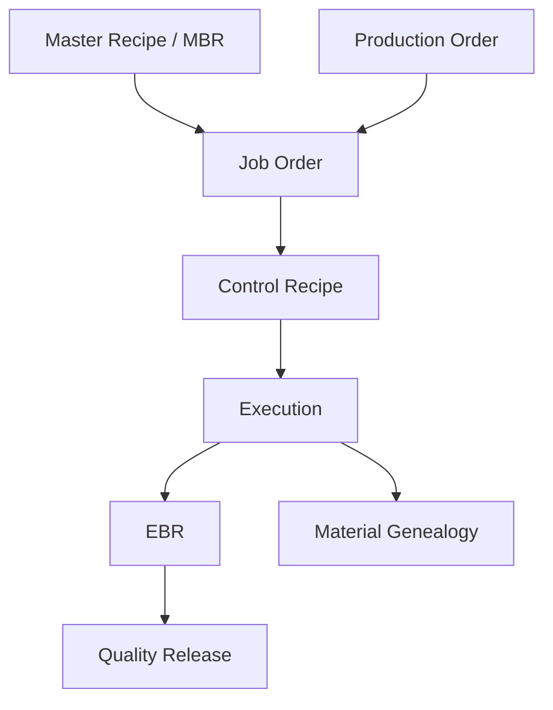

# MES Blueprint

Vastgestelde architectuurbaseline D89 (A01–A12). Doel: modulair MES voor chemische batchproductie, ISA-95 niveau 3. Niveau 4 ERP, niveau 2 DCS/SCADA/PLC, niveau 1 instrumentatie, niveau 0 fysiek proces. Geen veiligheidsbesturing vanuit MES. Production Operations volledig binnen gekozen scope; Quality productiegebonden; Inventory verbruik en traceerbaarheid; Maintenance beschikbaarheid en stilstand, geen volledig WMS/CMMS/LIMS/ERP.

Acht activiteiten: Definition Management (MBR), Resource Management (middelen, materialen, personeel), Detailed Scheduling, Dispatching, Execution Management, Data Collection, Tracking en Performance Analysis. ISA-88 procesmodel (process/stage/operation/action), procedureel (procedure/unit procedure/operation/phase), fysiek (process cell/unit/equipment module/control module); geen gedwongen 1-op-1 mapping. General/Site Recipe voorbereid, Master Recipe en Control Recipe binnen scope. Enterprise/site/area/cell/unit; lagere niveaus indien nodig. Modulaire PostgreSQL/API, lokale offline invoer.

Referenties: [ISA-88](https://www.isa.org/standards-and-publications/isa-standards/isa-88-standards), [ISA-95](https://www.isa.org/standards-and-publications/isa-standards/isa-95-standard), [OPC UA ISA-95](https://reference.opcfoundation.org/specs/OPC-10030/full), [Job Control](https://reference.opcfoundation.org/specs/OPC-10031-4/full). Openbare modellen, geen formele conformiteitsverklaring.

Ontwerpen: [Terminologie](TERMINOLOGY.md), [MBR/EBR](MBR-EBR-DESIGN.md), [Datamodel](DATA-MODEL.md), [Migratie](MIGRATION-STRATEGY.md), [Rollen en processen](ROLES-AND-PROCESSES.md), [Normmatrix](ISA-CONFORMANCE.md), [Acceptatie](ACCEPTANCE-CRITERIA.md). Enige planning: [ROADMAP](../../ROADMAP.md). Enige besluitenregister: [DECISIONS](../../DECISIONS.md).

D105: na Master Data & Recipe Management en vóór Resource Management wordt de portalarchitectuur geharmoniseerd: centrale registratie en één zichtbaarheidbeslissing op actuele permissions, onafhankelijke route-/API-/DB-handhaving, gedeelde UI-componenten en industriële bruikbaarheid. Fase 3 is een afzonderlijke acceptatiepoort; fysieke resources en volgende domeinen schuiven één fase op. Geen wijziging in ISA-procesmodel, domeinafhankelijkheden of fase-2-scope. Zie ROADMAP en ACCEPTANCE-CRITERIA.
