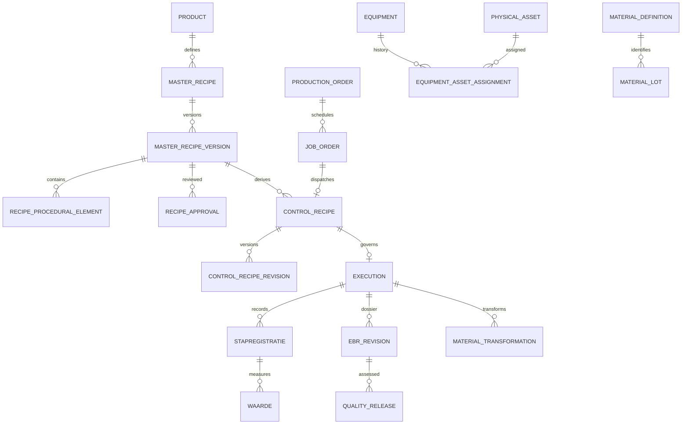

# Conceptueel datamodel

D89 M01–M12. Eén modulaire PostgreSQL-database, UUID, stabiele codes, FK, timestamptz, numeric en expliciete eenheid; relationele kern, JSONB voor berichten/auditdetails. Kritische regels in database en API, transacties, idempotentie, historie behouden. Onderstaande namen zijn ontwerp, geen definitieve DDL.

| Domein | Entiteiten (voorlopig) |
|---|---|
| Material master | material_class, material_definition, material_definition_version, material_lot, material_sublot, material_status_history |
| Recipe | master_recipe, master_recipe_version, recipe_procedural_element, recipe_dependency, recipe_parameter, recipe_parameter_limit, recipe_material_requirement, recipe_equipment_requirement, recipe_personnel_requirement, recipe_instruction, recipe_specification_link, recipe_lot_rule, recipe_compatibility_rule, recipe_approval, recipe_release, recipe_status_history |
| Resources | equipment_hierarchy, equipment_class, equipment, equipment_class_assignment, physical_asset, equipment_asset_assignment, equipment_capability, equipment_capacity, equipment_status_history, equipment_workstation; personnel_class, qualification, personnel_qualification, personnel_class_assignment |
| Planning | production_order, production_order_status_history, work_schedule, work_request, job_order, job_order_*_requirement, job_dispatch, job_response |
| Control Recipe | control_recipe, control_recipe_revision, control_recipe_parameter, control_recipe_material, control_recipe_equipment, control_recipe_change, control_recipe_execution_link |
| Execution | execution, execution_event, execution_equipment_actual, execution_personnel_actual, execution_instruction_check, execution_status_history, ebr_revision, ebr_addendum |
| Quality | deviation, deviation_execution_link, deviation_action, quality_hold, quality_review, quality_review_check, quality_release, quality_release_revocation, quality_status_history, capa |
| Genealogy | material_movement, material_transformation, material_transformation_input/output, material_genealogy, material_loss |
| Cross-cutting | audit_event, sync_event, sync_conflict, integration_inbox/outbox, external_identifier |

Hergebruik product, grondstof, processtap, veld, veld_product, specificatie, batch, lot, stapregistratie, waarde, grondstof_gebruik, keuring, herbewerking, stilstand, lot_voorstel, config_log. Geen dubbele bron voor feitelijke metingen of verbruik. Parameter- en CR-revisie per relevante registratie; historisch fysieke asset toewijzing. EBR-stand reproduceerbaar met vastgelegde records, niet dynamisch uit actuele stamdata. Proceduregrafiek valide, versiegrenzen en productrelaties afdwingen. Analytics via views (order progress, OEE, FPY, SPC, capaciteit, recipe performance, mass balance, EBR completeness, traceability). Exacte cardinaliteiten en constraints vóór elke implementatie-PR ontwerpen; diagram is concept, actueel schema blijft DATABASE.md.
