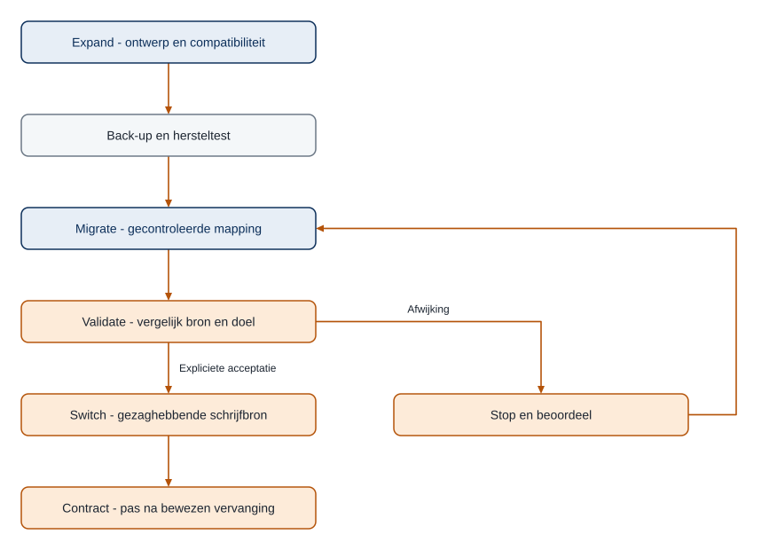
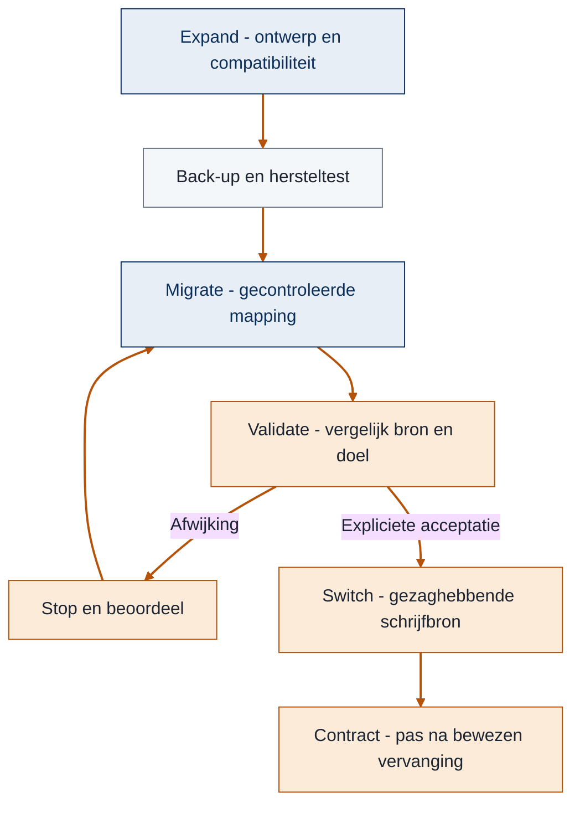

# Migratiestrategie

D89 M03–M05, M10–M12, G02. Start vanaf main 4e5e6cb; PR #1 (0d7c714a) uitsluitend referentie. De routeversie- en lotgrootteprototypes 0036/0037 zijn niet gemerged. Controleer actuele migratienummers; geen reservering van 0038–0055 en geen kopiëren van niet-geaccepteerde migraties zonder review.

Expand → Migrate → Validate → Switch → Contract. Nieuwe tabellen naast oude; één gezaghebbende schrijfbron per gegeven; compatibiliteit API en offline wachtrijen expliciet; oude writes pas afsluiten nadat vervanging bewezen is. Geen historische migratie wijzigen. Back-up en hersteltest vooraf, stop bij onverwachte data; vergelijking aantallen, ID's, relaties, meetwaarden, correcties en partijhistorie. Test schone installatie en upgrade vanaf werkelijk uitgebrachte versie. Gegevens uitsluitend fictief in PoC, toch veilige migratie.

Routes en actuele parameters worden MBR-concepten, nooit automatisch vrijgegeven. Historische koppeling alleen met bewijs, anders historical unknown; behoud oorspronkelijke IDs en grenzen. Herkomst native / verified migration / legacy / historical unknown. Geen gegokte machines of materialen. Bouw basis materiaaldefinitie en middelenklasse vóór afhankelijke receptvereisten; uitvoeringsidentiteit vóór dossier, materiaalstatus vóór vrijgave. Fasegewijs recipe, resources, planning, CR/execution, EBR, quality/genealogy, integraties. Compatibiliteitslaag tijdelijk, verwijder pas na acceptatie. Omschakeling met expliciete poort, terugvalstrategie en behoud van nieuwe feiten; herstel nooit stilzwijgend productiegegevens.

PR #6, migratie 0036 (deel): bestaande gebruikers en hun rol blijven ongewijzigd; `authorization_legacy_snapshot` bewaart de oude rol op migratiemoment. Geen automatische toekenning van nieuwe rechten. Nieuwe autorisatietabellen alleen leesbaar voor beide applicatielogins. Area- en equipmentcodes zijn voorlopige stabiele identifiers tot fase 4; product verwijst naar bestaande producttabel. Gecontroleerde toekenning en omschakeling volgen. Schema/diagram nog te verifiëren met PostgreSQL.

D95 / 0043: het MES-rollenregister wordt zonder automatische grants aan bestaande accounts toegevoegd. De demo-seed bevat nieuwe fictieve accounts voor alle dertien rollen en twee onafhankelijke security-identiteiten. Legacy-accounts blijven tijdelijk alleen voor regressie en bestaande schermen; vervanging en afsluiten legacy-autorisatie volgt na integratie. Geen productie-identiteiten of historie worden verwijderd.

D97: vóór de eerste pilot mogen fictieve demo-/testgegevens en accounts opnieuw worden opgebouwd. Historische fictieve records zijn geen verplichte functionele compatibiliteitseis. Test upgrades en herstel wel met representatieve gegevens en bescherm onbekende/echte databases tegen destructieve resets. In deze commit is geen data gewist.

D105: portal/UI-harmonisatie na release fase 2 en vóór middelenbeheer (nu fase 4). Expand/Migrate/Validate/Switch/Contract en historische gegevensbescherming ongewijzigd; geen schema- of datamigratie uitsluitend voor deze planningswijziging.

## Fase 2 / 113.6 — gecontroleerde bronvoorbereiding (D110)

Inventarisatie op basis van repositoryschema 0128, uitsluitend fictieve PoC. Geen echte bronbestanden beoordeeld. Onderstaande mapping is een voorstel dat per product en bronversie inhoudelijk moet worden bevestigd; geen automatische omzetting.

| Bron / sleutel | Doel / behandeling | Vereist bewijs / stopconditie |
|---|---|---|
| product.id, code | Bestaande productidentiteit; master_recipe.product_id; eventueel material_definition.product_id | ID behouden; meerdere recepten mogelijk, geen receptcode afleiden zonder besluit |
| grondstof.id, code, naam, eenheid | material_definition.raw_material_id en onveranderlijke material_definition_version | Exacte bron-ID, expliciete klasse en eenheid; onbekend blijft onbekend |
| product_stap (product_id, processtap_id), plek; processtap.id | Concept procedure / unit procedure / operation / phase en expliciete dependencies | Productgebonden volgorde, inhoudelijke hiërarchie en afhankelijkheden bevestigen; batch/lot-niveau is geen ISA-proceduretype |
| veld.id, veld_product (veld_id, product_id) | recipe_parameter per exacte conceptrevisie | Expliciete datatype, eenheid, activiteit, frequentie, kriticiteit; productoverride en NULL-semantiek controleren tegen bestaande serverlogica |
| veld.grens_min/max, tolerantie, tolerantie_soort | Kandidaten voor afzonderlijke recipe_parameter_limit-categorieën | Geen automatische categorie, doelwaarde, procentomrekening of SPC-grens; betekenis per veld bevestigen |
| specificatie.id/versie, specificatie_regel.id | Kandidaat specification_limit en recipe_specification_link | Exacte product-, stap-, veld- en bronversie; legacy vastgesteld is geen MBR-vrijgave |
| stap_grondstof.id | Kandidaat recipe_material_requirement | Exacte materiaalrevisie, input/output, hoeveelheid, referentieformule en schaling expliciet; verplicht-vlag alleen is onvoldoende |
| pc_stap, activiteit/kwalificatie, capaciteit_stap | Kandidaat equipment-/personeelsvereisten | Geen fysieke asset, capaciteit of kwalificatie afleiden zonder bewijs; resourcebeheer fase 4 |
| lot, batch.lot_id, legacy lotregel | Historische feiten behouden; toekomstige recipe_lot_rule expliciet per revisie | Geen standaard vier batches; afwijkingsreden verplicht, reviewbeleid en compatibiliteit expliciet |
| stapregistratie, waarde, grondstof_gebruik, keuring, herbewerking, certificaat | Bestaande historische feiten en correctieketens behouden | Geen koppeling aan nieuwste MBR zonder exact bewijs; historical unknown indien onvoldoende bewijs |
| config_log en bestaande bronbestanden (indien later beschikbaar) | Herkomst-/vergelijkingsbewijs | Onveranderlijke extract-ID/hash, sleutel, bronversie, tijd en verantwoordelijke; geen verzonnen herkomst |

### Uitvoerings- en validatieplan

1. Inventariseer bronhouder, extractdatum/tijdzone, schema/versie, sleutel, eenheden en autorisatie; maak read-only extract met SHA256 en aantallen. Geen productie-export in fase 2.
2. Leg per bronrecord mappingbesluit vast: bron-ID/versie, doel-ID/revisie (indien bekend), status mapped/needs_review/blocked/historical_unknown, reden, bewijsreferentie en persoonlijke beoordelaar. Bewaar originele waarden, inclusief NULL en exacte decimale tekst. Mappingmanifest is voorbereidingsbewijs, geen operationele tabel of automatische import.
3. Controleer duplicaten, referenties, scope, inactieve identiteiten, grenscategorieën, fysische grootheid, exacte eenheids-/conversierevisies, procedurehiërarchie, lotnorm en incompatibiliteit. Onbekende of tegenstrijdige gegevens rapporteren en niet stilzwijgend invullen.
4. Maak uitsluitend concepten via bestaande persoonlijke API in geïsoleerde testdatabase. Gebruik bestaande MOC, onafhankelijke review en expliciete vrijgave; geen automatische statusovergang of directe tabelwrites.
5. Vergelijk bron- en doelmanifest: alle bronrecords verantwoord, geen onverklaarde verliezen/duplicaten, historische ID's/relaties/waarden/correctieketens ongewijzigd. Herhaal dry-run en controleer dat het plan geen dubbele identiteiten creëert. Een gewijzigde bronhash vereist nieuwe beoordeling.
6. Test schone installatie, upgrade vanaf v0.63.0, back-up/herstel en negatieve scenario's. Stop bij verschil, onbekende echte database, ongeldige mapping of ontbrekend bewijs; geen omschakeling. Bij pilot afzonderlijke goedkeuring, gecontroleerde cutover en terugvalplan zonder verlies van nieuwe feiten.

Representatieve fictieve gevallen: [fixtures/phase2-source-cases.json](fixtures/phase2-source-cases.json). Dit zijn beoordelingsfixtures met verwachte uitkomsten, geen importformaat, geen operationele gegevens. Werkelijke uitvoering en bronvalidatie blijven open; specifieke importtool alleen na afzonderlijk besluit.

113.7b: automatische bronmanifestregressie toegevoegd aan gerichte en integrale CI: 16 unieke fictieve gevallen, expliciete statussen en redenen, geen automatische vrijgave, behoud van NULL, exacte decimale tekst en historische correctiereferentie. Dit is manifestvalidatie, geen bewijs van uitgevoerde bronmigratie; DB/API-regressies toetsen afzonderlijk de operationele regels. Uitvoering nog open.

## 113.7e — actualisatie bewijs 26 november 2026

Bewijs 26 november 2026: integrale CI [#665](https://github.com/Gertjun/Manufacturing-Execution-System/actions/runs/45765379770), head `2ebc36e0e0316c3edb34535fbc9aefe97c5fc12d`, schema 0128, beide Node-suites en Chrome groen. Gerichte baseline [#671](https://github.com/Gertjun/Manufacturing-Execution-System/actions/runs/45770644723), head `c7dce4f789acf84926a4f2e4a68f3bd669432fd9`, schema 0129, job 139742179386, base voor beide `ea3b78bc938647140b4e228e9382761504518906`: 1174/1174 DB, 16/16 security/beheertools inclusief bronmanifest, 10/10 autorisatiemodule, 129/129 API, schone installatie, migratiegelijkheid, historische upgrade 0035→0129 (tien historische tabellen, geen automatische grants), herstel en Linux-pakket groen. Geen integrale CI op 0129 of Windows-praktijkacceptatie geclaimd.

De fictieve bronmanifestregressie is geslaagd; dit bewijst de structuur en verwachte beoordelingsuitkomsten, niet uitvoering van een importer of werkelijke bronmigratie. Historische upgrade 0035→0129 is bewezen; dit is niet hetzelfde als een afzonderlijke praktijktest van het uitgebrachte Windows-pakket v0.63.0. De inventarisatie op schema 0128 blijft geldig voor het bronmodel: 0129 wijzigt alleen de persoonlijke transactiebinding, geen materiaal- of recepttabellen. D111 vervangt de oude releasevolgorde uit D105; gecombineerde Windows-praktijkacceptatie na fase 3.

## Migratiepoorten — conceptueel

Blauw = ontwerp en mapping; oranje = uitvoering en besluit; grijs = herstelondersteuning. Pijlen beschrijven de bestaande Expand/Migrate/Validate/Switch/Contract-strategie. Geen automatische productieomschakeling.

[Open de SVG op volledig formaat](../diagrams/rendered/migration.svg).

Mermaid-bron

Bij herstel nieuwe feiten en historische identiteit behouden. Werkelijke bronmigratie blijft vóór relevante pilotinzet te valideren; fictieve fixtures zijn geen bewijs van uitgevoerde productiemigratie.
