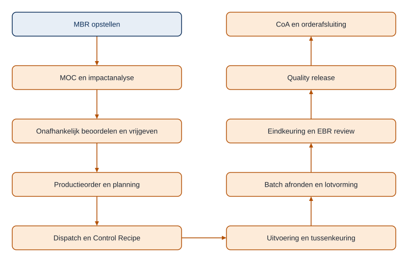
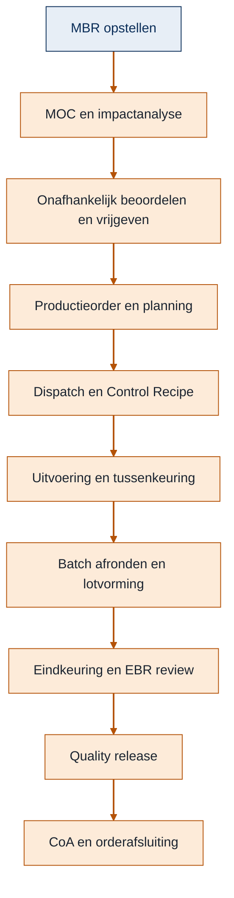

# Rollen en processen

D89 P01–P15. Persoonlijk account met meerdere rollen, concrete permissions, scope en geldige kwalificaties. Vierogen en functiescheiding, geen ongecontroleerde zelftoekenning. Herbevestig identiteit bij MBR-goedkeuring/vrijgave, CR-revisie, kwaliteitsvrijgave/intrekking en kritische rechten; bind besluit aan exacte inhoud. Technische superuser-risico beperken via aparte accounts, gecontroleerd beheer en audit/back-up. Geen claim gekwalificeerde handtekening.

| Rol | Verantwoordelijkheid |
|---|---|
| Operator | Uitvoeren en registreren binnen scope en kwalificatie |
| Shift Supervisor | Werkvrijgave, operationele correcties en blokkades |
| Manufacturing Manager | Uitvoering, prestaties en operationele verantwoordelijkheid |
| Production Planner | Orders, planning en gedelegeerde werkvrijgave |
| Process Engineer | MBR-concepten, parameters, MOC en CR-wijzigingsvoorstellen |
| Engineering Approver | Onafhankelijke inhoudelijke beoordeling |
| Quality Technician | Keuringen en blokkades, geen definitieve vrijgave |
| Quality Approver | Specificaties, afwijkingsbesluiten, vrijgave en intrekking |
| Maintenance Technician | Technische beschikbaarheid en blokkades |
| System Administrator | Accounts, server, herstel; geen automatische inhoudelijke rechten |
| Security Administrator | Rechten met onafhankelijke goedkeuring |
| Analyst / Management | Raadplegen binnen privacy en scope |
| Display / Integration Account | Alleen specifieke machinefunctie |

Normale keten: MBR opstellen → MOC/impactanalyse → onafhankelijk beoordelen → goedkeuren/vrijgeven → productieorder → planning → dispatch + CR → uitvoeren → tussenkeuring → batch afronden → lotvorming/lotuitvoering → eindkeuring → EBR review → expliciete quality release → CoA → order afsluiten/analyse. MOC externe veiligheidsbeoordeling waar vereist; HAZOP niet vervangen. Planning mag voorlopige niet-beschikbare middelen inplannen, dispatch en start toetsen vereisten. Statusmodel MES: idle/running/paused/held/complete/stopped/aborted; geen fysieke commando's. Volledige overgangen later specificeren. Onafhankelijke operationele, equipment, quality, recipe en material holds; één opheffen heft andere niet op. Herbewerking aparte job order; FPY blijft historisch. Offline beperkte tijdgebonden uitvoeringsrechten, geen nieuwe onbekende opdracht, goedkeuring of vrijgave. Exacte rollenmatrix, MOC-classificatie, offline duur en fabriekskwalificaties nog valideren met organisatie. Privacybesluiten #8/#63/#79 blijven open.

Technische deelimplementatie PR #6: `api/src/modules/authorization/policy.ts` beoordeelt een activiteit op basis van één geldige grant met passend recht én alle opgegeven scopedimensies; kwalificaties worden afzonderlijk getoetst. Technische/security-rollen en displayrollen worden niet gecombineerd met inhoudelijke rollen. De module is nog niet verbonden met de bestaande routes; opslag, vertrouwde doelcontext en volledige handhaving volgen binnen fase 1.

D92: gebruikersaccounts worden niet via Excel geïmporteerd; andere Excel-functies blijven per domein beschikbaar.

Fase 1: migratie 0038 legt exacte roltoekenningsaanvragen en afzonderlijke besluiten vast. Onafhankelijke beoordelaar, geen zelftoekenning, geen tweede besluit, geldigheid en functiescheiding worden in de eigenaar-only procedure gecontroleerd. Dit is nog geen operationeel beheerkanaal: de identiteit wordt nog niet persoonlijk herbevestigd en de procedures zijn niet beschikbaar voor mes_app. Geen automatische security-grants.

Migratie 0039: kritische security-identiteiten worden beschermd tegen directe accountwijzigingen via de gewone app-login. De eigenaar-only bevestigde besluitfunctie controleert het huidige wachtwoord via de bestaande inlogprocedure en beslist in dezelfde aanroep over de specifieke aanvraag. Onjuist wachtwoord geeft een status zodat de mislukte poging bij commit behouden blijft. Dit is nog geen compleet veilig beheerkanaal: wachtwoordhash-toegang, gecontroleerd herstel, intrekking, het eigenaar-only pad zonder herbevestiging en API/UI-integratie moeten nog worden afgeschermd of uitgewerkt.

0040: tabelbrede leestoegang tot gebruiker vervangen door expliciete niet-geheime kolommen voor beide applicatielogins. Login en eigen wachtwoordwijziging gebruiken afgeschermde databasefuncties; demo-indicatie retourneert alleen namen uit een vaste lijst. De oude accountupdate leest de hash niet meer. Nog geen acceptatiebewijs: alle overige hash-afhankelijkheden, privileges, SECURITY DEFINER zoekpaden, tijdelijke wachtwoorden en gecontroleerd herstel moeten worden getest voordat de besluitfuncties voor de applicatie worden geopend.

0041: intrekking van een specifieke grant met persoonlijke herbevestiging, reden en auditspoor; aanvraag, besluit en intrekkingsrecord hebben update/delete-bescherming. Intrekking is een beperkende maatregel, niet een nieuwe toekenning; het kanaal is eigenaar-only. Geen formele conformiteitsclaim. De veilige zoekpaden van afgeschermde functies zijn expliciet na schema-normalisatie hersteld. Operationele recovery en API/UI nog open.

0043: stabiele Engelse role codes voor de dertien ontworpen MES-rollen. Security Administrator krijgt uitsluitend request/approve/revoke-permissions; overige concrete permissions volgen per activiteit. Demo-bootstrap heeft aparte security-identiteiten en één supervisor met meerdere rollen. Legacy-rolveld blijft tijdelijk aanwezig; nog geen claim dat legacy-routes functiescheiding afdwingen.

0044: concrete technische, engineering- en security-leesrechten. Beheerroutes gebruiken actuele authorization_permits via de gedeelde API-module; een begrensde grant mag geen globale wijziging uitvoeren. De oude legacy-beheerdersrol verleent op deze routes geen toegang meer. Productgebonden wijzigingen zijn voorlopig bewust globaal beperkt; vertrouwde doelcontext voor fijnmazige scopes volgt. Andere legacy-routes en gebruikersinterface nog niet omgeschakeld; geen algemene functiescheidingsclaim.

0045: schrijfroutes /registraties controleren actuele MES-permissions in de schrijftransactie. Productcontext komt uit batch, lotleden of stapregistratie. Area/equipment ontbreken nog als betrouwbare productiecontext; scoped grants daarop worden geweigerd. Legacy DB-regels blijven aanvullend actief tot omschakeling. Leesroutes en overige uitvoeringsroutes nog open.

0046: registratie- en keuringsleesroutes filteren op server-afgeleide productscope; technische/security-rollen krijgen geen impliciet leesrecht. Quality Approver heeft afzonderlijk inspection.decide; technician niet. Bestaande keuring is nog geen definitieve MES-quality-release; persoonlijke herbevestiging en DB-handhaving moeten vóór operationele acceptatie worden aangesloten. De voorspelling van toekomstige keuringen is uit de basis-MES verwijderd (D96/#88); actuele keuringen blijven beschikbaar.

0047: schrijfroutes voor productdefinities en routes vereisen engineering.product.manage; overige planning-schrijfroutes planning.manage. Globale grants vereist tot doelcontext per actie is uitgewerkt. Leesroutes, legacy DB-controles en UI nog open. Productwijziging is geen formele MBR-vrijgave; die volgt in de betreffende MES-fase.

0048: stilstand en ploegoverdracht gebruiken afzonderlijke operationele rechten; oorzaken en roosters bij Manufacturing Manager. Maintenance en display krijgen uitsluitend afzonderlijk stilstandleesrecht. Globale acties vereisen globale grants; hal is nog geen gezaghebbende area-id. Hergebruik van stilstand-/overdracht-ID door ander account geweigerd. Technische beheerder heeft geen impliciete toegang. Scope en resterende legacy-routes nog open.

0049: batch-, lot- en herbewerkingsroutes gebruiken actuele MES-bevoegdheden. Lotleesrecht vereist dekking van alle leden en lotregistraties; lotvorming toetst elk lid. Blokkade gescheiden van kwaliteitsbesluit; herbewerkingsopdracht gescheiden van uitvoering. Bestaande vaste vier-batchesregel en oude databasecontroles blijven tot respectieve omschakeling; herbevestiging en job-order-model nog open.

D98: zelfstandige ongeplande batchcreatie door operators vervalt bij fase 5/6. Operator start vrijgegeven werk, identiteit wordt vanuit de opdracht uitgegeven; oude execution.batch.create is tijdelijk en geen definitief MES-recht. Geen verdere investering in die legacy-route.

D99: de volledige legacy-review is goedgekeurd. Beveilig behouden/tijdelijke interfaces, investeer niet in oude procesmodellen die bij fase 2–9 vervangen worden; autorisatiefundament blijft leidend. Basis display-identiteit blijft fase 1, uitgebreide schermconfiguratie fase 10. Zie DECISIONS.md en ROADMAP.md.

0051: technische en security-identiteiten afzonderlijk; overlappende grants worden geweigerd bij roltoekenning en conflicterende actieve grants geven geen bevoegdheid. Geen automatische wijziging van bestaande grants. Gecontroleerd accountbeheer en recovery blijven open.

0053: bestaande legacy-identiteiten en accounts met niet-ingetrokken grants vereisen gecontroleerd herstel; gewone technische reset is beperkt tot onbevoegde pending-accounts. Nieuwe grants vereisen een niet-tijdelijk wachtwoord. Eigen bevestigde wijziging blijft mogelijk. Initiële identiteitsoverdracht en onafhankelijk herstel nog uitwerken; geen claim dat database-eigenaar technisch onmachtig is.

0054: bootstrap uitsluitend door database-eigenaar op lege identiteitsadministratie, drie afzonderlijke persoonlijke beheeridentiteiten met verschillende wachtwoorden en vastgelegde reden. Oude noodsleutel wijzigt bestaande accounts niet meer. Persoonlijke aanwezigheid en externe autorisatie moeten organisatorisch worden gecontroleerd; gecontroleerd herstel en pakketacceptatie nog open.

0055: herstel van een actief persoonlijk account vereist twee verschillende bevoegde security-identiteiten, geen van beiden het doelaccount, herbevestiging van beide in dezelfde handeling en een onveranderlijk auditrecord. Geen automatische reactivering of nieuwe grants. Persoonlijke overdracht, intrekking van oude sessies, operationeel kanaal en noodherstel blijven open.

### Noodherstel (0057)

Bij verlies van voldoende onafhankelijke security-identiteiten: stop reguliere herstelpogingen, bepaal technische herstelgereedheid via eigenaar-only diagnose, controleer beschikbare personen buiten de applicatie. Bij onvoldoende beschikbare beoordelaars: laat organisatieverantwoordelijke en onafhankelijke IT/security-verantwoordelijke een incidentreferentie, identiteit van doelpersoon, reden en exacte herstelhandeling buiten het MES goedkeuren. Maak een beveiligde back-up en bewaar de auditgegevens. Geen herbootstrap, geen automatische grants, geen generieke reset of gedeeld account. Herstel uitsluitend onder een afzonderlijk goedgekeurde en gevalideerde uitzonderingsprocedure, met onafhankelijke verificatie na afloop en intrekking oude sessies. Zolang die procedure niet geaccepteerd is blijft noodherstel geblokkeerd; de diagnose wijzigt niets. Technische bevoegdheid bewijst geen feitelijke aanwezigheid.

0058: operationeel personeelsbeheer bij Manufacturing Manager via personnel.read/manage (globaal tot betrouwbare area-context beschikbaar). Technisch accountbeheer toont geen naam/ploeg en kent geen personeelsidentiteiten toe. Login leest uitsluitend bestaande koppeling; nieuwe koppeling voorlopig eigenaar-only, gecontroleerd proces nog open. Geen automatische migratie van bestaande koppelingen of rechten.

0059: apart databasekanaal mes_security_channel (NOLOGIN, geen automatische leden) met uitsluitend persoonlijk bevestigde aanvraag-, besluit- en intrekkingsfuncties. Gewone applicatie krijgt geen toegang. Toegang pas inrichten na gecontroleerde binding van persoonlijke database-login aan MES-identiteit en acceptatie van leesinterface, transport en operationele bediening.

0060: securitykanaal bepaalt de actor via SESSION_USER en geregistreerde PostgreSQL-rol-OID/naam; SET ROLE kan niet als andere MES-actor fungeren. Aanvraag, besluit en intrekking hebben geen actorparameter meer. Leesfuncties tonen exacte aanvragen, besluiten en grants inclusief intrekkingen, uitsluitend bij authorization.read. Bindingen eigenaar-only; provisioning, intrekking/herbinding en restoreprocedure nog open. Geen automatische database-logins.

0061: registratie door database-eigenaar van een reeds door IT ingerichte persoonlijke login, met reden/goedkeuringsreferentie. Intrekking is afzonderlijk onveranderlijk record; vervanging vereist nieuwe rolnaam/OID en intrekking oude binding. Andere groepslidmaatschappen en beheeropties worden geweigerd. IT controleert ook rechtstreeks verleende objectrechten en beëindigt bestaande verbindingen bij incidenten. Na restore kanaal geblokkeerd houden tot gecontroleerde herbinding; geen automatische OID-conversie. Operationele provisioning/transport en acceptatie nog open.

D105: nieuwe fase 3 centraliseert portalregistratie en zichtbaarheid op actuele permissionprojectie, inclusief meervoudige rollen/scopes; onafhankelijke route-/API-/DB-handhaving blijft verplicht. Geen automatische of ruimere grants. Fase 2 behoudt Process Engineering; middelenbeheer volgt fase 4.

## Procesketen — conceptueel, niet volledig geïmplementeerd

Blauw = receptdefinitie; oranje = operationele handeling of besluit. Pijlen geven procesvolgorde, geen database-FK of automatische bevoegdheid. Latere fasen blijven gepland.

[Open de SVG op volledig formaat](../diagrams/rendered/process-chain.svg).

Mermaid-bron

